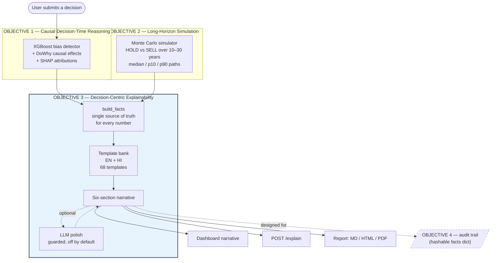
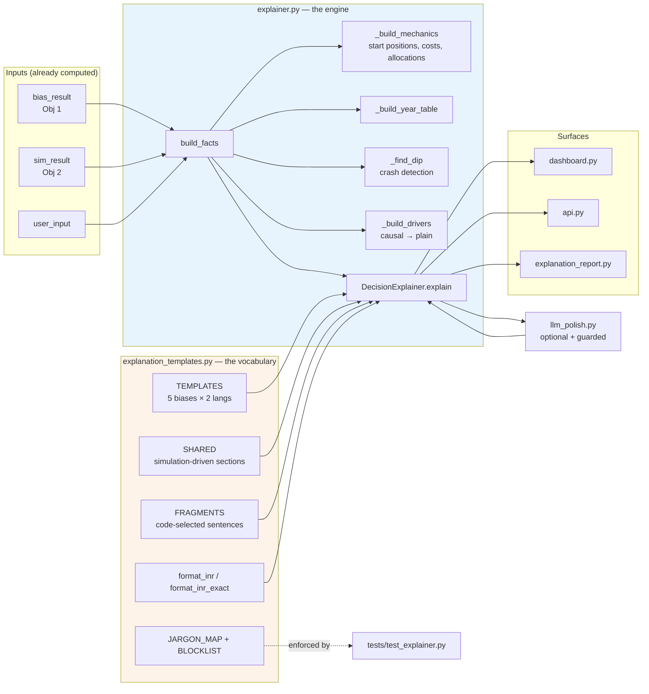
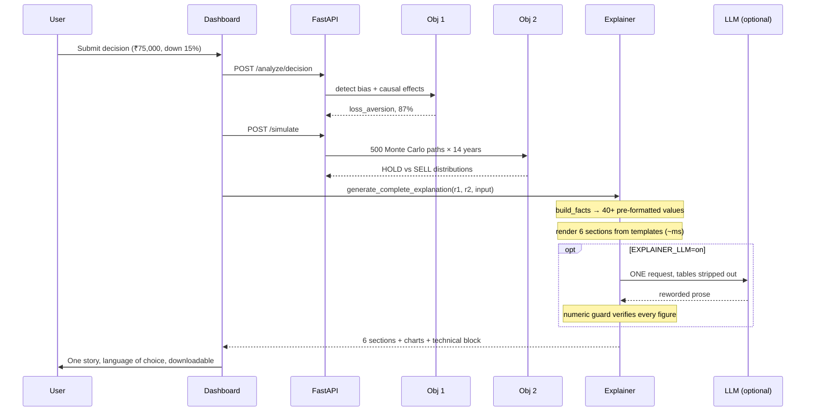
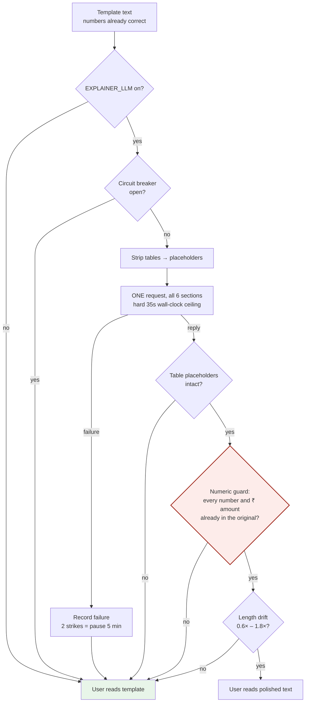

# Objective 3 — Decision-Centric Explainable AI
### Complete Technical Documentation

> **Objective:** Generate decision-centric, counterfactual explanations that clearly show how
> financial decisions causally influence long-term outcomes, beyond static post-hoc interpretations.

**Status: COMPLETE** · 4,102 lines of new code · 128 explainer tests (256 in the full suite) ·
English + Hindi · Flesch 78.3 · zero jargon leaks

---

## 1. The Problem in One Slide

Objectives 1 and 2 already computed everything needed. **None of it was readable by the person
whose money it was.**

### BEFORE — what the system actually showed the user

```
Detected Loss Aversion bias (confidence 87%, risk 64%).

Causal chain:
  [loss_aversion=2.7] causal effect on decision: +0.0412 — increases sell probability
  [unrealized_gl=-0.15] causal effect on decision: -0.1203 — increases sell probability

SHAP values:
  unrealized_gain_loss : 0.31
  crowd_action_ratio   : 0.12

hold mean : 900,000    hold p10 : 320,000    hold p90 : 1,400,000
sell mean : 300,000    sell p10 : 180,000    sell p90 :   420,000
```

**Why this fails:** `+0.0412` has no unit and no consequence. `p10` is percentile notation.
SHAP explains *the model*, not *the decision*. Nothing connects the bias to the money, and
nothing tells the user what to do.

### AFTER — same inputs, nothing recomputed

> **In short**
> You're thinking about selling while your investment is down 15%. Before you do, here's what
> that one decision is likely to cost you over the next 14 years.
>
> **What's going on right now**
> Your investment is down 15% right now, and that genuinely hurts. Here's the thing though:
> research on thousands of investors shows a loss feels about twice as painful as the
> same-sized gain feels good. So the urge you're feeling is stronger than the actual damage
> warrants. That urge has a job — it wants you to stop the pain. But selling doesn't stop the
> loss. It makes it permanent.
>
> **What to do now**
> **Our suggestion: stay invested. Don't sell today.**
> How sure are we? We're fairly sure about this read of your situation (87%). The rupee figures
> are estimates drawn from 500 simulated futures — they show you what usually happens, not what
> will happen.

---

## 2. Architecture

### 2.1 Where Objective 3 sits in the system



### 2.2 Internal module architecture



### 2.3 Request lifecycle — *when* each piece runs



**Key timing fact:** the narrative renders **locally in milliseconds** from data the API already
returned. Switching English ⇄ Hindi or downloading a report **never re-runs the model or the
simulation**.

---

## 3. What the User Reads — The Six Sections

| # | Section | Purpose | Driven by |
|---|---------|---------|-----------|
| 1 | **In short** | What you're about to do, and whether it's wise | Bias type + intent |
| 2 | **What's going on right now** | The bias in human words, using your numbers | Obj 1 |
| 3 | **Your two possible futures** | HOLD vs SELL in rupees, with good/bad cases | Obj 2 |
| 4 | **The story of your money** | Year-by-year table + how it was calculated | Obj 2 |
| 5 | **Why we're telling you this** | What actually drove the conclusion | Obj 1 causal effects |
| 6 | **What to do now** | One clear action + an honest confidence caveat | Both |

### Section 4 in detail — the deepest part

It answers four questions a user actually has:

1. **What are these numbers?** — "You have ₹75,000 invested, currently worth ₹63,750."
2. **What does selling really cost?** — "After brokerage, taxes and the spread — roughly 5% —
   you'd be left with ₹61,097. Selling costs you ₹2,653 straight away."
3. **What happens to the money afterwards?** — staying invested keeps **56% shares / 44% bonds**;
   selling moves it to **17% shares / 83% bonds** earning ~5.5% a year.
   *This reallocation is the real driver of the long-term gap, and it was previously invisible.*
4. **How was this calculated?** — compounding explained in plain words, plus "we ran 500 different
   futures and this is the middle one; half turned out better, half worse."

Then the year-by-year table, starting from **today** so the two paths visibly begin apart:

| Year | If you stay invested | If you sell now | Difference |
|---|---|---|---|
| Today | ₹63,750 | ₹61,097 | +₹2,653 |
| 5 | ₹92,299 | ₹82,558 | +₹9,741 |
| 10 | ₹1,33,896 | ₹1,08,822 | +₹25,074 |
| 11 | ₹1,14,009 | ₹1,08,490 | +₹5,519 |
| 14 | ₹1,41,543 | ₹1,30,016 | +₹11,526 |

**The system explains its own table.** The drop at year 10→11 is a crash in the synthetic market
paths. Left unexplained it looks like a bug, so `_find_dip()` detects it and narrates it:

> "You'll notice both columns fall between year 10 and year 11. That's a market crash in this
> particular future — the kind that happens every decade or so. Staying invested falls hardest,
> which is exactly the moment selling feels like the obvious thing to do."

---

## 4. Tech Stack

| Layer | Technology | Why this choice |
|---|---|---|
| **Templating** | Jinja2 3.1 | Conditional sentences per bias/language; `StrictUndefined` turns a missing fact into a test failure instead of a blank sentence |
| **NLG strategy** | Deterministic templates (primary) | A template physically cannot invent a rupee figure |
| **Optional NLG** | Google Gemini Flash-Lite via `google-genai` | Free tier; rewording only, never facts |
| **Readability** | `textstat` (Flesch Reading Ease) | Objective, citable readability target |
| **Reports** | ReportLab (PDF), hand-rolled HTML | Self-contained, no external assets |
| **Config/secrets** | `python-dotenv` + gitignored `.env` | Key never enters a shell, history, or the repo |
| **API** | FastAPI (existing) | Reuses Obj 1/2 singletons |
| **UI** | Streamlit (existing) | Renders Markdown tables natively |
| **Testing** | pytest (128 explainer tests) | Guards every user-facing promise |

### Why NOT a fine-tuned or self-trained LLM
Pre-training is infeasible (compute, data, months). Fine-tuning a small model on synthetic
narratives would train it on *template output* — producing a less accurate, less verifiable
version of text we already have for free. Documented as future work, not a deliverable.

---

## 5. The Jargon Translation Layer — the heart of the objective

18 mapped terms, 30 blocklisted terms, 14 causal drivers translated.

| Internal (what the models say) | Shown to the user (EN) | Shown to the user (HI) |
|---|---|---|
| `p10` / `p90` | "if things go badly" / "if things go well" | "अगर हालात बुरे रहे" / "अगर हालात अच्छे रहे" |
| `unrealized_gl` | "how much your investment is up or down right now" | "आपका निवेश अभी कितना ऊपर या नीचे है" |
| `opportunity_cost` | "money you'd miss out on by selling" | "बेचने पर जो पैसा आपके हाथ से निकल जाएगा" |
| `prob_hold_better` | "in X out of 100 possible futures, holding wins" | "हर 100 संभावित भविष्य में से X में" |
| `causal effect +0.0412` | "the biggest factor was how strongly losses affect you" | "सबसे बड़ी वजह थी कि नुकसान आप पर कितना असर करता है" |

**Enforcement:** `find_jargon()` scans every rendered explanation against a 30-term blocklist with
word-boundary matching. A test fails the build if any term reaches the user. Current leaks: **0**.

### Money formatting
Two functions, deliberately:
- `format_inr()` → **₹1.2 lakh** — used in prose, reads naturally in a sentence
- `format_inr_exact()` → **₹1,32,451** — used in table cells, because rounding printed two
  different years as the same "₹1.2 lakh" and destroyed the row-to-row comparison

---

## 6. Safety — How an LLM Is Allowed Near Financial Figures



**The contract:** *The model may reword. It may not introduce, remove, or alter a number.*

Verified live — the model rewrote dense jargon into plain language while **15%, ₹1.4 lakh,
₹1.3 lakh and 14 years survived byte-identical**. Rejections are logged and silently fall back.

---

## 7. Reliability — Failure Never Reaches the User

| Failure mode | Behaviour | Verified |
|---|---|---|
| No API key | Templates | ✅ |
| Rejected/invalid key | Templates | ✅ live SDK, `400 INVALID_ARGUMENT` |
| Quota exhausted (429) | Templates | ✅ live |
| Endpoint timeout (504) | Templates | ✅ live |
| Network down | Templates | ✅ |
| Malformed / empty reply | Templates | ✅ |
| Hung provider | Templates, bounded wait | ✅ hard ceiling on a daemon thread |
| Unreadable `.env` | Templates | ✅ |

**Circuit breaker** — measured with a deliberately invalid key, three consecutive explanations:

| Explanation | Wait | Complete? | Error shown |
|---|---|---|---|
| 1st | 7.0s | 6/6 sections | none |
| 2nd | 1.9s | 6/6 sections | none |
| 3rd | **0.0s** | 6/6 sections | none |

After 2 consecutive failures the layer pauses for 5 minutes. Failures are **not cached** — quota
resets and networks recover, so suppression is the breaker's job, not the cache's.

---

## 8. Multilingual Design — English and Hindi as Peers

Hindi is **not machine translation**. Both template banks are hand-written and kept structurally
identical (enforced by tests), so **Hindi works fully offline with no LLM**.

| Aspect | English | Hindi |
|---|---|---|
| Templates | 34 strings | 34 strings (test-enforced parity) |
| Readability metric | Flesch ≥ 60 | ≤ 20 words/sentence |
| Measured | **78.3** | **12.2 words/sentence** |
| Money units | lakh / crore | लाख / करोड़ |
| Report formats | MD, HTML, PDF | MD, HTML |

**Why Flesch is not used for Hindi:** its syllable model is built for English and is undefined for
Devanagari. Using it would produce a meaningless number, so a sentence-length bound is used instead.

**Why there is no Hindi PDF:** ReportLab has no OpenType text shaper. Devanagari needs one — in
`कि` the matra `ि` is stored *after* the consonant but must be drawn *before* it, and conjuncts
like `क्ष` must be composed. Without shaping, output is silently wrong. Refusing is correct; the
HTML report prints to a perfect PDF from any browser, which shapes Devanagari properly.

---

## 9. Validation & Results

`python scripts/evaluate_explanations.py --n-users 28`
→ `results/reports/explanation_quality.json`

Sample: **28 live pipeline runs + 4 template-coverage cases × 2 languages = 64 explanations**

| Metric | Target | English | Hindi |
|---|---|---|---|
| Completeness (all 6 sections) | 100% | **100%** | **100%** |
| Readability | Flesch ≥ 60 / ≤ 20 w/s | **78.3** | **12.2 w/s** |
| Actionability (explicit next step) | 100% | **100%** | **100%** |
| Personalisation (≥3 own figures) | 100% | **100%** | **100%** |
| Jargon leakage | 0 | **0** | **0** |
| **All targets met** | — | **YES** | **YES** |

Flesch 78.3 ≈ "fairly easy to read", roughly a 7th-grade level.

---

## 10. Testing — 128 Explainer Tests

| Test class | What it protects |
|---|---|
| `TestStructure` | All six sections, both languages, all bias types; graceful fallbacks |
| `TestPlainLanguage` | Zero jargon; Flesch ≥ 60; Hindi is really Devanagari |
| `TestNumbers` | **Every ₹ figure traces back to the simulation** |
| `TestMoneyStory` | Starting positions, allocations, day-one cost, table structure |
| `TestCrashAndClosing` | Crash detection; closing line can't contradict the table |
| `TestFormatting` | lakh/crore rules; exact table amounts |
| `TestTone` | Bias-resisted is praised, not warned about |
| `TestDeterminismAndGuard` | Numeric guard, one-request design, every failure mode, circuit breaker |
| `TestBiasOnly` | No unearned advice without a simulation |
| `TestReports` | MD/HTML/PDF render; Hindi PDF refused, not mangled |
| `TestTemplateBank` | EN/HI structural parity |

Plus API-level tests asserting `/explain` returns **200 with six sections while the key is failing**.

**Full suite: 256 tests passing.**

---

## 11. Key Design Decisions (defensible in a viva)

| Decision | Rationale |
|---|---|
| Templates authoritative, LLM optional | A template cannot hallucinate a rupee figure |
| Narrate the **median**, not the mean | Wealth is right-skewed; the mean contradicted the year-by-year table |
| One LLM request, not six | Free tier is 5 req/min and 20/day — six sections guaranteed a 429 |
| Tables never sent to the model | Data, not prose; it also blew the request deadline single-handedly |
| Hindi hand-written, not translated | Works offline; no dependency for half the user base |
| Hindi PDF refused | Broken typography is worse than an honest "not available" |
| Bias-only mode makes no recommendation | Advice without a simulation is unearned |
| SHAP/causal chain moved to an expander | Available for those who want it, out of the way of those who don't |

---

## 12. Deliverables

### New files (4,102 lines)
| File | Lines | Role |
|---|---|---|
| `src/explanation_templates.py` | 884 | Template bank EN+HI, jargon map, money formatting |
| `src/explainer.py` | 840 | Facts builder + narrative engine |
| `src/llm_polish.py` | 519 | Guarded optional LLM layer + circuit breaker |
| `src/explanation_report.py` | 334 | MD / HTML / PDF reports |
| `tests/test_explainer.py` | 946 | 128 tests |
| `scripts/evaluate_explanations.py` | 353 | Validation metrics |
| `scripts/check_llm_polish.py` | 153 | Live LLM verification |
| `.gitignore` / `.env.example` | 73 | Secret hygiene |
| `notebooks/09_explainability.ipynb` | 13 cells | Demonstration + metrics |

### Modified (additive only)
| File | Added | Change |
|---|---|---|
| `src/api.py` | +176 | `POST /explain`, `POST /explain/report`, `GET /explain/status` |
| `src/dashboard.py` | +312 | Narrative block, language toggle, downloads, technical expander |
| `src/simulator.py` | +11 | `assumptions` block so the explainer can state *how* figures were produced |
| `requirements.txt` | +14 | jinja2, textstat, reportlab, google-genai, python-dotenv |

---

## 13. How to Run

```bash
# API
python -m uvicorn api:app --app-dir src --port 8000

# Dashboard
streamlit run src/dashboard.py

# Validation metrics
python scripts/evaluate_explanations.py --n-users 28

# Tests
python -m pytest tests/ -v
```

**For the viva demo and report metrics, set `EXPLAINER_LLM=off` in `.env`** — instant,
deterministic, reproducible. Turn it on to demonstrate the guard.

---

## 14. Honest Limitations

1. **LLM polish is often a no-op.** Flash-Lite frequently returns the text unchanged because the
   templates are already Flesch 78. It is safe and adds nothing when there is nothing to add.
2. **Free-tier quota is small** — 20 requests/day on the flagship model. The design costs one
   request per explanation, and the system is fully functional with the layer off.
3. **Section 5 is qualitative.** It names the top causal driver in plain words but does not
   quantify it ("raised your sell probability by 4 points"). The effect sizes are already in
   `facts` — surfacing them is a contained future addition.
4. **Objective 4 is not addressed here.** The explanation is returned as a flat, JSON-serialisable
   `facts` dict specifically so the audit trail can hash it without rework.

---

## 15. Objective Statement — Clause by Clause

| Required | Delivered |
|---|---|
| "decision-centric" | Six sections about *this user's decision*, not about the model |
| "counterfactual explanations" | HOLD vs SELL in rupees, year by year, from Obj 2 |
| "how decisions causally influence long-term outcomes" | Section 5 translates DoWhy effects; Section 4 traces the money across the full horizon |
| "beyond static post-hoc interpretations" | SHAP demoted to an optional technical expander; the narrative is temporal and causal |
