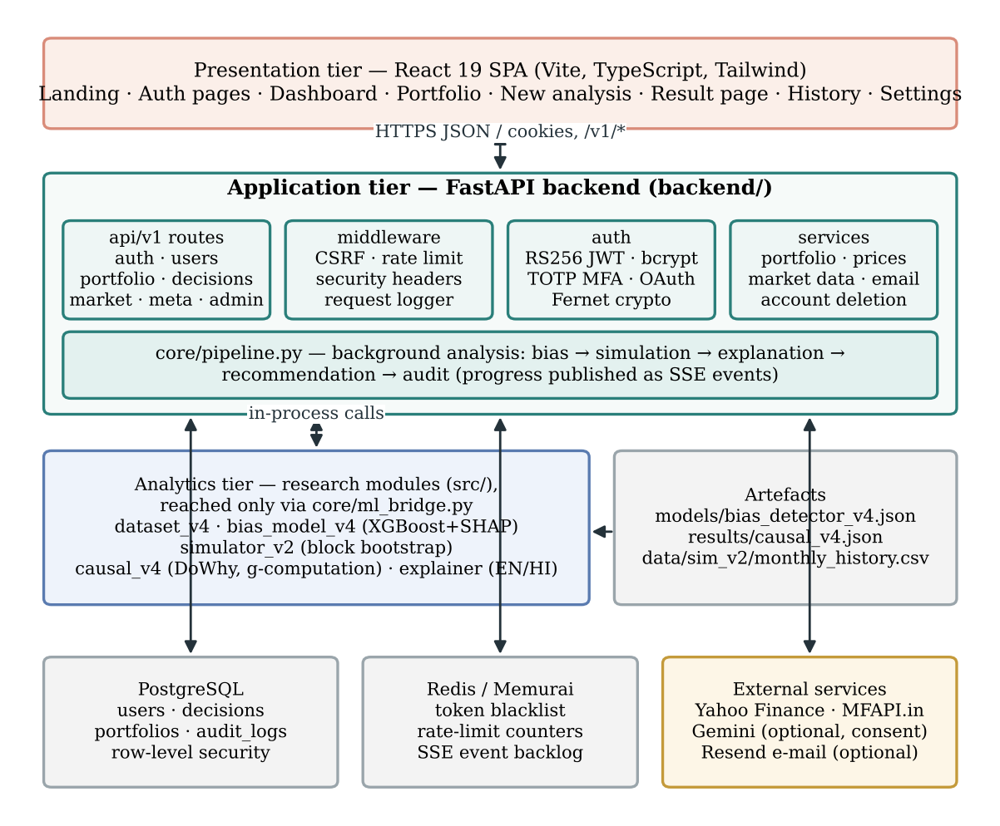
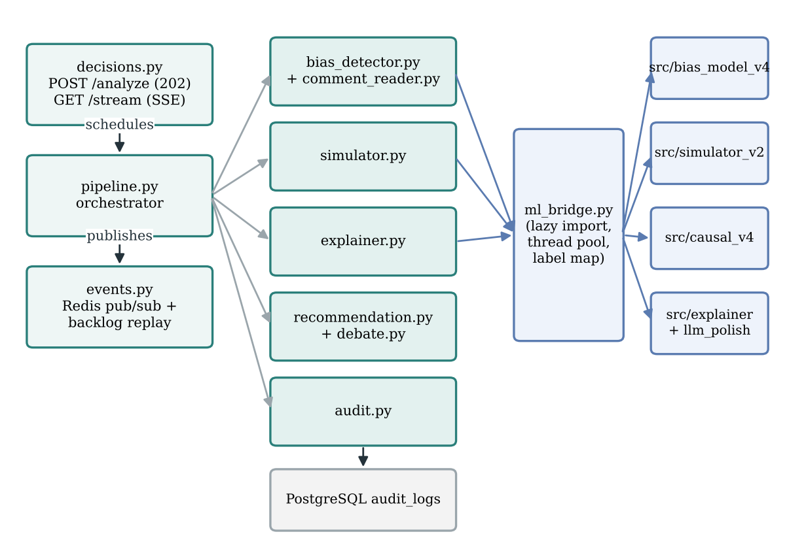
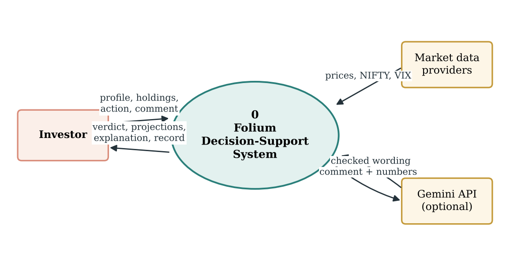
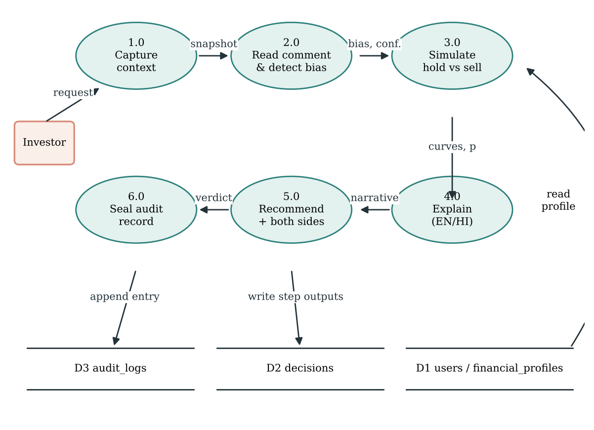
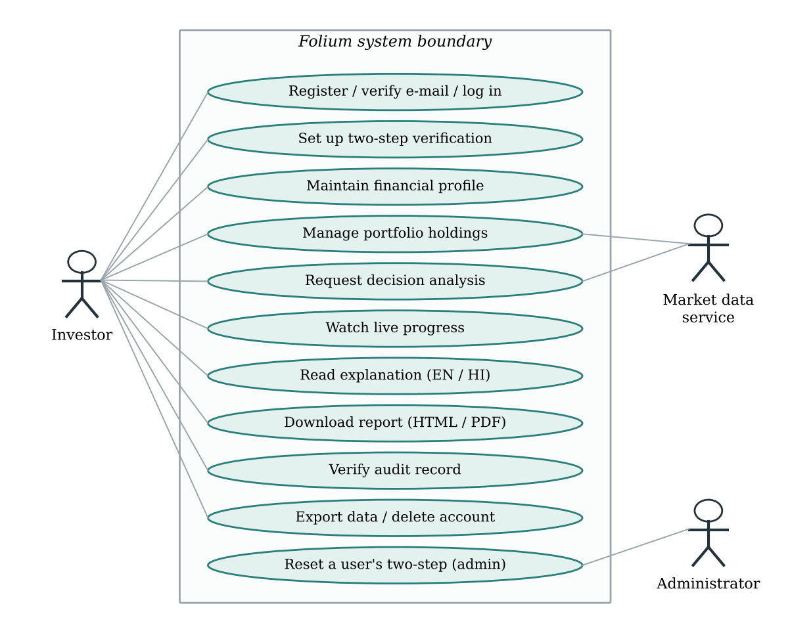
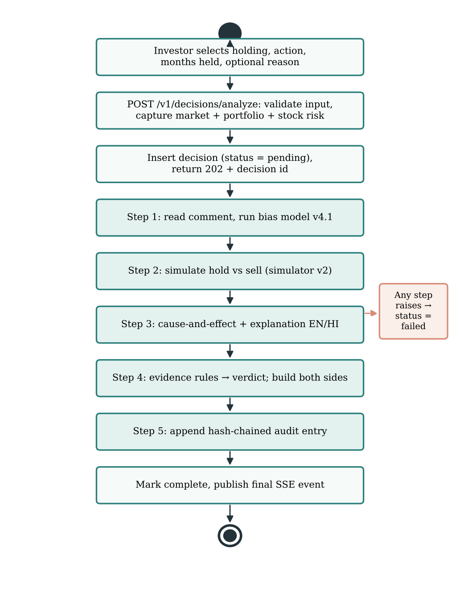
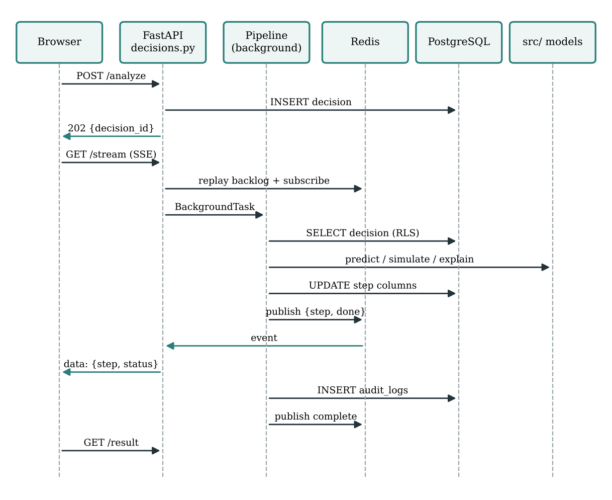
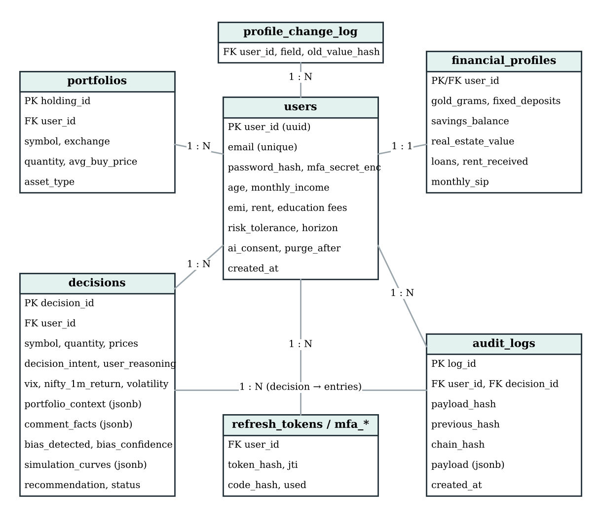
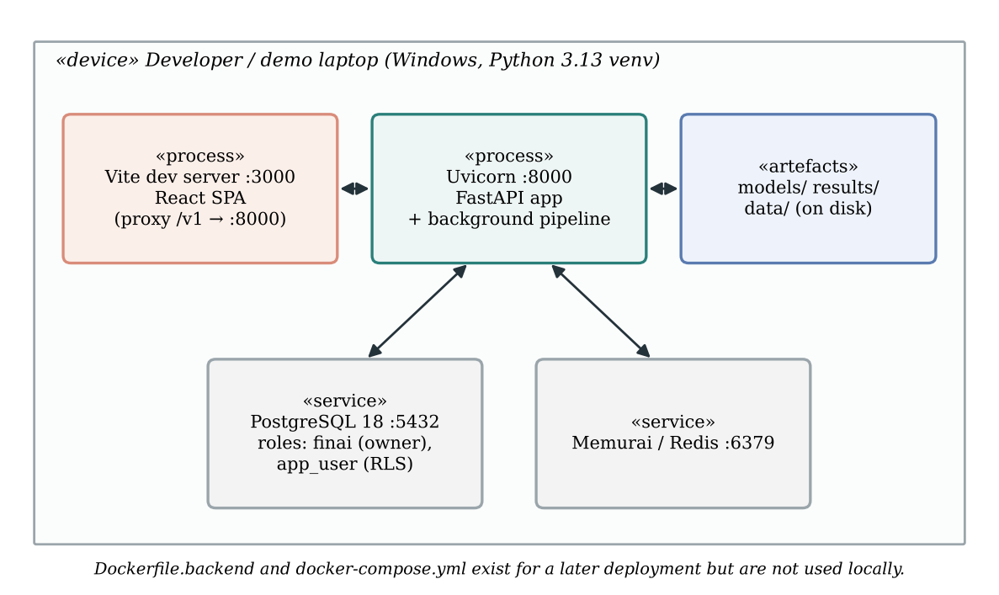

::: {custom-style="Cover Title"}
FOLIUM: BEHAVIOURAL DECISION INTELLIGENCE THROUGH CALIBRATED BIAS DETECTION, CAUSAL ANALYSIS AND PAIRED LONG-HORIZON PORTFOLIO SIMULATION
:::

::: {custom-style="Cover Text"}
Project Report

submitted in partial fulfilment of the requirement for the award of the Degree of

**Bachelor of Technology**

in

**Computer Engineering**

by

**Jesil Shah ([Roll / UID No.])**

**Param Shah ([Roll / UID No.])**

**Het Shah ([Roll / UID No.])**

under the guidance of

**Dr. Nataash Raul**
:::

::: {custom-style="Cover Logo"}
{width=1.3in}
:::

::: {custom-style="Cover Text"}
**Department of Computer Engineering**

Bharatiya Vidya Bhavan's

**Sardar Patel Institute of Technology**

(Autonomous Institute Affiliated to University of Mumbai)

Munshi Nagar, Andheri (West), Mumbai – 400058

University of Mumbai

[Month, Year of Submission]
:::


```{=openxml}
<w:p><w:r><w:br w:type="page"/></w:r></w:p>
```


::: {custom-style="Front Heading"}
Certificate
:::

This is to certify that the Project entitled "Folium: Behavioural Decision Intelligence through Calibrated Bias Detection, Causal Analysis and Paired Long-Horizon Portfolio Simulation" has been completed to our satisfaction by Mr. Jesil Shah, Mr. Param Shah and Mr. Het Shah under the guidance of Dr. Nataash Raul for the award of the Degree of Bachelor of Technology in Computer Engineering from the University of Mumbai.

::: {custom-style="Cover Text"}
**Certified by**
:::


```{=openxml}
<w:p><w:pPr><w:pStyle w:val="SignatureLine"/></w:pPr></w:p><w:p><w:pPr><w:pStyle w:val="SignatureLine"/></w:pPr></w:p><w:p><w:pPr><w:pStyle w:val="SignatureLine"/></w:pPr></w:p>
```


```{=openxml}
<w:p><w:pPr><w:pStyle w:val="SignatureLine"/><w:tabs><w:tab w:val="right" w:pos="8640"/></w:tabs><w:jc w:val="left"/></w:pPr><w:r><w:rPr><w:b/></w:rPr><w:t xml:space="preserve">Dr. Nataash Raul</w:t></w:r><w:r><w:tab/></w:r><w:r><w:rPr><w:b/></w:rPr><w:t xml:space="preserve">[Name of Head of Department]</w:t></w:r></w:p>
```


```{=openxml}
<w:p><w:pPr><w:pStyle w:val="SignatureLine"/><w:tabs><w:tab w:val="right" w:pos="8640"/></w:tabs><w:jc w:val="left"/></w:pPr><w:r><w:rPr></w:rPr><w:t xml:space="preserve">Project Guide</w:t></w:r><w:r><w:tab/></w:r><w:r><w:rPr></w:rPr><w:t xml:space="preserve">Head of Department</w:t></w:r></w:p>
```


```{=openxml}
<w:p><w:pPr><w:pStyle w:val="SignatureLine"/></w:pPr></w:p><w:p><w:pPr><w:pStyle w:val="SignatureLine"/></w:pPr></w:p><w:p><w:pPr><w:pStyle w:val="SignatureLine"/></w:pPr></w:p>
```


```{=openxml}
<w:p><w:pPr><w:pStyle w:val="SignatureLine"/><w:jc w:val="center"/></w:pPr><w:r><w:rPr><w:b/></w:rPr><w:t xml:space="preserve">[Name of Principal]</w:t></w:r></w:p>
```


```{=openxml}
<w:p><w:pPr><w:pStyle w:val="SignatureLine"/><w:jc w:val="center"/></w:pPr><w:r><w:rPr></w:rPr><w:t xml:space="preserve">Principal</w:t></w:r></w:p>
```


```{=openxml}
<w:p><w:pPr><w:pStyle w:val="SignatureLine"/></w:pPr></w:p>
```


::: {custom-style="Cover Text"}
**Department of Computer Engineering**

Bharatiya Vidya Bhavan's Sardar Patel Institute of Technology

(Autonomous Institute Affiliated to University of Mumbai)

Munshi Nagar, Andheri (West), Mumbai – 400058

[Month, Year of Submission]
:::


```{=openxml}
<w:p><w:r><w:br w:type="page"/></w:r></w:p>
```


::: {custom-style="Front Heading"}
Project Approval Certificate
:::

This is to certify that the Project entitled "Folium: Behavioural Decision Intelligence through Calibrated Bias Detection, Causal Analysis and Paired Long-Horizon Portfolio Simulation" by Mr. Jesil Shah, Mr. Param Shah and Mr. Het Shah is found to be satisfactory and is approved for the award of the Degree of Bachelor of Technology in Computer Engineering from the University of Mumbai.


```{=openxml}
<w:p><w:pPr><w:pStyle w:val="SignatureLine"/></w:pPr></w:p><w:p><w:pPr><w:pStyle w:val="SignatureLine"/></w:pPr></w:p><w:p><w:pPr><w:pStyle w:val="SignatureLine"/></w:pPr></w:p><w:p><w:pPr><w:pStyle w:val="SignatureLine"/></w:pPr></w:p>
```


```{=openxml}
<w:p><w:pPr><w:pStyle w:val="SignatureLine"/><w:tabs><w:tab w:val="right" w:pos="8640"/></w:tabs><w:jc w:val="left"/></w:pPr><w:r><w:rPr><w:b/></w:rPr><w:t xml:space="preserve">External Examiner</w:t></w:r><w:r><w:tab/></w:r><w:r><w:rPr><w:b/></w:rPr><w:t xml:space="preserve">Internal Examiner</w:t></w:r></w:p>
```


```{=openxml}
<w:p><w:pPr><w:pStyle w:val="SignatureLine"/></w:pPr></w:p><w:p><w:pPr><w:pStyle w:val="SignatureLine"/></w:pPr></w:p><w:p><w:pPr><w:pStyle w:val="SignatureLine"/></w:pPr></w:p>
```


```{=openxml}
<w:p><w:pPr><w:pStyle w:val="SignatureLine"/><w:tabs><w:tab w:val="right" w:pos="8640"/></w:tabs><w:jc w:val="left"/></w:pPr><w:r><w:rPr></w:rPr><w:t xml:space="preserve">(Signature)</w:t></w:r><w:r><w:tab/></w:r><w:r><w:rPr></w:rPr><w:t xml:space="preserve">(Signature)</w:t></w:r></w:p>
```


```{=openxml}
<w:p><w:pPr><w:pStyle w:val="SignatureLine"/></w:pPr></w:p>
```


```{=openxml}
<w:p><w:pPr><w:pStyle w:val="SignatureLine"/><w:tabs><w:tab w:val="right" w:pos="8640"/></w:tabs><w:jc w:val="left"/></w:pPr><w:r><w:rPr></w:rPr><w:t xml:space="preserve">Name:</w:t></w:r><w:r><w:tab/></w:r><w:r><w:rPr></w:rPr><w:t xml:space="preserve">Name:</w:t></w:r></w:p>
```


```{=openxml}
<w:p><w:pPr><w:pStyle w:val="SignatureLine"/></w:pPr></w:p>
```


```{=openxml}
<w:p><w:pPr><w:pStyle w:val="SignatureLine"/><w:tabs><w:tab w:val="right" w:pos="8640"/></w:tabs><w:jc w:val="left"/></w:pPr><w:r><w:rPr></w:rPr><w:t xml:space="preserve">Date:</w:t></w:r><w:r><w:tab/></w:r><w:r><w:rPr></w:rPr><w:t xml:space="preserve">Date:</w:t></w:r></w:p>
```


```{=openxml}
<w:p><w:pPr><w:pStyle w:val="SignatureLine"/></w:pPr></w:p><w:p><w:pPr><w:pStyle w:val="SignatureLine"/></w:pPr></w:p><w:p><w:pPr><w:pStyle w:val="SignatureLine"/></w:pPr></w:p>
```


::: {custom-style="Cover Text"}
**Seal of the Institute**
:::


```{=openxml}
<w:p><w:r><w:br w:type="page"/></w:r></w:p>
```


::: {custom-style="Front Heading"}
Statement by the Candidates
:::

We wish to state that the work embodied in this report titled "Folium: Behavioural Decision Intelligence through Calibrated Bias Detection, Causal Analysis and Paired Long-Horizon Portfolio Simulation" forms our own contribution to the work carried out under the guidance of Dr. Nataash Raul at the Sardar Patel Institute of Technology. We declare that this written submission represents our ideas in our own words and, where others' ideas or words have been included, we have adequately cited and referenced the original sources. We also declare that we have adhered to all principles of academic honesty and integrity and have not misrepresented, fabricated or falsified any idea, data, fact or source in our submission.


```{=openxml}
<w:p><w:pPr><w:pStyle w:val="SignatureLine"/></w:pPr></w:p><w:p><w:pPr><w:pStyle w:val="SignatureLine"/></w:pPr></w:p><w:p><w:pPr><w:pStyle w:val="SignatureLine"/></w:pPr></w:p><w:p><w:pPr><w:pStyle w:val="SignatureLine"/></w:pPr></w:p>
```


```{=openxml}
<w:p><w:pPr><w:pStyle w:val="SignatureLine"/><w:jc w:val="left"/></w:pPr><w:r><w:rPr><w:b/></w:rPr><w:t xml:space="preserve">Name and Signature:</w:t></w:r></w:p>
```


```{=openxml}
<w:p><w:pPr><w:pStyle w:val="SignatureLine"/></w:pPr></w:p>
```


```{=openxml}
<w:p><w:pPr><w:pStyle w:val="SignatureLine"/><w:jc w:val="left"/></w:pPr><w:r><w:rPr></w:rPr><w:t xml:space="preserve">1. Jesil Shah            ______________________</w:t></w:r></w:p>
```


```{=openxml}
<w:p><w:pPr><w:pStyle w:val="SignatureLine"/></w:pPr></w:p>
```


```{=openxml}
<w:p><w:pPr><w:pStyle w:val="SignatureLine"/><w:jc w:val="left"/></w:pPr><w:r><w:rPr></w:rPr><w:t xml:space="preserve">2. Param Shah           ______________________</w:t></w:r></w:p>
```


```{=openxml}
<w:p><w:pPr><w:pStyle w:val="SignatureLine"/></w:pPr></w:p>
```


```{=openxml}
<w:p><w:pPr><w:pStyle w:val="SignatureLine"/><w:jc w:val="left"/></w:pPr><w:r><w:rPr></w:rPr><w:t xml:space="preserve">3. Het Shah               ______________________</w:t></w:r></w:p>
```


```{=openxml}
<w:p><w:pPr><w:pStyle w:val="SignatureLine"/></w:pPr></w:p>
```


```{=openxml}
<w:p><w:pPr><w:pStyle w:val="SignatureLine"/><w:jc w:val="left"/></w:pPr><w:r><w:rPr></w:rPr><w:t xml:space="preserve">Date: ______________</w:t></w:r></w:p>
```


```{=openxml}
<w:p><w:r><w:t>@@SECTION_END_TITLE@@</w:t></w:r></w:p>
```


::: {custom-style="Front Heading"}
Acknowledgements
:::

It is a pleasure to acknowledge the help and support that went into this project. We express our sincere gratitude to our guide, Dr. Nataash Raul, for his guidance throughout the work. His insistence that every number shown to an investor should be traceable to evidence shaped many of the design decisions described in this report.

We thank [Name of Examiner / Reviewer] for advice during the project reviews, and the Head of Department and the staff of the Department of Computer Engineering, Sardar Patel Institute of Technology, for the facilities required to carry out this work.

Finally, we thank our families and friends for their constant encouragement.


```{=openxml}
<w:p><w:pPr><w:pStyle w:val="SignatureLine"/></w:pPr></w:p><w:p><w:pPr><w:pStyle w:val="SignatureLine"/></w:pPr></w:p>
```


```{=openxml}
<w:p><w:pPr><w:pStyle w:val="SignatureLine"/><w:jc w:val="right"/></w:pPr><w:r><w:rPr></w:rPr><w:t xml:space="preserve">Jesil Shah</w:t></w:r></w:p>
```


```{=openxml}
<w:p><w:pPr><w:pStyle w:val="SignatureLine"/><w:jc w:val="right"/></w:pPr><w:r><w:rPr></w:rPr><w:t xml:space="preserve">Param Shah</w:t></w:r></w:p>
```


```{=openxml}
<w:p><w:pPr><w:pStyle w:val="SignatureLine"/><w:jc w:val="right"/></w:pPr><w:r><w:rPr></w:rPr><w:t xml:space="preserve">Het Shah</w:t></w:r></w:p>
```


```{=openxml}
<w:p><w:r><w:br w:type="page"/></w:r></w:p>
```


::: {custom-style="Front Heading"}
Abstract
:::

Retail investors in India often decide to sell, hold or add to a share under the influence of recent price movements, social signals and the pain of a paper loss, rather than in the light of their own finances and time horizon. Most investing tools describe the stock; very few examine the decision that the investor is about to take. This project presents Folium, a full-stack decision-support web application that evaluates one intended action on one holding against the investor's whole financial picture.

For every analysis, Folium (i) reads the free-text reason given by the investor for stated cash needs and feelings, (ii) classifies the most likely behavioural pattern behind the decision—loss aversion, herd behaviour, the disposition effect or a rational motive—using an XGBoost classifier with 22 features, an isotonic calibration curve and exact TreeSHAP explanations, (iii) projects the HOLD and SELL alternatives over the investor's own horizon on the same 1,000 block-bootstrapped market paths built from real NIFTY 50 and gold history, after Indian capital-gains tax and charges, (iv) estimates what pushes such decisions using DoWhy backdoor adjustment and g-computation, (v) renders a six-part explanation from hand-written English and Hindi templates, (vi) issues a HOLD, SELL or BUY MORE verdict from explicit evidence rules rather than a language model, and (vii) seals the analysis into a per-investor SHA-256 hash chain that can be verified later. The system is built with FastAPI, PostgreSQL with row-level security, Redis and a React/TypeScript front end.

On a held-out test set of 4,000 synthetic decisions placed on real market days and re-weighted to real regime frequencies, the classifier reaches 87.9% accuracy, a macro-F1 score of 0.840 and an expected calibration error of 0.014; readings shown with High confidence are correct 98.7% of the time. Trained only on 2008–2019 and tested on 2020–2026, it scores 86.5%. The simulator's one-year return quantiles lie within 1.4 percentage points of the real index, and the causal estimates recover the known generator effects with a mean absolute error of about 0.5 percentage points. Because the behavioural labels are synthetic, these figures are development-stage results; they do not establish psychological diagnosis, real-market causality or improved investor returns.

**Keywords:** behavioural finance, decision support, XGBoost, probability calibration, SHAP, causal inference, block bootstrap, Monte Carlo simulation, explainable AI, row-level security.


```{=openxml}
<w:p><w:r><w:br w:type="page"/></w:r></w:p>
```


::: {custom-style="Front Heading"}
Executive Summary
:::

**What was built.** Folium is a working web application with sign-up, two-step verification, a portfolio of Indian assets with live prices, a five-step analysis pipeline with live progress, bilingual explanations and downloadable reports, a tamper-evident audit chain, and data-export and account-deletion tools. The machine-learning research code (in `src/`) is called by the product back end through a single bridge module, so the figures reported in this book are produced by the same code that serves users.

**What was measured.** Every numerical result in this report comes from evaluation files committed in the repository: `results/reports/bias_v4_evaluation.json`, `results/reports/simulator_v2_evaluation.json`, `results/causal_v4.json` and `results/reports/explanation_quality.json`. The charts in Chapters 8 and 9 were plotted directly from these files by `blackbook/make_figures.py`.

**Headline results (development stage, synthetic labels).** Bias model v4.1: 87.9% accuracy, macro-F1 0.840, ECE 0.014, 21 of 21 behavioural sense checks passed, against 53.4% accuracy for the previous v3 model on the same cases. Simulator v2: bad-year, typical-year and good-year returns of −6.9%, +11.6% and +34.7% against −7.5%, +11.3% and +33.3% for the real NIFTY 50. Causal module: 45 effects recovered with a mean absolute error of 0.48 percentage points and the correct sign in 97% of cases. Explanations: 100% completeness and zero jargon leaks across 64 explanations; English Flesch reading ease 78.3.

**What is not yet done.** Google sign-in does not yet return the browser into the web app, the admin panel is limited to an MFA-reset endpoint, the optional Gemini features have not been run against the live API, and the system has not been deployed with HTTPS. No study with real investors has been carried out, so no claim is made about improved investment outcomes.


```{=openxml}
<w:p><w:pPr><w:pStyle w:val="FrontHeading"/><w:pageBreakBefore/></w:pPr><w:r><w:t>Table of Contents</w:t></w:r></w:p><w:p><w:r><w:fldChar w:fldCharType="begin" w:dirty="true"/></w:r><w:r><w:instrText xml:space="preserve"> TOC \h \z \t "Heading 1,1,Heading 2,2" </w:instrText></w:r><w:r><w:fldChar w:fldCharType="separate"/></w:r><w:r><w:t>[Right-click and choose Update Field to refresh this list.]</w:t></w:r><w:r><w:fldChar w:fldCharType="end"/></w:r></w:p>
```


```{=openxml}
<w:p><w:pPr><w:pStyle w:val="FrontHeading"/><w:pageBreakBefore/></w:pPr><w:r><w:t>List of Figures</w:t></w:r></w:p><w:p><w:r><w:fldChar w:fldCharType="begin" w:dirty="true"/></w:r><w:r><w:instrText xml:space="preserve"> TOC \h \z \t "Image Caption,1" </w:instrText></w:r><w:r><w:fldChar w:fldCharType="separate"/></w:r><w:r><w:t>[Right-click and choose Update Field to refresh this list.]</w:t></w:r><w:r><w:fldChar w:fldCharType="end"/></w:r></w:p>
```


```{=openxml}
<w:p><w:pPr><w:pStyle w:val="FrontHeading"/><w:pageBreakBefore/></w:pPr><w:r><w:t>List of Tables</w:t></w:r></w:p><w:p><w:r><w:fldChar w:fldCharType="begin" w:dirty="true"/></w:r><w:r><w:instrText xml:space="preserve"> TOC \h \z \t "Table Caption,1" </w:instrText></w:r><w:r><w:fldChar w:fldCharType="separate"/></w:r><w:r><w:t>[Right-click and choose Update Field to refresh this list.]</w:t></w:r><w:r><w:fldChar w:fldCharType="end"/></w:r></w:p>
```


::: {custom-style="Front Heading"}
List of Abbreviations and Symbols
:::

| Abbreviation | Meaning |
|---|---|
| API | Application Programming Interface |
| ATE | Average Treatment Effect |
| CSRF | Cross-Site Request Forgery |
| DAG | Directed Acyclic Graph |
| DFD | Data-Flow Diagram |
| ECE | Expected Calibration Error |
| EMI | Equated Monthly Instalment |
| ER | Entity–Relationship |
| FD | Fixed Deposit |
| GUC | Grand Unified Configuration (PostgreSQL run-time setting) |
| JSONB | Binary JSON column type in PostgreSQL |
| JWT | JSON Web Token |
| LTCG / STCG | Long-Term / Short-Term Capital Gains |
| MFA | Multi-Factor Authentication |
| NIFTY 50 | National Stock Exchange of India's 50-stock benchmark index |
| ORM | Object-Relational Mapping |
| RLS | Row-Level Security |
| RS256 | RSA signature with SHA-256 |
| SHAP | SHapley Additive exPlanations |
| SIP | Systematic Investment Plan |
| SPA | Single-Page Application |
| SSE | Server-Sent Events |
| TOTP | Time-based One-Time Password |
| UI | User Interface |
| VIX | Volatility Index (here, India VIX) |
| XGBoost | eXtreme Gradient Boosting |

| Symbol | Meaning |
|---|---|
| $\mathbf{x} \in \mathbb{R}^{d}$ | Feature vector of one decision ($d = 22$) |
| $K$ | Number of behavioural classes ($K = 4$) |
| $F_k(\mathbf{x})$ | Raw boosted-tree score (margin) for class $k$ |
| $\hat{p}_k(\mathbf{x})$ | Predicted probability of class $k$ |
| $\phi_{j,k}$ | SHAP contribution of feature $j$ to class $k$ |
| $m_k(\mathbf{x})$ | Rule mask: 1 if the label definitions allow class $k$ |
| $g(\cdot)$ | Isotonic calibration map |
| $W^{(H)}_{s,T}, W^{(S)}_{s,T}$ | After-tax wealth of HOLD / SELL on path $s$ at year $T$ |
| $\Delta_{s,T}$ | Paired difference $W^{(H)}_{s,T} - W^{(S)}_{s,T}$ |
| $p$ | Share of simulated paths in which holding beats selling |
| $\beta$ | Sensitivity of a stock to the NIFTY 50 |
| $\sigma_{\text{own}}$ | Company-specific yearly volatility |
| $\mathrm{do}(A=a)$ | Intervention that sets treatment $A$ to $a$ |
| $h_i$ | Chain hash of the $i$-th audit entry |


```{=openxml}
<w:p><w:r><w:t>@@SECTION_END_ROMAN@@</w:t></w:r></w:p>
```


# Chapter 1: Introduction

## 1.1 Project Background

Participation of individual investors in Indian equity markets has grown sharply over the last decade. Discount brokers, mobile trading applications and the systematic investment plan (SIP) route into mutual funds have made it possible for a salaried person to own shares with a few taps. Access, however, is not the same as judgement. A first-time investor watching a holding fall 15% while friends discuss a market crash on a messaging group faces a decision that is as much emotional as financial.

Behavioural finance has studied such decisions for more than forty years. Kahneman and Tversky showed that people evaluate outcomes relative to a reference point and feel losses more strongly than equal gains [1]. Shefrin and Statman described the "disposition to sell winners too early and ride losers too long" [4], and Odean found clear evidence of it in brokerage records [2]. Bikhchandani, Hirshleifer and Welch explained how people can rationally follow the crowd and still end up in an informational cascade [3]. These patterns are not rare quirks: they are systematic and they cost money [14].

At the same time, the same action can be perfectly sensible for a different person. Selling a losing share is a mistake if it is driven by panic, but it is the right thing to do if the investor's college fees are due next month and there is no emergency fund. Any tool that labels a decision "biased" without looking at the investor's own finances will be wrong exactly when it matters most.

Folium was built to address this gap. The project began as a research effort on behavioural bias detection with a Streamlit prototype and synthetic data (versions v1 to v3 of the models, kept in the repository as rollback options). Over successive iterations it grew into a complete product: a FastAPI back end, a React front end, a PostgreSQL database with row-level security, a dataset built on real NIFTY 50 and India VIX history, a calibrated classifier, a tax-aware simulator, a causal-analysis module, a bilingual explanation engine and a tamper-evident audit trail.

## 1.2 Domain Overview

The project sits at the intersection of three areas.

**Behavioural finance** supplies the vocabulary of the problem: loss aversion, herd behaviour and the disposition effect are the three patterns Folium looks for, alongside a "rational" class that covers legitimate motives such as rebalancing, a near goal, cutting a loss or needing cash.

**Machine learning and causal inference** supply the tools to read a decision from data. A gradient-boosted tree classifier estimates which pattern best explains the situation and the action; isotonic calibration makes its confidence honest; SHAP attributions explain which inputs pushed the reading; and backdoor adjustment and g-computation estimate which factors change the chance of each action.

**Secure web engineering** supplies the means to deliver all of this to a real person. Financial data is sensitive, so authentication, session management, data isolation, auditability and data-subject rights (export and deletion) are part of the problem, not an afterthought.

## 1.3 Problem Context

Existing investing tools fall broadly into three groups. Brokerage and portfolio-tracking apps show prices, profit and loss, and charts; they describe the asset, not the decision. Robo-advisers construct a portfolio from a risk questionnaire but do not examine an individual trade at the moment it is being considered. Financial news and social media, which strongly influence retail behaviour, offer opinion without any link to the investor's circumstances.

None of these answers the question an investor is really asking at the moment of decision: *"Given my income, loans, emergency fund, the rest of my portfolio and how long I can wait, is what I am about to do sensible, or am I reacting to the moment?"* Answering it requires combining four separate pieces of evidence—the behavioural reading, the financial consequences of each choice, the factors that drive such choices, and a clear explanation—and doing so in a way that never hides an assumption or invents a number.

## 1.4 Problem Statement

To design and implement a secure, explainable decision-support system that, for a single intended action (sell, hold or buy more) on a single holding of an Indian retail investor:

1. identifies the behavioural pattern most likely behind the decision, with a calibrated confidence and a faithful explanation of the inputs that drove the reading;
2. compares the after-tax wealth outcome of holding and of selling over the investor's own horizon, under the same simulated market conditions;
3. estimates which situational and personal factors push investors towards that action, and which single habit would help most;
4. explains all of the above in plain English or Hindi without allowing wording to alter any number;
5. issues a recommendation from transparent evidence rules; and
6. records each analysis in a form that the investor can later verify has not been altered.

## 1.5 Motivation

Three observations motivated the project.

First, the cost of behavioural mistakes is real but invisible at the moment of decision. An investor who panic-sells during a correction rarely sees the counterfactual: what the money would have become had it stayed invested. Folium makes that counterfactual concrete by projecting both paths on identical market scenarios.

Second, existing "AI" financial assistants often produce fluent text whose numbers cannot be traced. For a decision about real money, a single invented rupee figure is unacceptable. We wanted a system in which every figure on screen comes from a deterministic computation and every assumption is disclosed.

Third, the Indian context matters. Taxes (short- and long-term capital gains under the FY 2025-26 regime), the importance of gold and fixed deposits in household portfolios, EMIs and education fees as fixed obligations, and the need for explanations in Hindi are rarely handled by tools designed elsewhere.

## 1.6 Objectives

The objectives of the project, as reflected in the repository, are:

1. **O1 – Behavioural reading.** Build an action-aware, portfolio-aware classifier that distinguishes loss aversion, herd behaviour, the disposition effect and rational decisions, with calibrated confidence and per-decision explanations.
2. **O2 – Consequence projection.** Build a simulator that compares HOLD and SELL over the investor's horizon (1–30 years) on shared market paths, after Indian tax and transaction costs.
3. **O3 – Cause and effect.** Quantify what pushes each action and estimate the benefit of simple debiasing habits, validated against a known ground truth.
4. **O4 – Explanation.** Produce structurally complete, jargon-free explanations in English and Hindi from templates, with an optional language-model rewording that is rejected if it changes any number.
5. **O5 – Recommendation.** Derive HOLD, SELL or BUY MORE from written rules over the simulation and the behavioural reading, never from a language model.
6. **O6 – Trust and security.** Deliver the above through a secure web application with strong authentication, per-user data isolation, a verifiable audit chain, and data export and deletion.

## 1.7 Scope of the Project

**In scope.** Listed Indian shares (NSE/BSE) and equity mutual funds as the subject of a decision; gold, fixed deposits, savings, property, loans, rent received and SIPs as context; three actions (sell, hold, buy more); four behavioural classes; horizons of 1–30 years; English and Hindi output; a web interface usable on desktops and phones.

**Out of scope.** Execution of trades or any broker integration; real-time trading signals; whole-portfolio optimisation (each analysis concerns one position); derivatives, cryptocurrency, credit-card balances and insurance; inflation-adjusted (real) projections; and any claim of personalised investment advice. The application states clearly that it is for information and education.

## 1.8 Intended Users and Stakeholders

| Stakeholder | Interest in the system |
|---|---|
| Retail investor (primary user) | A second opinion on a pending decision, grounded in their own finances, in a language they are comfortable with |
| Administrator | Resetting a user's two-step verification after a verified recovery request |
| Financial educators and researchers | A transparent example of how behavioural patterns, simulation and causal estimates can be combined |
| Project guide and examiners | Evidence that the system is correct, secure and honestly evaluated |

Table: Table 1.1: Stakeholders of the Folium system

## 1.9 Expected Contributions

The project does not claim to invent a new classifier, causal estimator or resampling method. Its contribution is the integration of established methods into one decision-time pipeline governed by explicit numerical safeguards:

- an action-aware classifier whose inputs include which patterns the label definitions permit, guarded so that it can never output a pattern the definitions rule out, with confidence calibrated to real market-regime frequencies;
- a paired hold-versus-sell simulator that uses common random numbers, real NIFTY and gold history, measured stock beta and idiosyncratic risk, and Indian tax rules;
- a causal module validated against an exactly reproducible data generator, including a negative control;
- an explanation layer where templates are authoritative and any AI wording is subject to a number-preservation guard;
- a per-investor hash-chained audit log with verification that detects alteration, deletion, forgery and forks.

## 1.10 Organisation of the Report

Chapter 2 reviews the literature and existing systems. Chapter 3 states the requirements and feasibility. Chapter 4 describes the methodology, including the dataset. Chapter 5 presents the architecture and design diagrams. Chapter 6 explains the implementation module by module with code excerpts. Chapter 7 develops the algorithms and their mathematics. Chapter 8 documents the experimental setup and evaluation, and Chapter 9 presents and discusses the results. Chapter 10 covers testing, Chapter 11 applications and limitations, and Chapter 12 concludes with future scope. References and appendices follow.


# Chapter 2: Literature Review and Existing Systems

This chapter reviews the theory and prior work on which Folium is built. For each strand we state what the work establishes, what it does not, and how it is used in the project. The review follows the one carried out for our research paper on Folium, extended with the engineering sources relevant to the implementation.

## 2.1 Behavioural Foundations

### 2.1.1 Prospect theory and reference dependence

Kahneman and Tversky's prospect theory explains departures from expected-utility predictions under risk [1]. Its central features are reference-dependent valuation (outcomes are judged as gains or losses relative to a reference point such as the purchase price), loss aversion (losses loom larger than equal gains) and non-linear weighting of probabilities. Cumulative prospect theory later extended the framework to rank-dependent probability weighting [17]. Prospect theory is descriptive: it explains why a person may behave as if a paper loss matters, but it gives no procedure for classifying a particular live decision. In Folium it justifies treating the unrealised gain or loss and the market's fear level as candidate signals, without treating every loss-making sale as irrational.

### 2.1.2 The disposition effect

Shefrin and Statman linked the tendency to sell winners and hold losers to mental accounting, regret aversion and self-control [4]. Odean confirmed the effect empirically in the trading records of a discount brokerage, showing that investors realised gains at a higher rate than losses [2]. Thaler's work on mental accounting supports the idea that people place gains and losses in separate mental "accounts" [18]. A single decision observed at one moment can only suggest the disposition effect; it cannot prove it. Folium therefore uses the gain or loss and the market regime as features and reports the reading as a tendency to watch for, not a diagnosis.

### 2.1.3 Herding and informational cascades

Bikhchandani, Hirshleifer and Welch showed that sequential decision-makers can rationally ignore their own information and follow others, producing fragile cascades [3]. De Long et al. showed that noise traders can move prices even in the presence of rational arbitrageurs [19]. Together these imply that following the crowd is not automatically irrational and that crowd signals carry information. Folium uses market fear (India VIX) and strong monthly index moves as proxies for crowd pressure, and the comment reader looks for explicit mentions of friends, colleagues or messaging groups; neither is treated as conclusive evidence of herding.

### 2.1.4 Empirical investor behaviour

Barber and Odean found that individual investors who trade more earn lower net returns [14], and that overconfidence shows up in trading intensity [15]. Grinblatt and Keloharju showed that investor traits, past returns and the trading context jointly affect trading decisions [16]. These studies caution against drawing individual conclusions from group-level patterns and suggest that a single questionnaire and one market snapshot cannot capture everything. Folium accordingly avoids demographic shortcuts: years of investing, for instance, was deliberately excluded as an input because the app does not collect it.

### 2.1.5 Market efficiency as a counterweight

Fama's review of efficient markets [20] reminds us that trading in response to new information can be entirely rational. This is why Folium always includes a rational class with several legitimate motives and why the classifier's "allows" logic ensures that a bias is only considered when the situation makes it possible.

## 2.2 Machine Learning for Tabular Financial Classification

### 2.2.1 Gradient boosting and XGBoost

Friedman formulated gradient boosting as stage-wise functional optimisation [26]. Chen and Guestrin's XGBoost added second-order optimisation, regularisation, sparsity-aware split finding and efficient histogram-based training [5]. Gradient-boosted trees are widely regarded as a strong default for medium-sized tabular data because they capture non-linear interactions—such as the joint effect of a loss, a falling market and high fear—without a hand-specified functional form. Breiman's random forests [25] are the natural alternative tree ensemble. Folium uses XGBoost for its multi-class classifier; a systematic comparison with logistic regression and random forests on the same splits is left as future work (Section 12.5).

### 2.2.2 Probability calibration

A classifier can be accurate yet badly calibrated: its stated probabilities may not match how often it is right. Zadrozny and Elkan showed how to transform classifier scores into calibrated multi-class probabilities, including through isotonic regression [6]. Niculescu-Mizil and Caruana compared calibration across learners and showed that boosted trees in particular tend to push probabilities away from 0 and 1 [27]. Guo et al. demonstrated that high accuracy does not imply good calibration, introducing expected calibration error (ECE) as a standard summary [28]. Folium calibrates the top-class probability with an isotonic curve fitted on out-of-fold predictions and reports ECE and reliability bins.

### 2.2.3 Evaluation under imbalance and time

Saito and Rehmsmeier showed that precision–recall analysis is more informative than ROC analysis under class imbalance [29]; Folium reports per-class precision, recall and F1 and uses macro-F1 because loss aversion is the smallest class (10%). López de Prado warns that random splits of financial data overstate generalisation because of temporal dependence and leakage [24]. Folium therefore adds an out-of-time evaluation: trained only on 2008–2019 decisions and tested on 2020–2026.

## 2.3 Explainable Machine Learning

### 2.3.1 SHAP feature attribution

Lundberg and Lee unified several attribution methods under Shapley values from cooperative game theory [7], and later gave an exact polynomial-time algorithm for tree ensembles, TreeSHAP [35]. SHAP values are additive: the contributions of all features plus a base value equal the model's raw output. Folium uses XGBoost's built-in exact TreeSHAP and groups the 22 feature contributions into 18 plain-language "drivers". An important limitation is that SHAP explains the prediction function, not the causal mechanism: a large SHAP value means a feature moved the score, not that changing it in the real world would change behaviour [31].

### 2.3.2 Local surrogates and counterfactual explanations

LIME fits a simple surrogate model around an instance [8]; its explanations depend on how perturbations are sampled. Counterfactual explanations describe the smallest change to the input that would change the prediction [9], and DiCE generates diverse counterfactuals [30]. These ideas are related to Folium's hold-versus-sell comparison but are not the same thing: Folium's comparison is a scenario simulation of two actions on shared market paths, not a perturbation of classifier inputs.

### 2.3.3 Explainable AI in finance

Weber, Carl and Hinz's systematic review of explainable AI in finance stresses that explanation methods must be evaluated in their financial context [34]. Folium contributes a specific design rule for this context: explanations are rendered from templates fed by computed facts, so wording cannot introduce numbers.

## 2.4 Causal Modelling

Pearl's structural causal models formalise interventions with the $\mathrm{do}(\cdot)$ operator and graphical criteria for identifying effects from observational data [10]. Robins introduced g-computation (the parametric g-formula) [36], and Hernán and Robins give a modern treatment of identification assumptions—consistency, positivity and conditional exchangeability [37]. Sharma and Kiciman's DoWhy library organises causal analysis into four steps: model the graph, identify the estimand, estimate, and refute [11]. Chernozhukov et al.'s double machine learning offers another route with flexible nuisance models [32].

A recurring caution in this literature is that refutation tests passing does not rule out unobserved confounding. Folium's causal work uses a synthetic dataset whose generator is known exactly, which allows the estimates to be checked against the true effects—an option real-world studies do not have. The results are therefore validation of the method on a known mechanism, not evidence about how Indian investors behave.

## 2.5 Long-Horizon Simulation and Resampling

Simulating future wealth requires plausible market paths. Drawing independent monthly returns destroys volatility clustering and the link between crashes and recoveries. Künsch's block bootstrap resamples contiguous blocks of a dependent series [12]; Politis and Romano's stationary bootstrap uses random block lengths and a circular wrap [33]. Efron and Tibshirani's bootstrap framework motivates reporting quantiles rather than a single forecast [13]. Hamilton's regime-switching model [23] reminds us that the past may not contain future regimes. Markowitz's portfolio selection [21] and Merton's lifetime portfolio choice [22] establish that a decision should be judged at the level of the whole portfolio and over the investor's horizon.

Folium uses a circular 12-month block bootstrap over 2007–2026 NIFTY 50 and gold-in-rupee history, recentres the average growth to stated long-run rates, and reports the 10th, 50th and 90th percentiles of both paths.

## 2.6 Security Foundations for a Financial Web Application

Several standards underpin the application layer. JSON Web Tokens are defined in RFC 7519 [38]; Folium signs them with RS256. Time-based one-time passwords for two-step verification follow RFC 6238 [39]. Passwords are hashed with bcrypt [40] and their strength is checked with zxcvbn [41]. Cross-site request forgery is mitigated with the double-submit cookie pattern described by OWASP [42]. Per-user data isolation uses PostgreSQL row-level security policies [43]. The tamper-evident audit log follows the hash-chaining idea of Haber and Stornetta [44] using SHA-256 as specified in FIPS 180-4 [45]. Live progress is delivered with server-sent events as defined in the HTML standard [46].

## 2.7 Comparison of Existing Approaches

| Approach | Looks at the decision? | Uses investor's finances? | Explains numbers? | Weakness relevant to this problem |
|---|---|---|---|---|
| Brokerage / portfolio trackers | No | Holdings only | Charts only | Describe the asset, not whether the action is sensible |
| Robo-advisers | At onboarding | Risk questionnaire | Allocation rationale | Do not evaluate an individual pending trade |
| Behavioural questionnaires | No | Self-reported | Score only | Measure a trait, not the present situation |
| Generic LLM chat assistants | Yes | Only if typed in | Fluent text | Numbers may be invented; no calibration or audit |
| Academic bias studies [2], [14] | Retrospectively | Account data | In papers | Population-level; not a decision-time tool |
| **Folium (this work)** | **Yes, at decision time** | **Income, outflows, fund, portfolio, horizon** | **Every figure traced to computation** | **Synthetic behavioural labels (Section 11.3)** |

Table: Table 2.1: Comparison of existing approaches with Folium

## 2.8 Research and Implementation Gaps

From the review, five gaps emerge that the project tries to address in a measurable way:

1. **Context-blind bias labelling.** Studies and tools tend to treat a loss-making sale or a winner sold early as a bias. A decision-time tool must recognise forced sales, rebalancing and near goals as rational.
2. **Uncalibrated confidence.** Classifiers presented to end users rarely report whether "90%" means right nine times in ten.
3. **Prediction confused with causation.** Feature attributions are often presented as reasons that, if changed, would change outcomes. Causal claims need a graph, an estimand and validation.
4. **Unpaired, untaxed simulations.** Simple "what if" calculators compare actions on different random scenarios or ignore tax, inflating noise and overstating the case for holding.
5. **Untraceable explanations.** Generated text may misstate figures. A guard that rejects any wording containing a number not in the source facts is rarely implemented.

## 2.9 How the Proposed System Addresses the Gaps

Folium's response is to keep each question separate and answer it with the appropriate tool: the classifier reads the pattern (gap 1 and 2: action-aware features, a definitional guard, cash-need input and isotonic calibration), the causal module answers "what pushes this action" against a known truth (gap 3), the simulator compares both actions on the same after-tax paths (gap 4), and the explanation engine turns verified facts into words under a numeric guard (gap 5). The recommendation is a small, readable rule set over these outputs, and the audit chain lets the investor confirm later that nothing was changed.


# Chapter 3: Requirements Analysis and Feasibility Study

The requirements below were reconstructed from the implemented code, the API routes, the database migrations and the project's master reference document (`FOLIUM_MASTER.md`). Each requirement is marked with its status as found in the repository: **Built** (implemented and covered by tests), **Partial** (implemented in part) or **Pending** (designed but not implemented).

## 3.1 Functional Requirements

### 3.1.1 Accounts and security

| ID | Requirement | Status |
|---|---|---|
| FR-1 | Register with e-mail and password; verify the e-mail address before first login | Built |
| FR-2 | Log in with an optional "Keep me signed in"; refresh sessions silently; log out | Built |
| FR-3 | Reset a forgotten password by e-mailed link | Built |
| FR-4 | Enable two-step verification with an authenticator app (TOTP), with 8 single-use backup codes | Built |
| FR-5 | Request two-step recovery; an administrator who proves their own TOTP may reset it | Built (endpoint only, no admin UI) |
| FR-6 | Sign in with Google | Partial: back-end flow tested with mocks; the callback returns JSON instead of redirecting into the web app |
| FR-7 | Re-verify (password, and TOTP if enabled) before changing sensitive profile fields; log every change | Built |

Table: Table 3.1: Functional requirements — accounts and security

### 3.1.2 Profile and portfolio

| ID | Requirement | Status |
|---|---|---|
| FR-8 | Record age, after-tax income, EMIs, rent, education fees (and end year), emergency fund, risk tolerance (five-question quiz) and horizon | Built |
| FR-9 | Add, edit and remove shares (NSE/BSE, live prices) and mutual funds (searched and priced via MFAPI.in) | Built |
| FR-10 | Record gold (grams), fixed deposits, savings, property, loans, rent received and monthly SIP | Built |
| FR-11 | Compute net worth, liquid assets, monthly surplus and allocation; fall back to average cost when a price is unavailable | Built |

Table: Table 3.2: Functional requirements — profile and portfolio

### 3.1.3 Analysis

| ID | Requirement | Status |
|---|---|---|
| FR-12 | Submit an analysis for one holding with an action (sell / hold / buy more), optional months held and a free-text reason | Built |
| FR-13 | Capture and store the market context (NIFTY 1-month return, 30-day volatility, India VIX), the portfolio snapshot and the stock's beta and own volatility at submission | Built |
| FR-14 | Run the five-step pipeline in the background and stream live progress; replay progress after a page reload | Built |
| FR-15 | Read the comment for stated cash needs (English, Hinglish, Hindi) and for feelings; quote them back verbatim | Built |
| FR-16 | Classify the behavioural pattern with calibrated High / Medium / Low confidence and show what weighed most | Built |
| FR-17 | Project HOLD and SELL over the investor's horizon, after tax, with median, bad-case and good-case values by year | Built |
| FR-18 | Show cause-and-effect factors and the single most helpful habit | Built |
| FR-19 | Produce a six-part explanation in English and Hindi; download HTML (both languages) and PDF (English) reports | Built |
| FR-20 | Issue a HOLD / SELL / BUY MORE verdict with reasons and the numbers used; show "both sides" | Built |
| FR-21 | Record the analysis in a tamper-evident chain and let the investor verify it | Built |
| FR-22 | List past analyses with filtering by pattern and search by holding | Built |

Table: Table 3.3: Functional requirements — analysis

### 3.1.4 Data rights and administration

| ID | Requirement | Status |
|---|---|---|
| FR-23 | Download all personal data as JSON | Built |
| FR-24 | Delete the account with a 30-day grace period, after which personal data is anonymised | Built |
| FR-25 | Opt in or out of optional AI help (Gemini) for comment reading and wording | Built (live API not exercised) |
| FR-26 | Administrative dashboard with usage statistics and user management | Pending (only the aggregate view and MFA-reset endpoints exist) |

Table: Table 3.4: Functional requirements — data rights and administration

## 3.2 Non-Functional Requirements

| ID | Category | Requirement and how it is met |
|---|---|---|
| NFR-1 | Correctness | Numbers shown must come from computation. Templates are authoritative; AI wording is rejected if it adds a number. |
| NFR-2 | Transparency | Missing inputs are filled with disclosed defaults listed under "How this was worked out". |
| NFR-3 | Security | bcrypt (cost 12), RS256 JWT (15-minute access, 7-day refresh with rotation), CSRF double-submit, TOTP, Fernet-encrypted MFA secrets, security headers. |
| NFR-4 | Privacy and isolation | PostgreSQL row-level security on all user-owned tables; the app connects as a non-superuser role. |
| NFR-5 | Integrity | Append-only audit table (UPDATE and DELETE rules do nothing) with per-investor hash chain. |
| NFR-6 | Availability under failure | A price or market-data outage never breaks a page; defaults are used and disclosed; explanation failures fall back to templates. |
| NFR-7 | Performance | One simulation of 1,000 paths × 30 years takes about 0.1 s (measured 103.4 ms in the evaluation file); analysis runs in the background so the request returns immediately (HTTP 202). |
| NFR-8 | Abuse resistance | Rate limits: login 5/minute, registration 3/hour, password reset 3/hour, analysis 10/minute. |
| NFR-9 | Usability | Plain titles, no model names or accuracy figures in the UI, confidence in words, light and dark themes, responsive layout. |
| NFR-10 | Localisation | Every explanation template exists in English and Hindi with identical structure, enforced by tests. |
| NFR-11 | Reproducibility | Market and portfolio snapshots stored with each decision; fixed random seeds for dataset, training and simulation. |
| NFR-12 | Maintainability | Single bridge between product and research code; versioned models with rollback switches (`BIAS_MODEL_VERSION`, `SIMULATOR_VERSION`). |

Table: Table 3.5: Non-functional requirements

## 3.3 Hardware Requirements

The project was developed and demonstrated on a Windows laptop running every service natively (`SETUP.md`). The figures below are the minimum we consider practical for the development set-up; they are based on the documented memory use of the ML libraries (~400 MB on import) and the size of the ML dependency set (~900 MB), not on a formal benchmark.

| Component | Development / demo | Notes |
|---|---|---|
| Processor | 4-core x86-64 | Model training (`scripts/train_bias_v4.py`) took 81.4 s on the development machine |
| Memory | 8 GB RAM (16 GB recommended) | PostgreSQL, Redis/Memurai, Uvicorn, Vite and the ML stack run together |
| Storage | ~3 GB free | Python environment, Node modules, dataset and models |
| Network | Internet access | Live prices (Yahoo Finance, MFAPI.in); optional e-mail and Gemini |

Table: Table 3.6: Hardware requirements

## 3.4 Software Requirements

| Layer | Software (versions as pinned in the repository) |
|---|---|
| Language runtimes | Python 3.13; Node.js with npm |
| Back end | FastAPI 0.115, Pydantic 2.10, asyncpg, Alembic, structlog, slowapi, Uvicorn |
| Authentication | PyJWT (RS256), bcrypt, zxcvbn, pyotp, Authlib, cryptography (Fernet) |
| Data stores | PostgreSQL 18; Redis-compatible store (Memurai on Windows) |
| Machine learning | numpy 2.4.2, pandas 3.0.1, scipy 1.17.1, scikit-learn 1.8.0, xgboost 3.2.0, shap 0.51.0, dowhy 0.14, networkx 3.6.1, pgmpy 1.0.0, yfinance 0.2.66 |
| Explanations and reports | jinja2 3.1.6, textstat 0.7.13, reportlab 5.0.1; optional google-genai |
| Front end | React 19, Vite 8, TypeScript, Tailwind 4, Radix-based components, TanStack Query 5, React Hook Form with Zod, Recharts 3, Vitest |
| Tooling | Git, pytest, Jupyter (research notebooks) |

Table: Table 3.7: Software requirements

**Why Python 3.13 is mandatory.** The comments in `backend/requirements-ml.txt` record that `dowhy 0.14` restricts scipy to ≤ 1.15.3 on Python versions below 3.13. On 3.11 or 3.12, pip would therefore downgrade scipy away from the 1.17.1 under which the model artefacts were built. Pinning Python 3.13 avoids this silent change.

## 3.5 Development Environment

Development used a Python virtual environment with the pinned ML stack, a helper (`scripts/with_env.py`) that loads `.env` into any command, Alembic migrations run as the owner role `finai`, the API served by Uvicorn on port 8000, and the Vite development server on port 3000 proxying `/v1/*` to the API so that cookies and CSRF operate on a single origin. A `Dockerfile.backend` and `docker-compose.yml` exist for later deployment but were not used locally.

## 3.6 Feasibility Study

### 3.6.1 Technical feasibility

Every component relies on mature open-source libraries. XGBoost, scikit-learn and SHAP are standard for tabular modelling; DoWhy provides causal identification and refutation; FastAPI and asyncpg support asynchronous I/O for long-running analyses; PostgreSQL provides row-level security natively. The heaviest computation—training the classifier and running the causal study—happens offline (81.4 s and 54.2 s respectively, per the evaluation files). At request time, one prediction and one 1,000-path simulation are fast enough to run inside a background task. The approach is therefore technically feasible on commodity hardware.

### 3.6.2 Operational feasibility

The user supplies information they already know (income, loans, holdings) once, and each analysis then needs only a holding, an action and an optional sentence. Gaps are filled with disclosed defaults instead of blocking the user. Explanations avoid jargon and are available in Hindi. A non-technical investor can therefore operate the system without training.

### 3.6.3 Economic feasibility

All software used is free and open source. Market data comes from free sources (Yahoo Finance via yfinance and MFAPI.in). The optional services—transactional e-mail and Gemini—have free tiers and are disabled by default. The development cost was therefore limited to the team's time and existing hardware. Hosting costs for a deployment have not been estimated because the system has not been deployed (Section 12.5).

### 3.6.4 Legal and ethical feasibility

The application handles personal financial data, so it implements data minimisation (no crypto, credit-card or insurance data collected), consent for any third-party AI processing, a privacy page that describes only what is true today, export and deletion of personal data, and a clear statement that the output is not investment advice. Formal regulatory review was outside the project's scope.

## 3.7 Use Cases and User Roles

| Role | Description | Main use cases |
|---|---|---|
| Visitor | Not signed in | View landing and privacy pages; register; log in; reset password |
| Investor (`role = user`) | Verified account holder | Maintain profile and portfolio; request and read analyses; download reports; verify records; export data; delete account; manage two-step and AI consent |
| Administrator (`role = admin`) | Operator with own TOTP | Inspect a user's two-step status; reset two-step after a recovery request |

Table: Table 3.8: User roles

The principal use case, "Request decision analysis", proceeds as follows. *Pre-condition:* the investor is signed in and has at least one holding. *Main flow:* (1) the investor opens "New analysis", picks a holding and an action, and optionally enters months held and a reason; (2) the system validates the input, captures the market and portfolio snapshots, creates the decision and returns its identifier; (3) the browser opens the live progress stream; (4) the five steps run and publish progress; (5) the result page shows the verdict, projections, explanation and verification. *Alternative flows:* market data unavailable → a calm median market is assumed and disclosed; a step fails → the decision is marked failed and the page says so. *Post-condition:* the decision row is complete and an audit entry exists.

## 3.8 Assumptions and Constraints

**Confirmed constraints (from the code).** One position per analysis; horizons capped at 30 years with a default of 20 when none is given; tax rules fixed to FY 2025-26 (new regime); mutual funds treated as equity funds; gold valued at the international price before Indian duty and GST; nominal (not inflation-adjusted) rupees; Hindi PDF reports refused because ReportLab cannot shape Devanagari (HTML offered instead).

**Assumptions made by the models (stated in the app).** Long-run growth rates of 11% for shares, 9% for gold, 6.75% for FDs and 3% for savings; sale charges of 0.15%; a habit modelled as halving the tendency it acts on; the ₹1.25 lakh long-term gains exemption available for the sale.

**Assumptions made for this report.** Hardware figures in Table 3.6 are practical estimates. Institutional details marked in square brackets (roll numbers, names of the Head of Department and Principal, submission date) must be supplied by the team.


# Chapter 4: System Analysis and Methodology

## 4.1 Proposed System

Folium treats an investment decision as the unit of analysis. The investor states what they intend to do with one holding; the system then answers four separate questions and only afterwards combines them:

1. *What pattern is most likely behind this decision?* — the bias model (Section 4.6.2).
2. *What would each choice lead to, in rupees, after tax, over my horizon?* — the simulator (Section 4.6.3).
3. *What generally pushes people towards this action, and what habit would help?* — the causal module (Section 4.6.4).
4. *What should I do, and why?* — the evidence rules and the explanation engine (Sections 4.6.5–4.6.6).

Keeping these questions apart is the main methodological choice of the project. A high classifier probability is not a psychological diagnosis; a SHAP attribution is not a causal effect; and a simulated wealth advantage is not a promise. Each module reports what it can support, and the recommendation rules read only the outputs they are designed to read.

## 4.2 Overall Workflow

The workflow has an offline part and an online part.

**Offline (research, run by developers).** Build dataset v4.1 from real market history (`python -m src.dataset_v4`); train and evaluate the bias model (`scripts/train_bias_v4.py`); evaluate the simulator (`scripts/evaluate_simulator_v2.py`); run the causal study (`python -m src.causal_v4`); evaluate explanation quality (`scripts/evaluate_explanations.py`). The outputs are model artefacts in `models/` and result files in `results/`.

**Online (per analysis, in the product).** Capture the request and its context, run the five pipeline steps (comment reading and bias detection, simulation, explanation, recommendation, audit), stream progress, and present the result. The online path loads the offline artefacts; it never retrains anything.

## 4.3 Input and Output Specification

| Input | Source | Used by |
|---|---|---|
| Holding (symbol, exchange, quantity, average price, current price) | Portfolio + live quote | All steps |
| Action (sell / hold / buy more) | Investor | Bias model, recommendation |
| Months held | Investor (optional) | Bias model, tax in simulator |
| Reason in own words | Investor (optional) | Comment reader → `cash_need_stated` |
| Age, income, EMIs, rent, education fees, emergency fund, risk tolerance, horizon | Profile | Bias model, simulator |
| Gold, FDs, savings, property, loans, rent received, SIP | Financial profile | Bias model (shares/ratios), simulator (destination of sale, SIP) |
| NIFTY 1-month return, 30-day volatility, India VIX | Captured at submission | Bias model, explanation |
| Stock beta and own volatility | Measured from 10 years of monthly prices at submission | Simulator |

Table: Table 4.1: Inputs to one analysis

| Output | Stored in (`decisions` column) |
|---|---|
| Comment facts and cues with verbatim quotes | `comment_facts` |
| Pattern, calibrated confidence, probabilities, top drivers | `bias_detected`, `bias_confidence`, `explainer_output.bias` |
| Hold/sell percentiles by year, probability holding wins, typical gap, sale breakdown | `simulation_curves`, `opportunity_cost_inr`, `hold_*`, `sell_*` |
| Causal effect and habit; six-part explanation in English and Hindi | `causal_effect`, `explainer_output` |
| Verdict, reasons, inputs used, both sides | `recommendation`, `debate_transcript` |
| Audit entry (fingerprints and chain hash) | `audit_logs` table |

Table: Table 4.2: Outputs of one analysis

## 4.4 Data Sources

Three kinds of data are used.

1. **Real market history.** Daily NIFTY 50 closes and India VIX values [54] downloaded through yfinance [52] and cached in `data/v4/market_history.csv` (10 June 2008 to 5 October 2026, 4,475 trading days). Monthly NIFTY 50 returns (plus a 1.25% dividend yield) and gold-in-rupee returns (COMEX gold × USD/INR) from October 2007 to September 2026 (228 months) are cached in `data/sim_v2/monthly_history.csv` for the simulator.
2. **Synthetic investor decisions.** Dataset v4.1 (`data/v4/decisions_v4.csv`): 20,000 decisions generated by `src/dataset_v4.py` on real trading days.
3. **Live data at run time.** Share prices and history (Yahoo Finance), mutual-fund NAVs (MFAPI.in [53]) and the gold price, cached for 15 minutes.

No real investor's trading records are used. This is a deliberate and important limitation, discussed in Section 11.3.

## 4.5 Dataset Description: Dataset v4.1

### 4.5.1 Why synthetic labels

There is no public dataset that pairs Indian retail investors' individual decisions with their full finances and a ground-truth behavioural label. Building one would require a large, consented user study. The project therefore constructs decisions synthetically while anchoring the market side to reality. The design principle, recorded in `data/v4/DATASET_CARD.md`, is that **labels are motives, not rules**: each simulated investor has hidden tendencies, the situation decides which biased motives are possible, these compete with a rational motive, and the winning motive sets both the action and the label. The same sale can therefore be rational for one investor and biased for another, and the model must infer which from what the app can observe.

{width=100%}

### 4.5.2 Generation steps

Figure 4.1 shows the steps; each corresponds to a function in `src/dataset_v4.py`.

1. **A real day** (`_situation`). A trading day is sampled with stress over-weighted (regime weights normal 1, bull 1, correction 2, euphoria 3, crash 6) so that every motive has enough examples. The day's real 1-month return, 30-day volatility, VIX and 52-week drawdown are attached. A holding period is drawn from a log-normal distribution (median 14 months, clipped to 1–84), and the position's gain or loss is the real NIFTY move over that period raised to a stock beta (drawn around 1.0) plus stock-specific noise.
2. **A household** (`_investor`). Age, income (rounded to ₹1,000), years investing, risk tolerance, horizon, home ownership, rent (12–40% of income), EMIs, education fees with an end year, and an emergency fund that is likelier when more money is left each month. Fourteen per cent of borrowers carry extra debt worth 25–65% of income.
3. **A portfolio** (`_portfolio`). Liquid assets scale with income and experience; equity share follows risk tolerance; gold is 4–38% of liquid assets; property, loans and rent received apply to home-owners.
4. **Hidden tendencies and cash shocks.** Loss-aversion, herd and disposition tendencies are drawn, partly explained by observable traits. A cash shock (job loss, medical bill, fees due) occurs with probability $0.04 + 0.06\cdot[\text{no fund}] + 0.12\cdot\mathrm{clip}((0.30 - s)/0.30, 0, 1)$, where $s$ is the surplus ratio. An emergency fund absorbs 70% of shocks. The money is *needed* when a shock is not absorbed, or when fixed payments exceed income and there is no fund.
5. **A stated cash need.** Investors who need the money say so with probability 0.65; those who do not mention it spuriously with probability 0.03. This is the observable `cash_need_stated` input.
6. **Motive competition** (`_choose`). The candidate motives compete with weights described in Section 7.1, and one is sampled.

### 4.5.3 Label definitions

| Label | Motive | Action | Applies when |
|---|---|---|---|
| Loss aversion | panic | sell | at a loss, NIFTY down 2%+ over the month, and VIX ≥ 20 or a correction/crash |
| Loss aversion | refusal | hold | position down 25% or more |
| Disposition effect | sell winner | sell | up 8%+ in a normal or rising market |
| Disposition effect | hold loser | hold | down 5–25% in a normal or rising market |
| Herd behaviour | sell into fear | sell | VIX ≥ 22 or NIFTY down 5%+ over the month |
| Herd behaviour | buy into a rally | buy more | NIFTY up 4%+ over the month |
| Rational | stay the course, add regularly, buy value, average down, cut a loss, rebalance, goal near, needs cash | any | the investor's own situation explains the action |

Table: Table 4.3: Label definitions used by the generator (`LABEL_RULES` in `src/dataset_v4.py`)

A consequence of these definitions, noted in the dataset card, is that in a calm market herd behaviour and panic-driven loss aversion cannot occur; a calm-market analysis can only read the disposition effect, loss-aversion "refusal" or rational.

### 4.5.4 Contents

{width=100%}

Figure 4.2(a) shows that rational decisions form the majority (11,134 cases, 55.7%), followed by herd behaviour (3,929; 19.6%), the disposition effect (2,937; 14.7%) and loss aversion (2,000; 10.0%). Actions are split into hold 8,251, sell 7,995 and buy more 3,754. Figure 4.2(b) shows the deliberate over-sampling of stress: crashes make up 24.5% of cases against 6.6% of real days. Because of this, every evaluation figure quoted in this report is re-weighted back to real regime frequencies.

| Feature | 5th percentile | Median | 95th percentile |
|---|---|---|---|
| Age | 28 | 38 | 56 |
| Monthly income | ₹26,000 | ₹75,000 | ₹2,19,000 |
| Fixed monthly payments | ₹0 | ₹16,500 | ₹79,500 |
| Money left each month (share of income) | 35% | 75% | 100% |
| Liquid assets | ₹1.6 L | ₹9.7 L | ₹62.7 L |
| Position share of liquid assets | 2% | 12% | 32% |
| Gain or loss on position | −42% | +5% | +106% |

Table: Table 4.4: Summary statistics of dataset v4.1 (from `DATASET_CARD.md`)

Money pressure is represented explicitly: 0.7% of households pay out more than they earn, 8.2% of borrowers have EMIs above 60% of income, 44% have no emergency fund, cash shocks hit 6.8% of decisions, and the money is needed in 1,165 cases, 889 of which end in a forced sale.

## 4.6 Data Preprocessing and Module Methodology

### 4.6.1 Feature engineering

The same function, `build_features` in `src/bias_model_v4.py`, converts raw inputs into the 22 model features for both training and live requests, so the two cannot drift apart. The derived features are:

$$ \text{surplus\_ratio} = \mathrm{clip}\!\left(\frac{\text{income} + \text{rent received} - \text{committed outflow}}{\text{income}}, -2, 2\right) $$

$$ \text{debt\_ratio} = \mathrm{clip}\!\left(\frac{\text{loans}}{\text{liquid assets} + \text{property}}, 0, 5\right) $$

together with three one-hot action flags, position, equity and gold shares clipped to [0, 1], an `owns_property` flag, and three `allows_*` flags that state which biased labels the definitions permit for this situation and action. The function raises an error if any raw input is missing: filling gaps is the caller's job, so that the caller can disclose what it filled.

**Handling missing values in the product.** `backend/core/bias_detector.py::build_v4_inputs` fills missing profile fields with training-set medians and records them in `assumed_defaults`; missing portfolio values are recorded in `fixed_inputs`. Missing market data is replaced by the median real trading day (NIFTY +1.0% over a month, VIX 16.9). All of these appear on the result page under "How this was worked out".

### 4.6.2 Behavioural classification

An XGBoost multi-class model scores the four classes. Its probabilities are passed through a *guard* that zeroes any class the definitions rule out, then the top probability is calibrated with an isotonic curve fitted on out-of-fold predictions weighted to real regime frequencies. The chosen class is explained by exact TreeSHAP values summed into 18 drivers. Confidence is shown as High (≥ 0.85), Medium (≥ 0.65) or Low.

### 4.6.3 Paired simulation

For the chosen horizon, 1,000 market paths are formed from 12-month blocks of real monthly history. Both HOLD and SELL are evaluated on the same paths. HOLD keeps the position, which moves with the market by its measured beta plus its own volatility; SELL pays charges and capital-gains tax today and moves the proceeds into the investor's existing mix of FDs, savings and gold. Each year, both are valued as cash in hand after tax.

### 4.6.4 Causal estimation

Because dataset v4.1 is generated by written rules, the generator's action probabilities can be recomputed exactly under any change of input, giving the true causal effect. The estimates the app shows, however, come from the data alone, as a real study would produce them: DoWhy backdoor adjustment with refutation tests, and g-computation with a gradient-boosted model. Gold share is a built-in negative control.

### 4.6.5 Evidence-based recommendation

A small rule set maps the action, the behavioural reading and the probability $p$ that holding beats selling to a verdict (Table 7.2). The rules are a pure function and every verdict stores the reasons and numbers used.

### 4.6.6 Explanation

All model outputs are gathered into one `facts` dictionary by `build_facts`. Hand-written Jinja2 templates, identical in structure in English and Hindi, turn the facts into six sections. An optional Gemini rewording is accepted only if it introduces no new number or rupee amount and its length stays within 0.6–1.8 times the original.

## 4.7 Design Methodology

The repository's history shows an iterative, version-driven methodology. Each model has been replaced by a better-evaluated successor while the previous version is retained for rollback and comparison: bias detector v1 → v2 → v3 (pickled XGBoost models in `models/`) → v4.0 → v4.1; simulator v1 (synthetic paths, fixed 20 years) → v2; causal analysis (older `src/causal_inference.py`) → v4. Each new version is accompanied by an evaluation script that writes every reported number to a JSON file and a Markdown report that compares it with its predecessor on the same cases. The web application was built in milestones (M1 database and authentication core, M2 MFA and OAuth, M3 the analysis pipeline, then phases B1–B3 for the audit chain, data rights and comment reading), visible in the commit messages.

## 4.8 Module Decomposition

| Module | Location | Responsibility |
|---|---|---|
| Authentication | `backend/auth/` | Passwords, JWT, cookies, CSRF tokens, TOTP, OAuth, encryption |
| API | `backend/api/v1/` | HTTP routes for auth, users, portfolio, decisions, market, meta, admin |
| Middleware | `backend/middleware/` | CSRF enforcement, rate limiting, security headers, request logging |
| Services | `backend/services/` | Portfolio valuation, prices, market context, e-mail, account deletion |
| Pipeline | `backend/core/` | Orchestrator, step registry, SSE events, the five steps, bridge to `src/` |
| Data layer | `backend/db/` | asyncpg pool, RLS transactions, Redis client, Alembic migrations 0001–0012 |
| Research models | `src/` | Dataset, bias model, simulator, causal module, explainer, templates, reports |
| Front end | `frontend/src/` | Pages, components, API client, query hooks, providers |

Table: Table 4.5: Module decomposition

## 4.9 Methodological Justification

**Why a tree ensemble and not a neural network?** The inputs are 22 heterogeneous tabular features; tree ensembles handle such data well with modest compute, provide exact and fast SHAP values, and store compactly as native JSON rather than a pickle.

**Why give the model the label rules as inputs?** The definitions determine which labels are possible; the hard part is deciding *between* the permitted ones. Supplying the `allows_*` flags lets the model focus on that judgement, and the guard guarantees definitional consistency. The evaluation (Section 8.6) shows that a rules-only baseline already reaches 85.2%, so the model's value lies in the remaining judgement and in calibrated confidence.

**Why paired paths?** If HOLD and SELL were simulated on different random markets, part of the difference would be noise. Common random numbers isolate the effect of the decision.

**Why validate causal estimates on synthetic data?** Real observational data never reveals the true effect. A known generator is the only setting in which an estimator's accuracy can be measured directly; the price is that results describe the generator, not people.

**Why rules for the verdict?** A verdict about money should be checkable by hand. A rule set with stated thresholds meets this need; a language model does not.

## 4.10 Ethical Considerations and Data Privacy

The pattern found is presented as "a tendency to watch for, not an accusation". No model name or accuracy figure is shown to the user, and confidence appears in words. Feelings detected in the comment are quoted back but never change the reading or the verdict; only a stated *fact*—a need for the money—can change the model input. Optional AI processing requires the investor's explicit consent and sends only the comment and analysis numbers, never the name or e-mail. Each investor's data is isolated by row-level security, and the investor can export or delete it. On deletion, personal data is erased after a 30-day grace period, while the audit chain is kept but unlinked from any person because the audit table is append-only.


# Chapter 5: System Architecture and Design

All diagrams in this chapter are generated diagrams drawn from the structure of the code (`blackbook/make_figures.py`); none is a screenshot. Equivalent Mermaid definitions are supplied separately in `blackbook/diagram_sources/`.

## 5.1 High-Level Architecture

{width=100%}

Figure 5.1 shows the three tiers. The **presentation tier** is a React single-page application [51]. During development the Vite server proxies every `/v1/*` request to the API, so the browser sees one origin; this keeps the httpOnly session cookies and the CSRF double-submit check simple.

The **application tier** is a FastAPI [50] service (`backend/main.py`). Its routers live in `backend/api/v1/`, its cross-cutting concerns in `backend/middleware/`, its authentication primitives in `backend/auth/` and its domain services in `backend/services/`. The analysis itself runs as a background task orchestrated by `backend/core/pipeline.py`.

The **analytics tier** is the research code in `src/`. A deliberate design decision is that the back end never re-implements the models: `backend/core/ml_bridge.py` is the only place where `backend/` reaches into `src/`. It adds the repository root to the import path, imports the heavy ML libraries lazily (about 2 seconds and 400 MB), runs blocking work in a thread so the event loop is not stalled, and maps vocabulary between the two worlds (for example `disposition` ↔ `disposition_effect`). The rationale, recorded in the master reference, is that the research modules produced the reported numbers, and re-implementing them would risk silently changing those numbers.

The **data tier** consists of PostgreSQL, which stores users, portfolios, decisions and the audit chain under row-level security, and a Redis-compatible store, which holds the token blacklist, rate-limit counters and the event backlog for live progress. External services are called only for prices and market data, and—optionally—for e-mail and Gemini.

## 5.2 Component Architecture of the Analysis Pipeline

{width=100%}

Figure 5.2 zooms into the pipeline. `decisions.py` handles `POST /v1/decisions/analyze`, schedules `run_analysis_pipeline` as a FastAPI `BackgroundTask` and returns immediately. The orchestrator calls five step functions in a fixed order defined in `events.STEP_ORDER`: bias detection, simulation, explanation, debate (recommendation) and audit. Each step is registered through `steps.register_step`; the step registry also holds placeholder implementations (`stub_steps.py`) so that the orchestration could be built and tested before the models existed. The first four steps call into `src/` through the bridge. The audit step writes to the `audit_logs` table directly.

A step returns a `StepResult` holding the columns to update and the fields to attach to its progress event; it does not write status or publish events itself. The orchestrator owns those responsibilities and refuses any step that tries to write the columns it reserves (`status`, `pipeline_step`, `error_message`, and so on). This separation is visible in Listing 6.11.

## 5.3 Data-Flow Diagrams

{width=92%}

At the context level (Figure 5.3) the system exchanges data with three external entities. The investor supplies their profile, holdings, the intended action and an optional comment, and receives a verdict, projections, an explanation and a verifiable record. Market data providers supply prices, NIFTY and VIX. The Gemini API is an optional entity: it receives a comment and analysis numbers only for investors who have consented and only when the server enables it, and its output is accepted only after checks.

{width=95%}

Figure 5.4 decomposes the analysis into six processes. Process 1.0 corresponds to the `analyze` endpoint (context capture); processes 2.0–6.0 correspond to the five pipeline steps. Every process writes its outputs into the `decisions` store (D2) and the next process reads the refreshed row, which is why the orchestrator reloads the decision before each step. The simulation reads the investor's profile and financial profile (D1) for income, SIP and the destination of sale proceeds; the final process appends an entry to the audit store (D3).

## 5.4 Use-Case Diagram

{width=92%}

Figure 5.5 shows the two human actors and one external system actor. The investor's use cases correspond to the routes listed in Appendix B. The administrator has a single implemented use case, resetting a user's two-step verification, exposed by `backend/api/v1/admin.py`; a fuller admin panel is listed as pending. The market data service participates in portfolio management (live prices) and in analysis requests (market context and stock risk).

## 5.5 Activity Diagram

{width=78%}

Figure 5.6 traces one analysis from the investor's input to completion. The synchronous part (the first three activities) ends with an HTTP 202 response so that the browser is never kept waiting for the models. The five shaded activities run in the background. If any step raises an exception, control leaves the main flow: the decision is marked `failed`, the error is stored, a `failed` event is published so that connected browsers stop waiting, and the error is reported to Sentry if configured. Wording problems never fail an analysis, because the explanation step falls back to template text.

## 5.6 Sequence Diagram

{width=100%}

Figure 5.7 shows the message order. A subtle detail is the *backlog replay*. If the browser opened the stream only by subscribing to Redis pub/sub, any event published before the subscription (for example a fast first step) would be lost, and a reload during an analysis would show an empty history. `backend/core/events.py` therefore appends every event to a Redis list with a time-to-live as well as publishing it. The stream endpoint first replays the list and then follows live messages, de-duplicating by a per-decision sequence number. If the stream cannot be opened at all, the result page falls back to polling.

## 5.7 Entity–Relationship Design

{width=100%}

Figure 5.8 shows the principal entities. `users` is the root: it holds the account, the Tier-1 financial profile, the deletion schedule (`purge_after`, `anonymised_at`) and the AI consent flag. `financial_profiles` has a one-to-one relationship with `users` and stores gold, deposits, savings, property, loans, rent received and monthly SIP. `portfolios` holds shares and mutual funds. Each analysis is a row of `decisions`, which stores both the inputs (including JSONB snapshots of the portfolio and the comment reading) and every model output. `audit_logs` holds the hash-chained entries; its foreign keys use `ON DELETE SET NULL` so that the chain survives anonymisation. Authentication support tables (`refresh_tokens`, `mfa_backup_codes`, `mfa_recovery_requests`) and `profile_change_log` complete the schema. Tables `bias_profiles`, `market_cache`, `sip_registrations` and `kite_tokens` exist from earlier plans but are reserved and not used by the current product.

Row-level security is enabled and forced on `decisions`, `audit_logs`, `portfolios`, `sip_registrations` and `profile_change_log` (migration 0007), with `financial_profiles` added later. Each policy compares the row's `user_id` with a per-transaction setting, as explained in Section 6.10.

## 5.8 Deployment Diagram

{width=95%}

Figure 5.9 shows the configuration actually used: all processes on one Windows laptop with native PostgreSQL 18 and Memurai. PostgreSQL has two roles: `finai`, the owner used for migrations, and `app_user`, a non-superuser used by the application so that RLS policies bind. Model artefacts and result files are read from disk. A container set-up exists in the repository but has not been used, and no production deployment with HTTPS exists yet.

## 5.9 User-Interface Design

The front end (`frontend/src/pages`) has public pages (landing, privacy, authentication) and application pages under `/app`: an overview dashboard, the portfolio, a new-analysis form with a live market card, the result page, history and settings. The result page is the centre of the design. In order, it shows the live five-step progress (with plain titles such as "Reading your decision" and "Projecting the future"), the recommendation with its reasons, the position against the whole portfolio, a chart of both futures, the pattern found with probability bars, the six-part explanation with an English/हिंदी switch, report downloads, "What weighed most", cause and effect, both sides in numbers, "In your own words", "Verify this record" and "How this was worked out". Product rules applied throughout are: no model names or accuracy figures, confidence as High/Medium/Low, and a light or dark theme with serif headings.

Screenshots of these pages are not included in the repository, and we have not reproduced them for this report. Appendix G lists the screenshots to capture and how to capture them; placeholders are reserved in Chapter 9.


# Chapter 6: Detailed Implementation

This chapter walks through the implementation module by module. Code listings are excerpts copied from the repository; where lines have been omitted for space this is shown with `...`. Identifiers and logic are unchanged. Proposed improvements are kept out of the listings and discussed in Chapter 12.

## 6.1 Repository Organisation

| Path | Contents |
|---|---|
| `backend/` | Product API: `api/v1/` routes, `auth/`, `core/` (pipeline and steps), `services/`, `db/` (pool, Redis client, Alembic migrations 0001–0012), `schemas/`, `middleware/`, `tests/` |
| `frontend/` | React application (`src/pages`, `src/components`, `src/lib`, `src/providers`, `src/test`) |
| `src/` | Models and engines. Current: `dataset_v4.py`, `bias_model_v4.py`, `simulator_v2.py`, `causal_v4.py`, `explainer.py`, `explanation_templates.py`, `explanation_report.py`, `llm_polish.py`, `market_data.py`. Earlier versions kept for rollback or reference: `bias_detector.py` (v3), `simulator.py` (v1), `causal_inference.py`, and the old Streamlit prototype (`api.py`, `dashboard.py`) |
| `models/` | `bias_detector_v4.json` and `.meta.json` (current); v4.0 and pickled v1–v3 models (rollback) |
| `data/` | `v4/decisions_v4.csv`, `v4/market_history.csv`, `v4/DATASET_CARD.md`, `sim_v2/monthly_history.csv` |
| `results/` | `causal_v4.json`, evaluation JSONs and `reports/` (three model reports) |
| `scripts/` | Training, evaluation, seeding, purging, key generation, environment checks |
| `tests/` | Tests for the models and engines (no database needed) |
| `notebooks/`, `archive/` | Research notebooks (01–09) and archived scripts and results from earlier versions |

Table: Table 6.1: Repository organisation

## 6.2 Dataset Generator (`src/dataset_v4.py`)

**Purpose.** Produce the 20,000 labelled decisions used to train the bias model and to validate the causal module.

**Inputs and outputs.** Input: cached market history and a seed (2026). Output: `data/v4/decisions_v4.csv` with situation, household, portfolio, action, label and hidden `latent_*` columns.

**Processing logic.** The key function for the rest of the system is `applicable_bias_motives`, which encodes the label table, and its action-specific wrapper `allowed_labels`, which the bias model uses both as an input and as a guard. Keeping the table in exactly one place means the generator, the model and the tests cannot disagree about what a label means.

::: {custom-style="Listing Caption"}
Listing 6.1: The label rules in code form — `applicable_bias_motives` and `allowed_labels` (`src/dataset_v4.py`)
:::

```python
def applicable_bias_motives(s: dict) -> list[Motive]:
    """The bias motives the situation allows — LABEL_RULES in code form."""
    gl, r1m, vix, regime = s["unrealized_gl"], s["nifty_1m_return"], s["vix"], s["regime"]
    falling_fear = gl < -0.03 and r1m <= FALLING_1M and (vix >= FEAR_VIX or regime in ("crash", "correction"))
    calm = regime in ("normal", "bull")
    out: list[Motive] = []
    if falling_fear:
        out.append(Motive("loss_aversion_panic", "loss_aversion", "sell"))
    if gl <= DEEP_LOSS:
        out.append(Motive("loss_aversion_refusal", "loss_aversion", "hold"))
    if calm and gl >= EARLY_WIN:
        out.append(Motive("disposition_sell_winner", "disposition", "sell"))
    if calm and DEEP_LOSS < gl <= MODERATE_LOSS:
        out.append(Motive("disposition_hold_loser", "disposition", "hold"))
    if vix >= HERD_FEAR_VIX or r1m <= HERD_FEAR_1M:
        out.append(Motive("herd_sell_fear", "herd", "sell"))
    if r1m >= FRENZY_1M:
        out.append(Motive("herd_buy_frenzy", "herd", "buy_more"))
    return out

def allowed_labels(unrealized_gl, nifty_1m_return, vix, action) -> set[str]:
    s = {"unrealized_gl": unrealized_gl, "nifty_1m_return": nifty_1m_return,
         "vix": vix, "regime": _regime(nifty_1m_return, vix, 0.0)}
    return {"rational"} | {m.label for m in applicable_bias_motives(s) if m.action == action}
```

The thresholds (`DEEP_LOSS = -0.25`, `MODERATE_LOSS = -0.05`, `EARLY_WIN = 0.08`, `FEAR_VIX = 20`, `HERD_FEAR_VIX = 22`) are module constants, so the dataset card, the tests and the code all refer to the same values. The regime function classifies a day as crash, correction, euphoria, bull or normal from its 1-month return, VIX and 52-week drawdown; inside `allowed_labels` the drawdown is passed as 0 because every rule treats crash and correction alike.

The motive competition (`_choose`) builds a list of candidates—one rational motive chosen by `rational_action`, plus every applicable bias motive—and samples one with probability proportional to its weight (Section 7.1). `rational_action` encodes the legitimate reasons in priority order: needs cash, rebalance an oversized position (above 35% of liquid assets), goal near with a gain, buy value in a fall with spare cash and a long horizon, add regularly, cut a loss, average down, and otherwise stay the course.

**Reproducibility.** The generator uses `numpy.random.default_rng(2026)` and the cached market file, so rebuilding gives identical output (verified by `tests/test_dataset_v4.py`).

## 6.3 Bias Model v4.1 (`src/bias_model_v4.py`)

**Purpose.** Read the behavioural pattern most likely behind a decision, with calibrated confidence and an explanation.

**Inputs.** The 20 raw inputs in `INPUTS` (action, gain or loss, months held, market values, age, horizon, risk tolerance, income, rent received, outflow, emergency fund, position/equity/gold shares, liquid assets, property, loans and `cash_need_stated`).

**Outputs.** A dictionary with `bias_type`, calibrated `confidence`, all four calibrated `probabilities`, the raw `model_probabilities`, the `allowed` labels, whether the guard changed the answer, the top drivers, the computed features and the inference time.

::: {custom-style="Listing Caption"}
Listing 6.2: Feature construction shared by training and live requests — excerpt of `build_features` (`src/bias_model_v4.py`)
:::

```python
def build_features(raw: pd.DataFrame) -> pd.DataFrame:
    missing = [c for c in INPUTS if c not in raw.columns]
    if missing:
        raise KeyError(f"bias model v4 inputs missing: {missing}")
    ...
    allowed = [allowed_labels(g, r, v, a)
               for g, r, v, a in zip(gl, r1m, vix, raw["action"])]
    income = raw["monthly_income"].astype(float)
    surplus = income + raw["rent_received"].astype(float) - raw["monthly_outflow"].astype(float)
    X = pd.DataFrame({
        "action_sell": (raw["action"] == "sell").astype(int),
        ...
        "allows_disposition": [int("disposition" in a) for a in allowed],
        "allows_herd": [int("herd" in a) for a in allowed],
        "allows_loss_aversion": [int("loss_aversion" in a) for a in allowed],
        ...
        "surplus_ratio": _ratio(surplus, income).clip(-2.0, 2.0),
        "debt_ratio": _ratio(raw["loans_outstanding"],
            raw["liquid_assets"].astype(float) + raw["real_estate_value"].astype(float),
        ).clip(0.0, 5.0),
        "cash_need_stated": raw["cash_need_stated"].astype(int),
    }, index=raw.index)
    return X[list(FEATURES)]
```

The function refuses to run with missing inputs, rejects unknown actions, and guards divisions with `_ratio`, which returns 0 when the denominator is not positive. Returning columns in the fixed `FEATURES` order matters because the booster expects features by position.

::: {custom-style="Listing Caption"}
Listing 6.3: The definitional guard and top-label calibration — `apply_guard` and `calibrate_top_label` (`src/bias_model_v4.py`)
:::

```python
def apply_guard(p: np.ndarray, mask: np.ndarray) -> np.ndarray:
    """Zero the patterns the definitions rule out, then renormalise."""
    q = p * mask
    return q / q.sum(axis=1, keepdims=True)

def calibrate_top_label(p, curve_x, curve_y):
    p = np.asarray(p, dtype=float)
    k = p.argmax(axis=1)
    rows = np.arange(len(p))
    top = p[rows, k]
    rest = 1.0 - top
    second = np.sort(p, axis=1)[:, -2]
    c = np.interp(top, curve_x, curve_y)
    floor = np.where(rest > 0, second / np.maximum(rest + second, 1e-12) + 1e-6, top)
    c = np.clip(np.maximum(c, floor), 0.0, 1.0)
    scale = np.where(rest > 1e-12, (1.0 - c) / np.maximum(rest, 1e-12), 0.0)
    q = p * scale[:, None]
    q[rows, k] = c
    return q
```

Because "rational" is always allowed, the mask never zeroes every class, so the renormalisation in `apply_guard` is safe. `calibrate_top_label` replaces only the chosen class's probability with its calibrated value and rescales the others to fill the remainder, preserving their ratios. The `floor` term is a careful detail: it ensures calibration can lower the stated confidence but can never demote the chosen class below the runner-up. In the words of the docstring, calibration "changes how sure the model says it is, never what it says".

::: {custom-style="Listing Caption"}
Listing 6.4: One prediction with exact TreeSHAP drivers — excerpt of `predict` (`src/bias_model_v4.py`)
:::

```python
def predict(inputs: Mapping[str, Any], top_n: int = 5) -> dict[str, Any]:
    bundle = load()
    meta = bundle["meta"]
    raw = pd.DataFrame([{k: inputs[k] for k in INPUTS}])
    X = build_features(raw)
    margins, contribs = _margins_and_contribs(bundle["booster"], X)
    p_model = softmax(margins)
    mask = allowed_mask(raw)
    p_guarded = apply_guard(p_model, mask)
    curve = meta["calibration"]
    p = calibrate_top_label(p_guarded, np.array(curve["x"]), np.array(curve["y"]))[0]
    k = int(p.argmax())
    label = LABELS[k]
    return {
        "bias_type": label,
        "confidence": round(float(p[k]), 4),
        ...
        "drivers": _drivers(contribs[0, k, :-1], X.iloc[0], top_n),
        ...
    }
```

`_margins_and_contribs` asks XGBoost for both the raw margins and `pred_contribs=True`, which returns exact TreeSHAP values per class. Only the chosen class's contributions (`contribs[0, k, :-1]`, dropping the bias column) are passed to `_drivers`, which sums them by the `DRIVER_OF` mapping into plain drivers such as "gain or loss", "market fear" or "position size", ranks them by magnitude and records whether each pushes towards or against the reading. This fixed a defect of the earlier v3 model, whose explanation ranked factors for whichever class had the largest total attribution—in 98.6% of test cases not the class it displayed (per `bias_v4_evaluation.json`).

**Artefacts and loading.** The model is stored as native XGBoost JSON (`models/bias_detector_v4.json`), not a pickle, with a metadata file holding the feature list, the calibration curve and the training medians. `load` caches the booster behind a lock and refuses to run if the metadata's feature list differs from the code's.

**Training** (`scripts/train_bias_v4.py`). The 20,000 cases are split 80/20 into development and test sets, stratified by label × regime (seed 7). Five-fold stratified cross-validation with early stopping (up to 3,000 trees, patience 80) determines the tree count: the mean best iteration × 1.1 = 402 trees. The same folds produce out-of-fold predictions for fitting the isotonic curve. Sample weights re-weight each regime to its real frequency. Hyper-parameters are listed in Table 8.2.

## 6.4 Bias Step in the Product (`backend/core/bias_detector.py`, `comment_reader.py`)

**Purpose.** Assemble model inputs from the database, run the comment reader and the model, and store the results.

`build_v4_inputs` reads the decision row, the user's profile and the portfolio snapshot captured at submission. It computes the position, equity and gold shares from the snapshot and fills any missing profile field with the training median from the model's metadata, appending its name to `assumed_defaults`. Missing market values use the median real trading day. The bridge then runs `predict` in a worker thread, maps the label to the product vocabulary and writes `bias_detected`, `bias_confidence` and the bias block of `explainer_output`.

**Comment reading** runs first so that `cash_need_stated` is available to the model. The rule-based reader scans the comment with regular expressions in English, Hinglish and Hindi.

::: {custom-style="Listing Caption"}
Listing 6.5: Excerpt of the phrase rules for facts and feelings (`backend/core/comment_reader.py`)
:::

```python
_FACT_RULES: dict[str, tuple[str, ...]] = {
    "cash_need": (
        r"\bneed (the |some |that |this )?(money|cash|funds?)\b",
        r"\b(school|college|tuition|education|exam) fees?\b",
        r"\b(medical|hospital|surgery|treatment|operation)\b",
        r"\b(lost my job|job loss|laid off|layoffs?|unemployed|no salary)\b",
        r"\b(paisa|paise|paison) (chahiye|ki zarurat|ki zaroorat|chahiye the)\b",
        ...
    ),
    ...
}
_CUE_RULES: dict[str, tuple[str, tuple[str, ...]]] = {
    "fear": ("loss_aversion", (
        r"\b(scared|afraid|frightened|panic\w*|nervous|worried|anxious)\b",
        r"\bbefore it (gets worse|falls more|drops more)\b",
        ...)),
    "crowd": ("herd_behavior", (
        r"\b(everyone|everybody)\b",
        r"\b(whatsapp|telegram) group\b",
        ...)),
    ...
}
```

Each match is returned with the whole sentence that contains it, quoted verbatim, so the investor sees exactly which words were read. The design separates *facts* (statements about the investor's situation) from *cues* (feelings). Only the `cash_need` fact changes anything—it sets the model input. Feelings are quoted back in "In your own words" with a note on whether they agree with the reading, but they never change the reading or the verdict. When the investor has consented and the server has a key, Gemini may read the comment as well; its answer is accepted only if every item has an allowed kind and a quote that appears word for word in the comment. Otherwise the rule-based reading stands.

## 6.5 Simulator v2 (`src/simulator_v2.py`) and Its Bridge (`backend/core/simulator.py`)

**Purpose.** Compare holding and selling one position over the investor's horizon.

**Inputs.** A `SimInputs` dataclass: position value and cost basis, months held, asset type (stock or equity fund), horizon (clamped to 1–30), annual income, the rest of the liquid portfolio, beta and own volatility, monthly SIP and education fees with their end year, number of paths (1,000) and seed.

**Outputs.** Year-by-year 10th/50th/90th percentiles for both paths, end-of-horizon summaries, the sale breakdown (tax, charges, proceeds, destination split), the comparison (median paired gap, probability holding wins), portfolio context and every assumption used.

::: {custom-style="Listing Caption"}
Listing 6.6: Circular 12-month block bootstrap — `_bootstrap` (`src/simulator_v2.py`)
:::

```python
def _bootstrap(rng: np.random.Generator, n_paths: int, months: int, n_hist: int) -> np.ndarray:
    """(n_paths, months) indices into history: 12-month blocks, joined end to end.

    Circular (Politis & Romano): a block may wrap from the last month to the
    first, so every month is equally likely. Without it the first and last
    months of history are under-sampled — and October 2007 starts with the
    2008 crash.
    """
    b = int(ASSUMPTIONS["block_months"])
    n_blocks = -(-months // b)
    starts = rng.integers(0, n_hist, size=(n_paths, n_blocks))
    return ((starts[:, :, None] + np.arange(b)) % n_hist).reshape(n_paths, -1)[:, :months]
```

The function is fully vectorised: it draws all block starts at once, expands each into 12 consecutive month indices with broadcasting, wraps them with the modulo operator and trims to the required length. The same index matrix is then used for equity and gold, which preserves their real month-by-month relationship.

::: {custom-style="Listing Caption"}
Listing 6.7: The paired HOLD and SELL valuation, after tax — excerpt of `simulate` (`src/simulator_v2.py`)
:::

```python
    growth = a["fd_rate"] + beta * (market_growth - a["fd_rate"])
    eq_shock = eq_log[idx] - eq_log.mean()
    own = rng.normal(-own_vol ** 2 / 2, own_vol, size=(n, m))
    pos_cum = np.exp(np.cumsum(math.log1p(growth) / 12 + beta * eq_shock + own, axis=1))
    ...
    # ── HOLD: the position stays; in hand = value - costs - tax on the gain ──
    hold_value = inp.position_value * pos_cum
    hold_gain = hold_value - inp.cost_basis
    hold_in_hand = hold_value * (1 - a["sale_cost"]) - equity_gains_tax(hold_gain, inp.months_held + months_ahead)

    # ── SELL: tax and costs now; proceeds into the safer money ──────────────
    sale = sale_today(inp)
    split = destination(inp)
    p = float(sale["proceeds"])
    gold_part = p * split["gold"] * gd_cum
    gold_in_hand = gold_part - gold_gains_tax(gold_part - p * split["gold"], months_ahead, slab)
    sell_in_hand = (gold_in_hand + p * split["fixed_deposits"] * fd_after_tax
                    + p * split["savings"] * sav_after_tax)
    ...
    diff = hold_end - sell_end
    opp = float(np.median(diff))
    prob_hold = float((diff > 0).mean())
```

Three design points are visible here. First, the holding's typical growth is set with the capital-asset-pricing relation (FD rate plus beta times the equity premium), so that a volatile stock is not projected to grow faster merely because it is volatile. Second, the own-volatility shock has mean $-\sigma^2/2$ in log space, so that its expected multiplicative effect is one. Third, HOLD is valued as if cashed in each year (charges and capital-gains tax deducted), while SELL paid its tax on day one and is taxed on interest each year; the two are therefore compared like for like. The headline gap is the *median* of the paired differences, because single-stock outcomes are right-skewed and the mean would overstate the usual result.

::: {custom-style="Listing Caption"}
Listing 6.8: Indian tax helpers — `marginal_slab_rate` and `equity_gains_tax` (`src/simulator_v2.py`)
:::

```python
def marginal_slab_rate(annual_income: float) -> float:
    taxable = max(0.0, float(annual_income) - TAX["standard_deduction"])
    if taxable <= TAX["rebate_up_to"]:
        return 0.0
    for upper, rate in TAX["slabs"]:
        if taxable <= upper:
            return rate * (1 + TAX["cess"])
    return TAX["slabs"][-1][1] * (1 + TAX["cess"])

def equity_gains_tax(gain, months_held, exemption: float | None = None):
    gain = np.maximum(np.asarray(gain, dtype=float), 0.0)
    months = np.asarray(months_held, dtype=float)
    exempt = TAX["ltcg_exemption"] if exemption is None else exemption
    short = months <= TAX["equity_ltcg_after_months"]
    stcg = gain * TAX["equity_stcg"]
    ltcg = np.maximum(gain - exempt, 0.0) * TAX["equity_ltcg"]
    return np.where(short, stcg, ltcg) * (1 + TAX["cess"])
```

The helpers work on whole arrays, so tax is computed for all 1,000 paths and every month in one call. Losses pay nothing; set-off against other gains is not modelled (a stated limitation).

**The bridge** (`backend/core/simulator.py::build_sim_inputs`) builds `SimInputs` from the decision, the profile and the portfolio snapshot. It uses the beta and own volatility measured at submission by `backend/services/prices.py::stock_risk` (from 10 years of monthly prices), falling back to the median NIFTY 50 stock (beta 1.0, own volatility 21%) and recording that in `fixed_inputs`. It also writes legacy columns (`hold_median_20y` and similar) that keep their historical names even though the horizon is now the investor's own; this naming inconsistency is cosmetic and noted in Section 10.8.

## 6.6 Cause-and-Effect Module (`src/causal_v4.py`)

**Purpose.** Estimate what pushes each action and which habit helps most, and verify the estimates against the truth.

**Processing logic.** `action_probabilities` re-implements the generator's motive weights so that, for any case, it returns the exact probability of sell, hold and buy more; `consistency_with_stored_data` confirms that it matches the stored motive share of all 20,000 cases (maximum absolute error 0.0, per `results/causal_v4.json`). A `do(...)` helper applies an intervention to a data frame. The *true* effect of an intervention is then the mean change in these exact probabilities. The *estimated* effect comes from two estimators trained on the observed data only.

::: {custom-style="Listing Caption"}
Listing 6.9: G-computation estimator — `GComputation` (`src/causal_v4.py`)
:::

```python
class GComputation:
    """S-learner: P(action | everything observed), queried under interventions."""

    def __init__(self, df: pd.DataFrame, seed: int = 0):
        from sklearn.ensemble import HistGradientBoostingClassifier

        self.model = HistGradientBoostingClassifier(max_iter=400, learning_rate=0.06, max_leaf_nodes=31,
                                                    l2_regularization=1.0, random_state=seed)
        self.model.fit(df[OBSERVED], df.action.map({a: i for i, a in enumerate(ACTIONS)}))

    def probabilities(self, df: pd.DataFrame) -> np.ndarray:
        p = self.model.predict_proba(_refresh_derived(df)[OBSERVED])
        out = np.zeros((len(df), 3))
        out[:, self.model.classes_] = p
        return out
```

The g-computation estimate of an intervention is the average predicted probability after the intervention minus the average before it (`_delta`). Note that `_refresh_derived` recomputes the surplus ratio after an intervention on income or outflow, so derived features stay consistent.

The DoWhy estimator (`dowhy_effect`) builds a GML graph in which every observed variable points to the outcome and profile variables point to the latent tendencies, identifies the effect with the maximal adjustment set, estimates it with `backdoor.linear_regression`, and runs three refuters—placebo treatment, random common cause and a data subset—each with 10 simulations. An effect passes when the placebo effect is below 25% of the estimate, adding a random common cause changes it by less than 10%, and the subset estimate is within 25%.

**Habits.** Each habit is modelled as halving the tendency it targets (for example "reframing the loss" halves loss aversion); "not watching the crowd" caps the market fear reaching the investor at VIX 15. The results file stores, for each (pattern, action) situation, the share who take the action and the change the best habit would make. `backend/core/explainer.py` reads `results/causal_v4.json` and caches it.

## 6.7 Recommendation (`backend/core/recommendation.py`)

::: {custom-style="Listing Caption"}
Listing 6.10: The evidence rules for the sell intent — excerpt of `decide` (`backend/core/recommendation.py`)
:::

```python
_STRONG, _WEAK = 0.60, 0.40
_BIAS_CONFIDENT = 0.60

def decide(intent, bias, confidence, p_hold, horizon_years=20):
    """Return (verdict, reasons). Pure function — unit-testable without a DB."""
    p = 0.5 if p_hold is None else p_hold
    biased = bias != "rational"
    ...
    if intent == "sell":
        if p >= _STRONG:
            reasons.append(f"Holding beat selling in {pct} of {horizon_years}-year simulations.")
            if biased:
                reasons.append(f"The urge to sell shows signs of {bias_name}.")
            return "HOLD", reasons
        if p <= _WEAK:
            reasons.append(f"Holding beat selling in only {pct} of simulations.")
            return "SELL", reasons
        reasons.append(f"The simulations are close to even ({pct} favour holding).")
        if biased:
            reasons.append(f"With {bias_name} detected, the cautious choice is to wait.")
            return "HOLD", reasons
        ...
        return "SELL", reasons
```

`decide` is a pure function: it takes values, returns a verdict and a list of reasons, and touches neither the database nor the network, which makes it directly unit-testable. If no simulation result is available, the odds are treated as even and that fact is stated. The step wrapper `recommend` stores a `debate_transcript` with `engine = "evidence_rules_v1"`, the reasons, the exact inputs used and the "both sides" cases built afterwards by `backend/core/debate.py`. The cases are never read by the verdict.

## 6.8 Pipeline Orchestrator (`backend/core/pipeline.py`)

::: {custom-style="Listing Caption"}
Listing 6.11: The step loop and failure handling — excerpt of `run_analysis_pipeline` (`backend/core/pipeline.py`)
:::

```python
    try:
        for step_name in STEP_ORDER:
            await _set_status(db, decision_id, user_id, "processing", step_name)
            await publish_event(redis, decision_id, {"step": step_name, "status": "running"})
            # Reload before each step so it sees the previous steps' writes
            decision = await _load_decision(db, decision_id, user_id)
            if decision is None:
                raise LookupError(f"decision {decision_id} not found for user {user_id}")
            ctx = PipelineContext(decision_id=decision_id, user_id=user_id,
                                  decision=decision, db=db, redis=redis)
            result = await resolve_step(step_name)(ctx)
            await _apply_updates(db, decision_id, user_id, result.updates)
            await publish_event(redis, decision_id,
                                {"step": step_name, "status": "done", **result.event})
        await _set_status(db, decision_id, user_id, "complete", None, completed=True)
        await publish_event(redis, decision_id, {"step": "complete", "status": "done"})
    except Exception as exc:  # noqa: BLE001 — any step failure fails the decision
        sentry_sdk.capture_exception(exc)
        try:
            await _set_status(db, decision_id, user_id, "failed", None,
                              error_message=str(exc)[:500])
        finally:
            await publish_event(redis, decision_id,
                {"step": "failed", "status": "error", "error": str(exc)[:500]})
```

The loop guarantees two properties. Each step sees what earlier steps wrote, because the row is reloaded every time. And a connected browser always learns that the run ended: the success path publishes `complete`, and the failure path publishes `failed` inside a `finally` block, so even a failure while writing the status still notifies the stream. `_apply_updates` builds a parameterised `UPDATE` (column names come from the step's own code, values are bound as parameters), casts JSONB columns explicitly and converts floats to `Decimal` through their string form to avoid binary-float noise in `NUMERIC` columns.

## 6.9 Explanation Engine (`src/explainer.py`, `explanation_templates.py`, `explanation_report.py`, `llm_polish.py`)

**Purpose.** Turn every model output into a six-section story—*In short*; *What's going on right now*; *Your two possible futures*; *The story of your money*; *Why we're telling you this*; *What to do now*—in English and Hindi, plus HTML and PDF reports.

**Processing logic.** `build_facts` gathers all numbers into one dictionary. Templates are rendered by Jinja2 [57] with `StrictUndefined`, so a missing fact raises an error during tests rather than printing a blank. A translation layer replaces internal terms ("p10", "opportunity cost", causal variable names) with plain phrases, and a 30-term jargon blocklist is enforced by tests. Money is formatted the Indian way (₹1.2 lakh in prose; ₹1,32,451 in tables). The narrative quotes the *typical* (median) outcome rather than the mean, because wealth distributions are right-skewed. English and Hindi template banks are hand-written and structurally identical (34 templates each, enforced by tests), so Hindi works offline.

::: {custom-style="Listing Caption"}
Listing 6.12: The number-preservation guard for optional AI wording — `guard_ok` (`src/llm_polish.py`)
:::

```python
def guard_ok(original: str, polished: str) -> bool:
    """
    The whole safety argument for this module.

    Rejects the polished text if it contains any number or rupee amount that
    is not present in the original, or if its length has drifted far enough
    to suggest content was invented or dropped.
    """
    if not polished or not polished.strip():
        return False
    invented_numbers = _numbers(polished) - _numbers(original)
    if invented_numbers:
        return False
    invented_money = _money(polished) - _money(original)
    if invented_money:
        return False
    ratio = len(polished) / max(len(original), 1)
    if not 0.6 <= ratio <= 1.8:
        return False
    return True
```

`_numbers` normalises numeric tokens (so "1,20,000" and "120000" compare equal) and `_money` extracts rupee amounts including "lakh" and "crore". Tables are replaced with placeholder tokens before the text is sent and restored afterwards, so the model never sees them. Any failure—no key, bad key, quota, timeout, malformed reply—returns the template text, and two consecutive failures open a five-minute circuit breaker. As written, the guard rejects *added* numbers; a *dropped* number is caught only indirectly through the length bound. Section 10.8 records this as a gap between the code and the stronger wording in the master document.

**Reports.** `explanation_report.py` produces a self-contained, print-ready HTML report in both languages and a PDF in English using ReportLab. A Hindi PDF is refused with an explanation because ReportLab cannot shape Devanagari; the HTML version prints correctly from a browser.

## 6.10 Data Layer and Row-Level Security (`backend/db/`)

::: {custom-style="Listing Caption"}
Listing 6.13: Setting the per-transaction user for RLS — `Database.rls_transaction` (`backend/db/pool.py`) and the policy from migration 0007
:::

```python
    async def rls_transaction(self, user_id):
        async with self._pool.acquire() as conn:
            async with conn.transaction():
                await conn.execute(
                    "SELECT set_config('app.current_user_id', $1::text, true)",
                    str(user_id) if user_id is not None else "",
                )
                yield conn
```

```sql
ALTER TABLE decisions ENABLE ROW LEVEL SECURITY;
ALTER TABLE decisions FORCE ROW LEVEL SECURITY;
CREATE POLICY decisions_isolation ON decisions
    FOR ALL
    USING (user_id = NULLIF(current_setting('app.current_user_id', true), '')::uuid)
    WITH CHECK (user_id = NULLIF(current_setting('app.current_user_id', true), '')::uuid);
```

The third argument `true` to `set_config` makes the setting local to the transaction, so it cannot leak to the next request that reuses the pooled connection. `NULLIF(..., '')` turns an unset setting into `NULL`, so a query that forgot to set the user sees zero rows instead of failing. The migration's docstring records an important lesson: PostgreSQL superusers bypass RLS unconditionally, so the application must connect as the non-superuser `app_user`; the commit history shows this was fixed explicitly (`fix(M1): enforce RLS by connecting the app as non-superuser app_user`). A consequence for the API is that another user's decision is simply invisible, so requesting it returns 404 rather than 403, revealing nothing about its existence.

## 6.11 Tamper-Evident Audit Chain (`backend/core/audit.py`)

::: {custom-style="Listing Caption"}
Listing 6.14: Appending an entry under a per-investor lock — `append_entry` (`backend/core/audit.py`)
:::

```python
def genesis_hash(user_id: str, created_at: datetime) -> str:
    return sha256(f"GENESIS:{user_id}:{created_at.isoformat()}")

async def append_entry(conn, user_id, decision_id, row, recorded_at=None):
    """Append one entry under a per-investor lock. ``conn`` must be inside a transaction."""
    await conn.execute("SELECT pg_advisory_xact_lock(hashtextextended($1::text, 0))", str(user_id))
    entries, genesis = await load_chain(conn, user_id)
    previous = chain_head(entries, genesis)
    payload = build_payload(row, recorded_at or datetime.now(timezone.utc))
    payload_hash = sha256(canonical(payload))
    chain_hash = sha256(previous + payload_hash)
    await conn.execute(
        """INSERT INTO audit_logs (decision_id, user_id, event_type, payload_hash,
                                   previous_hash, chain_hash, payload)
           VALUES ($1, $2, $3, $4, $5, $6, $7::jsonb)""",
        decision_id, user_id, payload["event"], payload_hash, previous, chain_hash, canonical(payload),
    )
```

The payload contains two fingerprints: `inputs_hash` over 21 input fields (holding, prices, action, reason, market snapshot, portfolio snapshot and comment reading) and `analysis_hash` over 14 output fields (pattern, confidence, projections, explanation, transcript and verdict). `canonical` serialises with sorted keys and no spaces, and `_normalise` makes values identical however they arrive from the database (for example `Decimal('1600.00')` and `1600` both become `"1600"`). The advisory lock serialises appends per investor, so two analyses finishing together cannot both claim the same predecessor. Each payload also lists the fields its fingerprints cover, so the set can grow later without old entries failing verification.

**Verification.** `verify_chain` walks the entries by following links from the genesis rather than sorting by timestamp, which lets it detect an altered entry (its hashes no longer recompute), a removed entry (the next link points at nothing), a forged entry (it does not link in) and a fork (two entries claim the same predecessor). `verify_decision` recomputes both fingerprints from the current decision row and names which part changed, if any. At the database level, migration 0004 adds `DO INSTEAD NOTHING` rules for `UPDATE` and `DELETE` on `audit_logs`, making the table append-only.

## 6.12 Authentication and Session Security (`backend/auth/`, `backend/middleware/`)

| Concern | Implementation |
|---|---|
| Passwords | bcrypt with cost 12; zxcvbn score ≥ 3 required (`auth/password.py`) |
| Tokens | RS256 JWT; access 15 minutes, refresh 7 days with rotation (`auth/jwt_handler.py`); both in httpOnly cookies, `SameSite=Lax`, `Secure` outside development (`auth/cookies.py`) |
| Revocation | Dual-jti blacklist in Redis invalidates both tokens on logout and refresh |
| CSRF | Double-submit: the `csrf_token` cookie must equal the `X-CSRF-Token` header on every mutating request (`middleware/csrf.py`) |
| Two-step | pyotp TOTP with `valid_window=1`; secret encrypted with Fernet; 8 bcrypt-hashed backup codes; recovery requests limited to one per e-mail per 24 hours (`auth/mfa_handler.py`) |
| Rate limits | slowapi with a Redis store: login 5/min, register 3/h, forgot-password 3/h, analyze 10/min, admin 20/min (`middleware/rate_limiter.py`) |
| Headers | Security headers on every response; CORS restricted to the configured origin |
| Errors | One shape for all errors: `{"error", "message", "request_id"}` (`backend/errors.py`) |

Table: Table 6.2: Authentication and session-security controls

## 6.13 Portfolio, Prices and Market Context (`backend/services/`)

`portfolio.py` computes the derived figures listed in Table 6.3. `prices.py` fetches quotes (NSE symbols with suffix `.NS`, BSE `.BO`) and mutual-fund NAVs, caching them for 15 minutes; a failed lookup returns no price rather than an error, and the holding is valued at average cost with a "price unavailable" flag. `market_data.py` captures the NIFTY 1-month return, 30-day volatility and India VIX with a timeout; when unavailable, a calm median market is assumed and disclosed.

| Figure | Formula |
|---|---|
| Committed outflow | EMIs + rent paid + education fees |
| Monthly surplus | income + rent received − committed outflow |
| Liquid assets | stocks + mutual funds + gold + fixed deposits + savings |
| Net worth | liquid + property − home loan − other loans |
| Equity share | (stocks + mutual funds) / liquid |
| Position share | value of the holding / liquid |
| Gold price per gram | GC=F (USD/troy oz) × INR=X / 31.1034768 |

Table: Table 6.3: Derived portfolio figures (`backend/services/portfolio.py`)

## 6.14 Account Deletion and Data Export (`backend/services/account_deletion.py`)

Deleting an account requires the password (and a TOTP code if two-step is on) and signs the user out everywhere. For 30 days, logging in offers "Keep my account". After that, a periodic task in the API process (every 6 hours by default) or `scripts/purge_deleted_accounts.py` anonymises the account: name, e-mail, phone, credentials, two-step secret, profile and financial data, holdings, sessions, backup codes and profile history are erased, and each analysis loses its comment, portfolio snapshot, explanation and projections. The user identifier and creation time—the chain's genesis anchor—remain, together with the audit entries, unlinked to any person. Outright deletion is impossible by design because `audit_logs` is append-only. "Download my data" (`GET /v1/users/me/export`) returns everything held about the investor as JSON, excluding the password hash, the two-step secret and tokens.

## 6.15 Front End (`frontend/src/`)

The front end is a React 19 single-page application written in TypeScript and built with Vite. `lib/api.ts` configures an axios client that echoes the `csrf_token` cookie in the `X-CSRF-Token` header on mutating requests and, on an expired session, calls `/v1/auth/refresh` once (shared by concurrent requests) and retries. `lib/queries.ts` defines TanStack Query hooks for every resource. Forms use React Hook Form with Zod schemas. `pages/app/DecisionPage.tsx` (865 lines, the largest page) uses a stream hook from `components/decision.tsx` that opens an `EventSource` on the stream endpoint; the page renders the five steps as they progress, falls back to polling if the stream fails, and then lays out the result sections listed in Section 5.9. Charts use Recharts. `lib/domain.ts` holds shared constants such as the confidence bands (High ≥ 0.85, Medium ≥ 0.65), which the training script mirrors. Route guards send signed-out visitors to the login page while remembering where they were going.

## 6.16 Error Handling and Edge Cases

| Situation | Behaviour (as implemented) |
|---|---|
| No live price | Valued at average cost, flagged "price unavailable"; for a new analysis the investor enters today's price |
| Market data unavailable or slow | Calm median market assumed (NIFTY +1.0%/month, VIX 16.9) and disclosed; capture bounded by a timeout |
| Profile or portfolio gaps | Training medians used and listed under "How this was worked out" |
| Stock with too little history | Median NIFTY 50 stock (beta 1.0, own swings 21%) used and disclosed |
| No horizon | 20 years, stated; horizons above 30 are capped |
| Payments exceed income | `surplus_ratio` clipped at −2; a stated cash need reads a sale as rational |
| Very large position (> ~35% of liquid) | A sale can be read as rational rebalancing |
| Goal within 3 years with a gain | A sale can be read as rational |
| Reload during analysis | Event backlog replayed; polling fallback |
| Two analyses finishing together | Per-investor advisory lock keeps the audit chain linear |
| Unverified account registers again | Unverified record replaced; verified e-mail returns "already registered" |
| AI help fails or misquotes | Rule-based reading / template text used |
| Hindi PDF requested | Refused with explanation; HTML offered |

Table: Table 6.4: Edge cases and their handling (from `FOLIUM_MASTER.md` §5, cross-checked against the code)


# Chapter 7: Algorithms and Technical Foundations

This chapter states the algorithms used in Folium formally. Notation follows the List of Symbols. Each section ends with the parameter choices made in the repository and the reason for them.

## 7.1 Motive Competition in the Data Generator

For a case with situation $s$ and investor $i$, let $\mathcal{M}(s)$ be the set of applicable bias motives (Listing 6.1) and $r$ the rational motive chosen by `rational_action`. The rational weight is

$$ w_r = 0.7 + 0.025\,y_i + 0.25\,e_i + 3.0\,c_i , $$

where $y_i$ is years of investing, $e_i \in \{0,1\}$ indicates an emergency fund and $c_i \in \{0,1\}$ indicates that the money is genuinely needed. For a bias motive $m$ with label $\ell(m)$,

$$ w_m = S_{\ell(m)} \; \tau_{i,\ell(m)}^{\,1.5} \; I_m(s), $$

where $\tau_{i,\ell} \in [0,1]$ is the investor's hidden tendency, $S_{\text{loss aversion}} = 3.4$, $S_{\text{herd}} = 2.0$, $S_{\text{disposition}} = 2.8$, and $I_m(s) \ge 1$ is the intensity of the situation (for example $I = 1 + \min(3|g|, 1.5)$ for a panic sale with loss $g$, and $I = 1 + \text{crowd ratio}$ for selling into fear, where the crowd ratio is $\mathrm{clip}((V - 10)/40,\ 0.05,\ 1)$ for India VIX value $V$). One motive is sampled with probability

$$ P(\text{motive} = k) = \frac{w_k}{w_r + \sum_{m \in \mathcal{M}(s)} w_m} , $$

and it fixes both the action and the label. The exponent 1.5 makes strong tendencies matter disproportionately, and the large weight for a genuine cash need encodes the idea that necessity is a constraint, not a preference.

## 7.2 Gradient-Boosted Multi-Class Classification

### 7.2.1 Model

Let $\mathbf{x} \in \mathbb{R}^{22}$ be the feature vector and $y \in \{1, \dots, K\}$ with $K = 4$. XGBoost learns, for each class, an additive model of $M$ regression trees:

$$ F_k(\mathbf{x}) = \sum_{m=1}^{M} f_{m,k}(\mathbf{x}), \qquad \hat{p}_k(\mathbf{x}) = \frac{e^{F_k(\mathbf{x})}}{\sum_{j=1}^{K} e^{F_j(\mathbf{x})}} . $$

The training objective combines the weighted multi-class log-loss with a complexity penalty for each tree [5]:

$$ \mathcal{L} = \sum_{i=1}^{n} w_i \, \ell\big(y_i, \hat{\mathbf{p}}(\mathbf{x}_i)\big) + \sum_{m,k} \Omega(f_{m,k}), \qquad \Omega(f) = \gamma T + \tfrac{1}{2}\lambda \lVert \boldsymbol{\omega} \rVert^2 , $$

where $T$ is the number of leaves, $\boldsymbol{\omega}$ the leaf weights, and $w_i$ the regime re-weighting factor $w_i = \frac{\pi^{\text{real}}_{r(i)}}{\pi^{\text{sample}}_{r(i)}}$ for the regime $r(i)$ of case $i$. Each boosting round fits a tree to the first and second derivatives of the loss (Newton boosting), with the leaf weight $\omega_j = -\frac{G_j}{H_j + \lambda}$ for gradient sum $G_j$ and Hessian sum $H_j$ in leaf $j$.

### 7.2.2 Parameter choices

`max_depth = 5`, `learning_rate = 0.03`, `subsample = 0.85`, `colsample_bytree = 0.85`, `min_child_weight = 3`, `reg_lambda = 2.0`, `tree_method = "hist"`, 402 trees. A small learning rate with early stopping trades training time (still only about 81 seconds end to end) for smoother fits; depth 5 allows interactions of up to five inputs, enough for "a loss, in a falling market, with high fear, with a sell action"; row and column subsampling reduce variance.

### 7.2.3 Alternatives considered

Logistic regression would need hand-built interaction terms; a neural network would need more data and lose exact SHAP values; a random forest is a reasonable alternative but tends to give less sharp probabilities. The repository's earlier versions (v1–v3) were also XGBoost but without the action, the portfolio or real markets; the step change from 53.4% to 87.9% accuracy came from better data and features rather than from a different algorithm.

## 7.3 Definitional Guard

Let $m_k(\mathbf{x}) = 1$ if label $k$ is allowed by the definitions for this situation and action (Listing 6.1), with $m_{\text{rational}} \equiv 1$. The guarded probabilities are

$$ \tilde{p}_k = \frac{m_k\,\hat{p}_k}{\sum_{j} m_j\,\hat{p}_j} . $$

Because the model also receives the $m_k$ as inputs (`allows_*`), on the test set the guard never had to change an answer (`guard_changed_answer = 0.0`); it remains as a hard guarantee.

## 7.4 Isotonic Calibration of the Top Label

Let $c = \max_k \tilde{p}_k$ be the confidence of the chosen class and $z \in \{0,1\}$ whether that choice is correct. Isotonic regression finds the non-decreasing function $g$ minimising $\sum_i w_i (z_i - g(c_i))^2$. Plain isotonic regression is a step function, so the repository uses *centred* isotonic regression [47]: the weighted centre of each constant block becomes a knot, and the knots are joined by straight lines, giving a strictly increasing curve. The curve is fitted on out-of-fold predictions, capped at 0.99, and applied by linear interpolation. The calibrated confidence is $g(c)$, floored so that the chosen class cannot fall below the runner-up (Listing 6.3); the remaining probability mass is shared among the other classes in their original ratios.

**Expected calibration error.** With confidence bins $B_1, \dots, B_{10}$ of width 0.1,

$$ \mathrm{ECE} = \sum_{b=1}^{10} \frac{W(B_b)}{W} \,\big|\, \mathrm{acc}(B_b) - \mathrm{conf}(B_b) \,\big| , $$

where $W(B_b)$ is the total sample weight in bin $b$ and accuracy and confidence are weighted averages within the bin (function `ece` in `scripts/train_bias_v4.py`).

## 7.5 Exact TreeSHAP Attribution

For the chosen class $k$, SHAP decomposes the margin additively [7]:

$$ F_k(\mathbf{x}) = \phi_{0,k} + \sum_{j=1}^{22} \phi_{j,k}(\mathbf{x}) , $$

where $\phi_{j,k}$ is the Shapley value of feature $j$—its average marginal contribution over all orderings of features—computed exactly in polynomial time for trees by TreeSHAP [35]. Folium groups features into drivers $D$ and reports $\Phi_{D,k} = \sum_{j \in D} \phi_{j,k}$, which is valid because Shapley values are additive. The repository checks additivity numerically: the largest deviation between $\phi_{0,k} + \sum_j \phi_{j,k}$ and the margin over the test checks is $8.1 \times 10^{-6}$. A driver's share is $|\Phi_{D,k}| / \sum_{D'} |\Phi_{D',k}|$ and its direction is the sign of $\Phi_{D,k}$.

## 7.6 Block-Bootstrap Market Paths

Let $\{r^{E}_t, r^{G}_t\}_{t=1}^{N}$ be monthly log-returns of NIFTY 50 (including a 1.25% annual dividend yield) and gold in rupees, with $N = 228$. To keep the swings of history but set typical growth to stated long-run rates $\mu_E = 11\%$ and $\mu_G = 9\%$, each series is recentred:

$$ \tilde{r}^{E}_t = r^{E}_t - \bar{r}^{E} + \frac{\ln(1+\mu_E)}{12}, \qquad \tilde{r}^{G}_t = r^{G}_t - \bar{r}^{G} + \frac{\ln(1+\mu_G)}{12} . $$

A path of $12H$ months is built by drawing $\lceil 12H / 12 \rceil$ block starts uniformly from $\{0, \dots, N-1\}$ and taking 12 consecutive months from each, indices taken modulo $N$ (circular block bootstrap [12], [33]). The cumulative index level is $E_{s,t} = \exp\big(\sum_{u \le t} \tilde{r}^{E}_{s,u}\big)$, and similarly for gold.

**Why 12-month blocks?** A one-year block keeps intra-year volatility clustering and the immediate recovery after a crash month, while still giving many distinct combinations over a 20-year horizon. **Why recentre?** Gold compounded at about 14.8% a year in 2007–2026 (`history.gold_growth_a_year = 0.1476` in the evaluation file); replaying that as the future would build an unusually strong gold boom into every path. The sensitivity analysis (Section 9.3) shows the effect of replaying history exactly.

## 7.7 The Holding and the Two Wealth Paths

For a stock with beta $\beta$ and own monthly volatility $\sigma = \sigma_{\text{own}}/\sqrt{12}$, the typical annual growth follows the capital-asset-pricing relation with the FD rate $r_f = 6.75\%$:

$$ \mu_{\text{pos}} = r_f + \beta\,(\mu_E - r_f) , $$

and the position's monthly log-return on path $s$ is

$$ \rho_{s,t} = \frac{\ln(1+\mu_{\text{pos}})}{12} + \beta\,(\tilde{r}^{E}_{s,t} - \bar{\tilde{r}}^{E}) + \varepsilon_{s,t}, \qquad \varepsilon_{s,t} \sim \mathcal{N}\!\left(-\tfrac{\sigma^2}{2}, \sigma^2\right) . $$

With $V_0$ the value today and $C$ the cost basis, the HOLD value in hand after $t$ months is

$$ W^{(H)}_{s,t} = V_0 e^{\sum_{u \le t} \rho_{s,u}} (1 - \kappa) - \mathrm{Tax}_{E}\!\left(V_0 e^{\sum_{u \le t} \rho_{s,u}} - C,\; m_0 + t\right), $$

where $\kappa = 0.15\%$ are sale charges, $m_0$ the months already held and $\mathrm{Tax}_E$ the equity gains tax. SELL realises today's proceeds $P = V_0 - \mathrm{Tax}_E(V_0 - C, m_0) - \kappa V_0$ and splits them by the investor's current shares $(\alpha_G, \alpha_F, \alpha_S)$ of gold, FDs and savings:

$$ W^{(S)}_{s,t} = \alpha_G P\,G_{s,t} - \mathrm{Tax}_G(\cdot) + \alpha_F P \big(1 + r_f (1-\tau)\big)^{t/12} + \alpha_S P \big(1 + r_{sv} (1-\tau)\big)^{t/12}, $$

where $\tau$ is the investor's marginal slab rate on interest and $r_{sv} = 3\%$. Because both are computed on the same path $s$, the paired difference $\Delta_{s,T} = W^{(H)}_{s,T} - W^{(S)}_{s,T}$ isolates the decision. The outputs are

$$ \tilde{\Delta}_T = \mathrm{median}_s \Delta_{s,T}, \qquad p = \frac{1}{n}\sum_{s=1}^{n} \mathbf{1}\big[\Delta_{s,T} > 0\big], $$

and the 10th, 50th and 90th percentiles of $W^{(H)}$ and $W^{(S)}$ for each year.

## 7.8 Tax Rules (FY 2025-26, New Regime)

| Item | Rule implemented in `TAX` |
|---|---|
| Listed equity held ≤ 12 months | 20% short-term gains tax |
| Listed equity held > 12 months | 12.5% on gains above ₹1,25,000 |
| Gold | 12.5% after 24 months; otherwise slab rate |
| FD and savings interest | Investor's marginal slab rate, every year |
| Cess | 4% on top of each tax |
| Slab rate | taxable = gross − ₹75,000; zero up to ₹12 lakh taxable (Section 87A rebate); above that 0/5/10/15/20/25/30% slabs in steps of ₹4 lakh |

Table: Table 7.1: Tax rules used by the simulator

These rules follow the capital-gains changes of the Finance (No. 2) Act, 2024 [55] and the new-regime slabs and rebate of the Finance Act, 2025 [56], as encoded by the project. They are a simplification: losses are not set off against other gains, and the full long-term exemption is assumed to be available for this sale.

## 7.9 Causal Estimands and Estimators

For a treatment $A$ and outcome $Y$ (the indicator that the investor takes a given action), the average treatment effect of moving $A$ from $a$ to $a'$ is

$$ \mathrm{ATE} = \mathbb{E}[Y \mid \mathrm{do}(A = a')] - \mathbb{E}[Y \mid \mathrm{do}(A = a)] . $$

Under consistency, positivity and conditional exchangeability given an adjustment set $Z$, the g-formula identifies it from observational data [10], [36], [37]:

$$ \mathbb{E}[Y \mid \mathrm{do}(A = a)] = \sum_{z} \mathbb{E}[Y \mid A = a, Z = z]\,P(Z = z) . $$

**G-computation** estimates $\mathbb{E}[Y \mid A, Z]$ with a flexible classifier (scikit-learn's [48] histogram gradient-boosting model with 400 iterations, learning rate 0.06, 31 leaves) and averages its predictions over the sample with $A$ set to $a$ and to $a'$. **DoWhy backdoor adjustment** identifies the same estimand from a graph and estimates it with a linear probability model; it is then refuted three ways (placebo, random common cause, subset).

**True effect.** Because the generator is known, $\mathbb{E}[Y \mid \mathrm{do}(A=a)]$ can be computed exactly by re-evaluating the generator's motive probabilities (Section 7.1) on every case with $A$ set to $a$. Estimator accuracy is then the mean absolute difference between estimated and true effects over 45 effect–action pairs, and sign agreement over effects of at least 0.5 percentage points.

**Habits.** A habit is an intervention on a hidden tendency, $\mathrm{do}(\tau \leftarrow \tau/2)$, evaluated within the situation where the pattern can occur.

## 7.10 Evidence Rules for the Verdict

| Intent | Rule |
|---|---|
| Sell | $p \ge 0.60$ → HOLD; $p \le 0.40$ → SELL; otherwise HOLD if the sale reads as biased, else SELL |
| Hold | $p \le 0.40$ → SELL; otherwise HOLD |
| Buy more | Herd behaviour, or any bias with confidence $\ge 0.60$ → HOLD; otherwise BUY MORE if $p \ge 0.50$, else HOLD |

Table: Table 7.2: Recommendation rules (`backend/core/recommendation.py::decide`)

The band between 0.40 and 0.60 is treated as a toss-up, in which the behavioural reading acts as the tie-breaker. The rules are asymmetric by design: for a buy-more intent, a herd reading always counsels waiting because buying into a rally is the herd pattern by definition.

## 7.11 Hash-Chained Audit Log

Let $\mathrm{canon}(\cdot)$ be the canonical JSON serialisation (sorted keys, no spaces) and $H$ SHA-256 [45]. For the $i$-th entry of an investor with payload $P_i$:

$$ h_0 = H(\texttt{"GENESIS:"} \,\Vert\, \text{user\_id} \,\Vert\, \texttt{":"} \,\Vert\, \text{created\_at}), \qquad \pi_i = H(\mathrm{canon}(P_i)), \qquad h_i = H(h_{i-1} \,\Vert\, \pi_i) . $$

Changing any byte of $P_i$ changes $\pi_i$ and therefore $h_i, h_{i+1}, \dots$; removing entry $i$ leaves entry $i+1$ pointing at a hash no entry produces. This is the linked time-stamping idea of Haber and Stornetta [44]. Verification is linear in the number of entries.

```text
Algorithm 7.1  verify_chain(entries, genesis)
  for each entry e:
      if H(canon(e.payload)) ≠ e.payload_hash      → report "altered"
      else if H(e.previous_hash ‖ e.payload_hash) ≠ e.chain_hash → report "altered"
  index entries by previous_hash
  cur ← genesis (or the legacy zero genesis if only that is present)
  while some entry has previous_hash = cur:
      if more than one entry has previous_hash = cur → report "fork"
      append that entry to order; cur ← its chain_hash
  every entry not in order and not a reported fork  → report "unlinked"
  return valid = (no problems), order
```

## 7.12 End-to-End Pseudocode of One Analysis

```text
Algorithm 7.2  analyse(decision)
  facts      ← read_comment(decision.user_reasoning)            # rules (+ Gemini if consented)
  x          ← build_v4_inputs(decision, profile, snapshot, facts.cash_need)
  bias       ← predict(x)                                        # guard → calibrate → TreeSHAP
  sim        ← simulate(build_sim_inputs(decision, profile, snapshot))
  causal     ← situation_effects(bias, decision.action)          # from results/causal_v4.json
  text_en, text_hi ← render_templates(build_facts(bias, sim, causal))
  verdict, reasons ← decide(decision.action, bias.type, bias.confidence, sim.p, sim.horizon)
  sides      ← build_cases(decision, sim, bias, facts)           # never read by decide
  append_entry(user, decision)                                   # hash chain
```

## 7.13 Computational Considerations

Inference is light: one XGBoost prediction with SHAP for a single row takes milliseconds (the result records `inference_ms`). The simulator is vectorised with NumPy over a $1000 \times 12H$ matrix; for $H = 30$ it runs in about 103 ms. The heavy ML imports are deferred until the first analysis and executed in a worker thread so the asynchronous server stays responsive. Training the classifier (five-fold cross-validation plus the final fit) and the causal study run offline in roughly 81 s and 54 s respectively. Audit verification and appends read one investor's chain, which grows by one entry per analysis.


# Chapter 8: Experimental Setup and Evaluation

## 8.1 Evidence Base and Scope

Every number in this chapter and the next is taken from an evaluation file committed in the repository. The files and the scripts that produce them are:

| Evaluation file | Produced by | Date in file | Runtime |
|---|---|---|---|
| `results/reports/bias_v4_evaluation.json` | `scripts/train_bias_v4.py` | 2026-10-08 | 81.4 s |
| `results/reports/simulator_v2_evaluation.json` | `scripts/evaluate_simulator_v2.py` | 2026-10-07 | 12.2 s |
| `results/causal_v4.json` | `python -m src.causal_v4` | 2026-10-08 | 54.2 s |
| `results/reports/explanation_quality.json` | `scripts/evaluate_explanations.py` | 2026-08-22 | — |

Table: Table 8.1: Evaluation artefacts used in this report

These experiments were run by the team during development; they were not re-executed while preparing this report. Because every script uses fixed seeds and cached market data, they can be reproduced with the commands in Appendix D. The scope is development-stage evaluation on synthetic behavioural labels and real market history. No experiment with real investors has been performed.

## 8.2 Experimental Environment

Experiments ran in the project's Python 3.13 virtual environment with the pinned library versions of Table 3.7 (XGBoost 3.2.0, scikit-learn 1.8.0, SHAP 0.51.0, DoWhy 0.14, NumPy 2.4.2, pandas 3.0.1). The hardware was the team's development laptop (Section 3.3). `scripts/verify_ml_env.py` checks that the installed versions and artefacts match before results are regenerated.

## 8.3 Bias Model: Data Split and Protocol

1. **Data.** 20,000 cases of dataset v4.1 with 22 features.
2. **Split.** 16,000 development and 4,000 test cases, stratified by label × regime (seed 7). The test set is used once.
3. **Cross-validation.** Five stratified folds on the development set with early stopping; the best iterations were 423, 330, 329, 381 and 364, giving $\lceil 1.1 \times \text{mean} \rceil = 402$ trees.
4. **Calibration.** Centred isotonic curve fitted on the out-of-fold predictions.
5. **Weighting.** Because stress regimes are over-sampled, every metric is reported both "as sampled" and re-weighted to the real frequency of each regime (normal 39.4%, bull 29.0%, correction 19.9%, crash 6.6%, euphoria 5.2%). The real-frequency figures are the ones quoted in the abstract.
6. **Additional protocols.** Out-of-time (train 2008-06 to 2019-12, 13,601 rows; test 2020-01 to 2026-10, 6,399 rows, including the COVID crash); baselines (Section 8.6); comparison with v3 on the same test cases; forced-sale analysis; 21 scenario and relational sense checks.

| Hyper-parameter | Value |
|---|---|
| Objective | `multi:softprob` (4 classes) |
| Number of trees | 402 (from cross-validation) |
| Maximum depth | 5 |
| Learning rate | 0.03 |
| Row / column subsample | 0.85 / 0.85 |
| Minimum child weight | 3 |
| L2 regularisation (λ) | 2.0 |
| Tree method | `hist` |
| Random state / split seed | 42 / 7 |

Table: Table 8.2: Hyper-parameters of bias model v4.1 (`scripts/train_bias_v4.py`)

## 8.4 Evaluation Metrics

For true labels $y_i$, predictions $\hat{y}_i$ and weights $w_i$:

$$ \text{Accuracy} = \frac{\sum_i w_i \mathbf{1}[\hat{y}_i = y_i]}{\sum_i w_i}, \qquad \text{Precision}_k = \frac{TP_k}{TP_k + FP_k}, \qquad \text{Recall}_k = \frac{TP_k}{TP_k + FN_k}, $$

$$ F1_k = \frac{2\,\text{Precision}_k\,\text{Recall}_k}{\text{Precision}_k + \text{Recall}_k}, \qquad \text{Macro-F1} = \frac{1}{K}\sum_{k=1}^{K} F1_k , $$

where the counts $TP_k$, $FP_k$, $FN_k$ are weighted sums. Macro-F1 gives each class equal importance, which matters because loss aversion is only 10% of cases. Log-loss is $-\frac{1}{W}\sum_i w_i \ln \hat{p}_{y_i}(\mathbf{x}_i)$, and ECE is defined in Section 7.4. For the simulator, the metrics are percentiles of simulated 1-year and 10-year returns compared with rolling windows of the real index. For the causal module, the metric is mean absolute error in percentage points between estimated and true effects, plus sign agreement. For explanations, the metrics are completeness (all six sections present), actionability (a concrete action stated), personalisation (the investor's own figures used), jargon leaks, Flesch reading ease [49] for English and words per sentence for Hindi.

## 8.5 Bias Model Results

### 8.5.1 Overall performance

| Metric | As sampled | Real frequency |
|---|---|---|
| Accuracy (test) | 86.0% | **87.9%** |
| Macro-F1 (test) | 0.834 | **0.840** |
| Log-loss (test, calibrated) | — | 0.246 |
| ECE (test, calibrated) | — | **0.014** |
| Cross-validation accuracy | 84.9% | 86.3% |
| Cross-validation macro-F1 | 0.824 | 0.829 |
| Rule violations (pattern the definitions rule out) | — | 0% |

Table: Table 8.3: Overall test performance of bias model v4.1

The guard and the calibration step do not change any prediction on the test set: the model alone, the guarded model and the guarded-and-calibrated model all score 87.92% accuracy. Calibration lowered log-loss from 0.2482 to 0.2463 but did not lower ECE further on this test set (0.012 after the guard, 0.014 after calibration); the repository's report notes that both are small and that the calibrated curve keeps the confidence bands honest where the raw model was over-confident in the middle range.

### 8.5.2 Per-class results

{width=62%}

{width=85%}

| Pattern | Precision | Recall | F1 |
|---|---|---|---|
| Disposition effect | 0.844 | 0.918 | 0.879 |
| Herd behaviour | 0.819 | 0.838 | 0.828 |
| Loss aversion | 0.667 | 0.849 | 0.747 |
| Rational | 0.939 | 0.875 | 0.906 |

Table: Table 8.4: Per-class metrics (real frequency)

Figure 8.1 and Table 8.4 show that loss aversion is the weakest class, with the lowest precision. The confusion matrix explains why: 8.0% of true herd cases are predicted as loss aversion, and 12.2% of true loss-aversion cases are predicted as rational. In a falling, fearful market a loss-making sale is permitted under both loss aversion (panic) and herd behaviour (selling into fear), and the data cannot always tell which motive won. Rational decisions are recognised with the highest precision (0.939), which matters because wrongly labelling a sensible decision as biased is the more harmful error for a user.

### 8.5.3 Calibration and confidence bands

{width=58%}

| Band shown to user | Threshold | Share of analyses | Share correct |
|---|---|---|---|
| High | ≥ 0.85 | 68.4% | **98.7%** |
| Medium | 0.65–0.85 | 7.1% | 74.4% |
| Low | < 0.65 | 24.5% | 61.7% |

Table: Table 8.5: Confidence bands and how often each is right (test set, real frequency)

Figure 8.3 shows the calibrated points lying close to the diagonal. Most cases (66% by weight) fall in the 0.95–1.00 bin, where the model is right 99.1% of the time against a mean stated confidence of 99.1%. The bands in Table 8.5 are what the user sees: a High reading is right about 99 times in 100, while a Low reading usually means that two patterns are close to even.

**Single-reading cases.** In 44.3% of real-frequency test cases the definitions allow only one label (for example, holding a winner in a calm market can only be rational), which flatters the overall figures. On the remaining 55.7%—the cases that need judgement—accuracy is **78.3%** and macro-F1 0.747.

### 8.5.4 Results by regime and action

| Regime | Test cases | Accuracy | Macro-F1 |
|---|---|---|---|
| Normal | 950 | 89.5% | 0.793 |
| Bull | 713 | 87.8% | 0.834 |
| Correction | 975 | 87.8% | 0.839 |
| Crash | 979 | 77.6% | 0.771 |
| Euphoria | 383 | 90.3% | 0.895 |

Table: Table 8.6: Accuracy by market regime

| Action | Test cases | Accuracy (real frequency) |
|---|---|---|
| Sell | 1,582 | 84.9% |
| Hold | 1,641 | 90.0% |
| Buy more | 777 | 89.4% |

Table: Table 8.7: Accuracy by action

Crashes are the hardest regime (77.6%) because they are where loss aversion and herd behaviour overlap most.

### 8.5.5 Out-of-time generalisation

Trained only on decisions dated 2008–2019 and tested on 2020–2026, the model reaches **86.5%** accuracy and 0.826 macro-F1 at real frequency—close to the random-split result. This suggests the model is not merely memorising particular market days. It does not test robustness to genuinely new market regimes or to real investors.

## 8.6 Baselines and Ablations

{width=92%}

| Model | Accuracy | Macro-F1 |
|---|---|---|
| Always "rational" | 57.5% | — |
| Previous model v3 (same test cases) | 53.4% | 0.309 |
| Definitions only (call a bias whenever one can apply; loss aversion > disposition > herd) | 85.2% | 0.825 |
| v4.1 without the `allows_*` inputs | 87.6% | 0.832 |
| **v4.1** | **87.9%** | **0.840** |
| Ceiling: v4.1 also given the hidden tendencies | 90.0% | 0.866 |

Table: Table 8.8: Baselines, ablation and ceiling (real-frequency test set)

Table 8.8 is the most important table for interpreting the model honestly. Because labels are generated from written definitions, a rules-only baseline already reaches 85.2%. The model's gain over that baseline is 2.7 percentage points of accuracy. Its value lies in two places: it disagrees with the rules in 9.6% of cases and, when it does, it is right 64% of the time against 36% for the rules—it recognises rebalancing, a near goal, cutting a loss and a stated cash need; and it provides calibrated confidence, which the rules cannot. Removing the `allows_*` inputs costs only 0.3 points but introduces rule violations (0.08% of cases), which the guard would then have to correct. The ceiling of 90.0% shows that about one case in ten cannot be resolved from what the app observes, because it depends on hidden tendencies. Where two biases could both apply (5.3% of cases), neither the model (58.2%) nor the rules (56.8%) do much better than chance.

## 8.7 Forced Sales

Of the test cases, 167 are sales forced by money (an uncovered shock, or payments above income with no emergency fund).

| Model and condition | Read as rational |
|---|---|
| v4.1, need stated in the comment | **90.6%** |
| v4.1, need not stated | 39.3% |
| v4.1, all forced sales | 71.9% |
| v4.0 (trained without money pressure) | 37.7% |

Table: Table 8.9: Forced sales read as rational

The gap between stated and unstated needs is exactly what the comment reader is designed to close: when the investor writes "fees are due in March", the `cash_need_stated` input is set and the sale is read as the forced sale it is.

## 8.8 Comparison with the Previous Model (v3)

v3 was evaluated on the same test cases with the same label mapping and was even given each case's true years of investing, which the app never has. It scored 53.4% accuracy, 0.309 macro-F1 and an ECE of 0.254, and it output a pattern the definitions rule out in 13.5% of cases. Two structural defects explain this. First, v3 did not see the action: across 600 test cases, changing only the action changed v4.1's answer in 83.7% of them and v3's in none. Second, v3's "what weighed most" explained a different pattern from the one it displayed in 98.6% of cases. Of the 13 scenario checks, v3 passed 5.

## 8.9 Sense Checks

The training script also runs 13 scenarios and 8 relational checks against a typical investor (dataset medians: age 38, ₹75,000 income, 12% position, emergency fund). v4.1 passes **21 of 21**. Selected examples:

| ID | Scenario or check | Expected | v4.1 |
|---|---|---|---|
| S1 | Calm market: selling a winner up 35% | Disposition | Disposition (0.98) |
| S3 | Calm market: holding a deep loser down 40% | Loss aversion | Loss aversion (0.65) |
| S4 | Calm market: selling at a 20% loss | Rational | Rational (1.00) |
| S6 | Crash: selling a winner up 25% into the fear | Herd | Herd (0.98) |
| S7 | Euphoric rally: buying more with little to spare | Herd | Herd (0.98) |
| S12 | Calm market: selling a winner, paying out more than earned, no fund | Rational | Rational (0.64) |
| S13 | Calm market: selling a winner, says the money is needed | Rational | Rational (0.64) |
| C1 | Same holding up 35%: the action changes the reading | sell → disposition; hold, buy → rational | Passed |
| C2 | Oversized holding (45%) reads less like disposition than a small one (8%) | lower | 0.56 vs 0.96 |
| C5 | Selling a winner reads more rational with the goal 2 years away than 20 | higher | 0.49 vs 0.05 |
| C6 | Gold share alone (5% vs 35%) barely moves the reading | small change | largest change 0.05 |
| C7 | Fearful market, selling at a 15% loss: stated cash need raises "rational" | higher | 0.09 → 0.49 |

Table: Table 8.10: Selected sense checks (full list in `results/reports/BIAS_MODEL_V4.md`)

C6 doubles as a sanity check on spurious features: gold share has no role in the label definitions, and the model correctly gives it almost no influence.

## 8.10 Simulator Evaluation Protocol

The simulator was evaluated on four questions using `scripts/evaluate_simulator_v2.py`:

1. **Realism.** Do simulated 1-year and 10-year NIFTY returns match rolling windows of the real index (217 one-year and 109 ten-year windows)?
2. **Horizon effect.** For a base case—a ₹1 lakh position, an investor earning ₹18 lakh a year with ₹11 lakh liquid—how do $p$ and the typical gap change from 1 to 30 years, for a stock down 17% and a fund up 30%?
3. **Sensitivity.** How do the results change with each assumption?
4. **Stock-specific risk.** For 24 NIFTY 50 stocks, measured beta and own volatility from 10 years of monthly prices, how often does holding win over 20 years?

All runs use 1,000 paths and seed 2026. Results are presented in Chapter 9.

## 8.11 Causal Evaluation Protocol

Dataset v4.1 is used with `src/causal_v4.py`. The mechanism check confirms that the re-implemented generator reproduces all 20,000 stored motive shares exactly (maximum absolute error 0.0). Thirteen factors (including the gold-share negative control) are intervened on, and their effects on the probabilities of sell, hold and buy more are computed exactly and estimated by g-computation; DoWhy estimates and refutes the effects on selling. Six (pattern, action) situations and four habits are evaluated in the same way.

## 8.12 Explanation Evaluation Protocol

`scripts/evaluate_explanations.py` generated explanations for 28 synthetic users plus 4 template-coverage cases, in both languages (64 explanations), using 300 simulation paths and seed 42, with AI wording switched off. The evaluation file is dated 2026-08-22, before bias model v4.1 and simulator v2 were finalised; the measured properties are those of the template engine, which did not change in structure, but the figures should be regenerated with the current models before final submission (Section 10.8).

## 8.13 Reproducibility Considerations

- Fixed seeds: dataset 2026, split 7, model 42, cross-validation folds 1, simulator 2026, explanation evaluation 42.
- Cached market data (`data/v4/market_history.csv`, `data/sim_v2/monthly_history.csv`) makes the dataset and simulations reproducible offline.
- Pinned library versions and a verification script guard against silent changes in numerical libraries.
- Every analysis stores its market and portfolio snapshot and the stock's measured risk, so a re-run of a stored decision reproduces its inputs.
- The bias model is stored as native XGBoost JSON with a metadata file, avoiding pickle compatibility issues between library versions.


# Chapter 9: Results and Discussion

Chapter 8 reported the bias model in detail. This chapter presents the results of the simulator, the causal module and the explanation engine, discusses what all the results together demonstrate, and reserves space for screenshots of the running application.

## 9.1 Simulator Realism

{width=88%}

| Statistic | Real NIFTY (217 windows) | Simulator v2 | v2 replaying history | v1 synthetic paths |
|---|---|---|---|---|
| Bad year (10th percentile) | −7.5% | −6.9% | −8.1% | −15.8% |
| Typical year (median) | +11.3% | +11.6% | +10.3% | +9.5% |
| Good year (90th percentile) | +33.3% | +34.7% | +33.0% | +35.1% |
| Years below −20% | 4.6% | 4.3% | 4.6% | 6.8% |

Table: Table 9.1: Realism of simulated one-year returns

Figure 9.1 and Table 9.1 show that simulator v2's one-year distribution lies within 1.4 percentage points of the real index at all three quantiles, whereas the earlier v1 paths produced bad years roughly twice as bad as reality. Over ten years, v2 is deliberately wider than the real record: the real 10-year annualised growth ranged from 8.8% to 14.8% (10th to 90th percentile), while v2's middle 80% spans 2.4% to 19.8%. The repository's report justifies this: the real record holds only about two independent decades, so the simulator allows for decades better and worse than 2008–2026. This is a matching of one-year marginal distributions, not evidence of forecasting ability.

## 9.2 The Horizon Matters

{width=100%}

| Horizon | Stock down 17%: holding wins | Typical gap | Fund up 30%: holding wins | Typical gap |
|---|---|---|---|---|
| 1 year | 55% | ₹3,592 | 66% | ₹6,377 |
| 3 years | 60% | ₹13,950 | 70% | ₹22,244 |
| 5 years | 59% | ₹21,124 | 70% | ₹41,640 |
| 10 years | 62% | ₹59,925 | 75% | ₹1.09 L |
| 20 years | 64% | ₹1.81 L | 80% | ₹4.09 L |
| 30 years | 61% | ₹3.49 L | 81% | ₹13.9 L |

Table: Table 9.2: Effect of horizon (₹1 lakh position; investor on ₹18 lakh a year with ₹11 lakh liquid)

Figure 9.2(a) shows the central practical result of the simulator. For a single stock down 17%, the probability that holding beats selling stays between 55% and 64% at every horizon—mostly inside or near the 40–60% band that the recommendation rules treat as a toss-up. A diversified fund, which carries little company-specific risk, favours holding much more clearly, reaching 80% at 20 years. The previous simulator always used a 20-year horizon and therefore tilted every recommendation towards holding, even for someone who needs the money in three years. A second observation is that the typical gap grows with horizon even when the probability does not, because the size of outcomes grows with time; the year-by-year comparison is not monotonic in every scenario, which is why the result page shows the whole table rather than a single number.

The v1 simulator gave essentially the same answer (62–64% holding wins) for a stock or a fund, a gain or a loss, short- or long-term. v2 separates these cases for the reasons a planner would give: a fund up 30% held for a long horizon wins 80% of the time, while a short-term gain on a stock incurs ₹4,800 of short-term tax if sold today.

## 9.3 Sensitivity to Assumptions

{width=90%}

| Change | Holding wins | Typical gap |
|---|---|---|
| Base case | 64% | ₹1.81 L |
| Shares grow 9% instead of 11% | 54% | ₹44,036 |
| Shares grow 13% | 72% | ₹3.86 L |
| Stock's own swings 15% instead of 21% | 72% | ₹3.09 L |
| Stock's own swings 35% | 45% | −₹70,915 |
| Gold grows 6% instead of 9% | 68% | ₹2.43 L |
| All the sale goes to an FD | 70% | ₹2.30 L |
| All the sale goes to gold | 50% | ₹2,365 |
| No slab tax on interest | 60% | ₹1.30 L |
| History replayed exactly (gold ~15% a year) | 42% | −₹1.23 L |

Table: Table 9.3: Sensitivity analysis

Figure 9.3 makes the dependence on assumptions explicit. The answer depends most on how fast shares are assumed to grow relative to the safer assets, and on how volatile the particular stock is. Replaying 2007–2026 exactly reverses the conclusion, because gold's exceptional run in that period would then be assumed to continue. This is why Folium measures each stock's risk at submission instead of assuming it, and why it states the growth assumptions on the result page.

## 9.4 Each Stock Is Different

{width=82%}

Figure 9.4 shows a clear negative relationship between a stock's own volatility and the advantage of holding it. HDFC Bank, with beta 1.03 and own swings of 14%, wins in 73% of 20-year futures; Wipro, with beta 0.60 and own swings of 25%, wins in 50%. The median of the 24 stocks—beta 1.00 and own swings 21%—is the default used when a stock cannot be measured. Two effects combine here: idiosyncratic volatility drags down the median compound outcome (the $-\sigma^2/2$ term), and a low beta lowers expected growth under the CAPM relation. The report notes that the second effect is a modelling choice: historically, steady low-beta stocks such as HUL, Infosys and Nestlé have often done better than CAPM predicts.

## 9.5 Monthly Investing and Portfolio Context

The SIP and freed-up education fees flow into the investor's current mix in both futures, so they leave the gap between holding and selling unchanged (verified by a unit test) but change the size of the whole portfolio. For the base case with ₹15,000 a month, the typical gap at 20 years is 0.7% of the projected portfolio; with no SIP it is 1.7%. Showing this helps an investor put a single decision in proportion.

## 9.6 Cause and Effect

{width=100%}

| Factor | Change | Sell | Hold | Buy more |
|---|---|---|---|---|
| A cash shock | having one vs not | +31.8 (+31.3) | −23.6 (−23.3) | −8.2 (−8.0) |
| Having an emergency fund | having one vs not | −7.5 (−5.6) | +1.4 (−0.1) | +6.1 (+5.7) |
| Higher market fear | VIX +10 points | +6.4 (+3.9) | −4.7 (−2.9) | −1.7 (−1.0) |
| A weaker month for NIFTY | 5 points worse | +5.6 (+5.8) | −3.9 (−3.7) | −1.7 (−2.1) |
| A bigger holding | +10 points of liquid assets | +4.8 (+4.7) | +2.7 (+2.8) | −7.5 (−7.5) |
| More years until money is needed | +5 years | −2.4 (−2.3) | +1.4 (+1.4) | +1.0 (+1.0) |
| More swayed by the crowd | +0.1 tendency | +1.9 (+1.8) | −2.8 (−2.5) | +0.9 (+0.7) |
| More gold (negative control) | +10 points | 0.0 (−0.2) | 0.0 (+0.4) | 0.0 (−0.2) |

Table: Table 9.4: Average effects in percentage points, true value with the g-computation estimate in brackets (selected rows of `CAUSAL_V4.md`)

| Accuracy measure | g-computation | DoWhy (linear) |
|---|---|---|
| Effects on selling, mean absolute error | **0.45 points** | 1.07 points |
| All 45 effects, mean absolute error | **0.48 points** | — |
| Correct direction (effects ≥ 0.5 points) | **97%** | — |
| Tendency effect within its situation, mean error | 1.4 points | **0.3 points** |
| Negative control, estimated effect on selling | −0.2 points | −0.0 points |
| Refutation tests passed | — | 12 of 13 |

Table: Table 9.5: Accuracy of the causal estimates against the known truth

Figure 9.5 and Table 9.4 show that money pressure dominates: a cash shock raises the chance of selling by about 32 points, and an emergency fund lowers it by 7.5 points, mostly by absorbing shocks. Market fear and a weak month push towards selling, a bigger holding pushes towards selling (largely through rebalancing) and strongly away from adding. Loss aversion's population-wide effect is small (+0.3 points) because it acts only in specific situations; within them it is substantial.

Table 9.5 shows that the two estimators are good at different things. The flexible g-computation model is far better across the whole population—the linear model, for example, overstates the effect of investing experience about fivefold (−5.8 points against a true −1.1). The linear DoWhy model is better at the effect of a tendency within its situation, where the flexible model smooths and understates it. The one direction g-computation gets wrong is the emergency fund's effect on *holding* (+1.4 true, −0.1 estimated), which the app does not display. The single failed refutation is the gold negative control, whose true effect is zero, so a test against chance cannot confirm anything—an expected outcome rather than a defect.

| Situation | Habit | True: before → after | Estimated: before → after |
|---|---|---|---|
| Loss aversion, sell | Reframing the loss as one step in a plan | 61% → 55% | 59% → 54% |
| Herd, sell | Not watching the crowd while deciding | 48% → 37% | 48% → 41% |
| Herd, buy more | Pausing for an independent analysis | 33% → 23% | 33% → 24% |
| Disposition, sell | Setting selling rules in advance | 56% → 39% | 54% → 40% |
| Disposition, hold | Setting selling rules in advance | 76% → 68% | 71% → 68% |

Table: Table 9.6: Effect of the most helpful habit in each situation (habit modelled as halving the tendency)

The estimates move in the right direction every time and, where they are off, they understate the benefit; they never overclaim. An unexpected finding is that habits can offset each other: for someone holding a deep loser, all three habits together barely help (43% → 42% in truth), while reframing alone helps a lot (43% → 36%), because calming crowd-following also removes some panic-selling and leaves more people holding the loser. This finding is the reason the app offers the single most helpful habit rather than a bundle.

## 9.7 Explanation Quality

{width=85%}

| Measure | English | Hindi | Target |
|---|---|---|---|
| Completeness (all six sections) | 100% | 100% | 100% |
| Actionability | 100% | 100% | 100% |
| Personalisation | 100% | 100% | 100% |
| Jargon leaks | 0 | 0 | 0 |
| Flesch reading ease (mean / minimum) | 78.3 / 77.4 | — | ≥ 60 |
| Words per sentence | 10.9 | 12.2 | Hindi ≤ 20 |
| Mean length (words) | 975 | 1,079 | — |

Table: Table 9.7: Explanation quality (`explanation_quality.json`, 64 explanations, AI wording off)

All targets are met (Figure 9.6). A Flesch score of 78.3 corresponds to "fairly easy" text. Flesch is not used for Hindi because its syllable model is undefined for Devanagari, so sentence length is used instead. These are measures of structure and readability; they do not show that the explanations change investor behaviour, which would require a user study.

## 9.8 Application Outputs

The repository does not contain screenshots of the running application, and the application was not run while preparing this report. The figures below are placeholders that must be replaced with real screenshots before submission; Appendix G gives the exact steps to capture them using the demo accounts created by `scripts/seed_demo.py`.

![Figure 9.7: [PLACEHOLDER — screenshot to be inserted] Result page: recommendation with reasons, both futures chart and pattern found](figures/placeholder_result.png){width=75%}

![Figure 9.8: [PLACEHOLDER — screenshot to be inserted] Live five-step progress during an analysis](figures/placeholder_progress.png){width=75%}

![Figure 9.9: [PLACEHOLDER — screenshot to be inserted] Six-part explanation in Hindi with the language switch](figures/placeholder_hindi.png){width=75%}

![Figure 9.10: [PLACEHOLDER — screenshot to be inserted] Portfolio page with net worth, allocation and holdings](figures/placeholder_portfolio.png){width=75%}

![Figure 9.11: [PLACEHOLDER — screenshot to be inserted] "Verify this record" result and "How this was worked out"](figures/placeholder_verify.png){width=75%}

## 9.9 Discussion

**What the results demonstrate.** On the development task, the four analytical components each do what they were designed to do. The classifier is accurate, calibrated and consistent with the label definitions; it changes its reading when the action changes, recognises forced sales when the need is stated, and generalises across time periods within the data. The simulator reproduces the real index's one-year return distribution closely and distinguishes stocks from funds, gains from losses, and short from long horizons. The causal estimates recover a known mechanism closely and never overclaim the benefit of habits. The explanations are complete, readable and free of jargon.

**What the results do not demonstrate.** The behavioural labels are synthetic, so 87.9% accuracy means that the model recovers the generator's labels, not that it diagnoses real investors. A rules-only baseline reaches 85.2%, so most of the accuracy follows from the definitions themselves. The simulator's agreement with history is a marginal-distribution check, not a forecast. The causal results describe the generator, not people. No study has measured whether investors who use Folium make better decisions or earn better returns.

**Practical significance.** The combination is more useful than any part alone. For a typical "sell a falling stock" request, the simulator often lands in the toss-up band, and the behavioural reading then decides whether waiting is the cautious choice. A stated cash need moves the reading to rational and lets the sale stand. The investor sees why, in their own language, with every figure traceable, and can later verify that the record has not been changed.

**Limitations of the evaluation.** No confidence intervals across multiple seeds are reported; baselines include rules-only and the previous model but not logistic regression or random forests on the same splits; the explanation evaluation predates the final models; and the Gemini paths have been tested only with a stand-in. These gaps are carried into the future work of Chapter 12.


# Chapter 10: Testing and Validation

## 10.1 Testing Objectives

Testing in Folium has four goals: (1) to show that each model and engine behaves as its specification says, including behavioural "sense" properties rather than only code paths; (2) to show that the security controls actually block what they are meant to block; (3) to show that the pipeline, database and live-progress stream work together end to end; and (4) to prevent regressions when models are retrained or replaced.

## 10.2 Test Suites and Execution Status

| Suite | Location | Tests (documented) | Needs | Framework |
|---|---|---|---|---|
| Models and engines | `tests/` (11 files) | 334 collected; 329 run, 5 skipped without an AI key | Python venv | pytest |
| Back end, unit (no database) | `backend/tests/unit/` (6 files) | 162 (subset of the 255 below) | Python venv | pytest |
| Back end, full | `backend/tests/` (17 files + unit) | 255 | PostgreSQL + Redis | pytest, httpx, pytest-asyncio |
| Front end | `frontend/src/test/` | 17 | Node | Vitest, Testing Library |

Table: Table 10.1: Test suites in the repository

The counts in Table 10.1 are those recorded in `FOLIUM_MASTER.md` (dated 2026-10-08), which states that the suites passed at that time. Counting `def test_` functions in the source gives 275 in `tests/` and 195 in `backend/tests/`; the higher collected counts come from parametrised tests, where one function runs over many cases. **The suites were not re-executed while preparing this report**, so the pass status is as documented by the team, not independently verified here. Appendix D gives the commands to re-run them; the run log should be attached to the final report.

## 10.3 Unit Testing

Unit tests exercise pure functions and engines without a database. Representative examples, with the property each one asserts:

| ID | Test (file :: function) | Property checked |
|---|---|---|
| UT-1 | `tests/test_bias_model_v4.py::test_one_row_and_batch_build_identical_features` | Training and live feature paths agree |
| UT-2 | `::test_missing_input_and_unknown_action_are_rejected` | Invalid input raises instead of silently filling |
| UT-3 | `::test_the_true_label_is_allowed_for_the_whole_dataset` | Label rules and dataset agree for all 20,000 rows |
| UT-4 | `::test_guard_removes_ruled_out_patterns` | Guard zeroes disallowed classes |
| UT-5 | `::test_calibration_never_changes_the_answer` | Calibration changes confidence, not the chosen class |
| UT-6 | `::test_drivers_explain_the_chosen_pattern_exactly` | SHAP drivers sum to the chosen class's margin |
| UT-7 | `::test_the_action_changes_the_reading` | Same situation, different action → different reading |
| UT-8 | `tests/test_simulator_v2.py::test_short_term_equity_gain_pays_20_percent_plus_cess` | Tax rule |
| UT-9 | `::test_long_term_equity_gain_is_exempt_up_to_125000` | Exemption rule |
| UT-10 | `::test_horizon_is_the_investors_within_1_to_30_years` | Horizon clamping |
| UT-11 | `::test_same_inputs_same_answer` | Determinism with a fixed seed |
| UT-12 | `::test_a_fund_is_less_spread_out_than_a_single_stock` | Fund vs stock risk |
| UT-13 | `::test_monthly_investing_sizes_the_portfolio_not_the_decision` | SIP leaves the gap unchanged |
| UT-14 | `::test_simulated_years_resemble_real_nifty` | Realism within tolerance |
| UT-15 | `::test_beta_sets_typical_growth_the_standard_way` | CAPM growth rule |
| UT-16 | `backend/tests/unit/test_pipeline_logic.py::test_decide` (parametrised) | Recommendation rules over intents, biases and $p$ |
| UT-17 | `::test_missing_simulation_is_disclosed_and_treated_as_even` | Missing $p$ handled and stated |
| UT-18 | `::test_inr_uses_lakh_and_crore` | Indian money formatting |
| UT-19 | `backend/tests/unit/test_audit_chain.py::test_an_edited_entry_is_caught` | Tamper detection |
| UT-20 | `::test_a_removed_entry_is_caught`, `::test_a_forged_insertion_is_caught`, `::test_a_fork_is_caught` | Deletion, forgery and fork detection |
| UT-21 | `::test_fingerprints_survive_database_round_trips` | Canonical hashing stable across Decimal/UUID/JSON |
| UT-22 | `::test_a_chain_started_by_the_placeholder_still_verifies` | Backward compatibility with legacy entries |
| UT-23 | `backend/tests/unit/test_comment_and_debate.py` (18 tests) | Comment rules in three languages; quotes verbatim; cases never alter the verdict |
| UT-24 | `tests/test_explainer.py` (88 functions, 128 collected) | Six sections, EN/HI structural parity, jargon blocklist, number guard |

Table: Table 10.2: Representative unit tests

## 10.4 Integration Testing

Integration tests in `backend/tests/` run the FastAPI app against real PostgreSQL and Redis instances through an HTTP client.

| ID | Test file | Scenario | Expected result |
|---|---|---|---|
| IT-1 | `test_auth_flow.py` | Register → verify e-mail → log in → refresh → log out | Cookies set and rotated; old tokens blacklisted |
| IT-2 | `test_mfa.py`, `test_mfa_recovery.py` | Enable TOTP, log in with code, use a backup code, request recovery | Second factor enforced; backup code single-use; one recovery request per 24 h |
| IT-3 | `test_csrf.py` | Mutating request with missing / mismatched / matching CSRF header | 403 / 403 / passes; login exempt |
| IT-4 | `test_rls.py` | User A's rows queried by user B; query with no user set | Zero rows in both cases |
| IT-5 | `test_rate_limit.py` | Repeated logins beyond the limit | HTTP 429 |
| IT-6 | `test_portfolio_api.py` | Add, edit, delete holdings; price outage | Values computed; outage falls back to average cost |
| IT-7 | `test_decisions.py`, `test_pipeline.py` | Submit an analysis and run the pipeline | 202; status moves pending → processing → complete; columns filled |
| IT-8 | `test_decisions_stream.py` | Open the stream mid-run and after completion | Backlog replayed; no duplicate events; terminal event received |
| IT-9 | `test_audit_chain_db.py` | Two analyses; tamper with a row; verify | Chain linear; tampering detected and named |
| IT-10 | `test_comment_reading_db.py` | Analysis with "college fees are due" in the reason | `comment_facts.cash_need = true`; sale can read rational |
| IT-11 | `test_account_deletion.py` | Delete, log in during grace, purge after grace | "Keep my account" offered; data anonymised; audit kept |
| IT-12 | `test_oauth.py` | Google sign-in for four account cases (mocked provider) | Accounts created or linked correctly |

Table: Table 10.3: Integration test scenarios

## 10.5 Functional and System Testing

Functional behaviour of the product as a whole was exercised through the demonstration walkthrough in `DEMO.md`, which uses accounts and analyses seeded by `scripts/seed_demo.py`. The walkthrough covers sign-in, the dashboard, the portfolio, a new analysis with live progress, the result page in both languages, report downloads, record verification and the data tools. We have not found a written record of the outcome of each walkthrough step in the repository; Table 10.4 therefore lists the system test cases with their expected results, and the "Observed" column must be completed when the walkthrough is repeated for the final submission.

| ID | Test case | Steps | Expected | Observed |
|---|---|---|---|---|
| ST-1 | Analysis with stated cash need | Sell a losing holding; reason "need money for college fees in March" | Pattern reads rational; quote shown; verdict SELL or HOLD with reasons | [to be filled] |
| ST-2 | Calm-market sale of a winner | Sell a holding up 30% with no reason | Disposition effect with High or Medium confidence | [to be filled] |
| ST-3 | Buy more in a rally | Buy more after NIFTY +5% month | Herd reading; verdict HOLD | [to be filled] |
| ST-4 | Hindi explanation | Switch language on the result page | All six sections in Hindi; same numbers | [to be filled] |
| ST-5 | Hindi PDF | Request PDF with `lang=hi` | Refused with explanation; HTML offered | [to be filled] |
| ST-6 | Reload during analysis | Refresh the page at step 2 | Steps 1–2 shown from backlog; progress continues | [to be filled] |
| ST-7 | Verify record | Click "Verify this record" | "Verified"; chain intact | [to be filled] |
| ST-8 | Tampered record | Edit the stored recommendation in the database, verify again | "Changed"; names the analysis part | [to be filled] |
| ST-9 | Market data off | Set `MARKET_DATA_ENABLED=false`, run analysis | Calm market assumed and disclosed | [to be filled] |
| ST-10 | Data export | Settings → Download my data | JSON without password hash, TOTP secret or tokens | [to be filled] |

Table: Table 10.4: System test cases (expected results from the specification; observed results to be recorded)

## 10.6 Input Validation and Edge-Case Testing

Input validation is enforced at three layers. Pydantic schemas in `backend/schemas/` reject malformed requests with HTTP 422 before any logic runs. Database `CHECK` constraints enforce domain rules regardless of the code path—for example `age BETWEEN 18 AND 100`, `holding_quantity > 0`, `bias_confidence BETWEEN 0.0 AND 1.0`, and `recommendation IN ('HOLD','SELL','BUY_MORE')` (migrations 0001 and 0003). The model and simulator raise on missing inputs or invalid values (`build_features`, `SimInputs.__post_init__`), which the tests UT-2 and `test_bad_inputs_are_rejected` check. Edge cases from Table 6.4 are covered by tests such as UT-10 (horizon), UT-17 (missing simulation) and IT-6 (price outage).

## 10.7 Performance Testing

No load or stress test has been performed. Two timing measurements are recorded in the evaluation files: one simulation of 1,000 paths over 30 years takes 103.4 ms, and each bias prediction reports its own inference time in milliseconds. Because analyses run in the background and the analyze endpoint is rate-limited to 10 per minute per client, request latency is dominated by the initial context capture (market data and stock risk, bounded by a timeout). A proper load test (for example with Locust against a deployed instance) is listed as future work.

## 10.8 Defects, Inconsistencies and Open Issues

The following issues were found while auditing the repository for this report or are documented by the team. None of them changes a reported result, but each should be known before the viva.

| # | Issue | Evidence | Status / suggested action |
|---|---|---|---|
| D-1 | Superuser connection bypassed RLS | Commit `fix(M1): enforce RLS by connecting the app as non-superuser app_user` | Fixed |
| D-2 | v3 explanations described a different class than shown (98.6% of cases) | `bias_v4_evaluation.json` | Fixed in v4 by explaining only the chosen class |
| D-3 | Google sign-in callback returns JSON instead of redirecting into the app | `FOLIUM_MASTER.md` §15 | Open |
| D-4 | Stale docstring: `recommendation.py` says nothing reads the user's free-text reason, but the comment reader (Phase B3) now does | `backend/core/recommendation.py` | Open (comment only; behaviour correct) |
| D-5 | `guard_ok` rejects added numbers but not removed ones; removal is only bounded by the 0.6× length limit, while the master document says a number may not be removed | `src/llm_polish.py` | Open; add a check that every number in the original appears in the rewording |
| D-6 | Explanation-quality evaluation (2026-08-22) predates bias model v4.1 and simulator v2 | `explanation_quality.json` | Re-run `scripts/evaluate_explanations.py` |
| D-7 | Column names such as `hold_median_20y` remain although the horizon is now variable | migration 0003, `backend/core/simulator.py` | Cosmetic; rename in a future migration |
| D-8 | Root `requirements.txt` lists older ranges (and `causalnex`) unlike the pinned `backend/requirements-ml.txt` | both files | Use the pinned file; tidy the root file |
| D-9 | Figures in `results/figures/` and `results/simulations/` are from v1–v3 | file names and dates | Not used in this report; archive them |

Table: Table 10.5: Defects and inconsistencies


# Chapter 11: Applications, Advantages and Limitations

## 11.1 Real-World Applications

1. **A pause button for retail investors.** The most direct use is as a second opinion before acting on a sell, hold or buy decision, especially during sharp market moves when emotional decisions are most likely.
2. **Investor education.** Brokerages, mutual-fund distributors and investor-awareness programmes could use the explanations—what pushes people towards this action and which habit helps—to teach behavioural concepts with the learner's own numbers rather than abstract examples.
3. **Advisory support.** A registered adviser could use the paired after-tax projection and the "both sides" view as a structured starting point for a conversation with a client, while keeping the decision with the human.
4. **Research platform.** The dataset generator, the known-truth causal check and the evaluation scripts form a reusable test bed for methods in behavioural finance and causal machine learning.

## 11.2 Advantages

- **Decision-centric.** It evaluates the action the investor is about to take, not just the asset.
- **Context-aware.** Income, EMIs, education fees, emergency fund, the whole portfolio and the horizon all shape the reading and the projection, so a forced sale is not mislabelled as a bias.
- **Honest confidence.** Calibrated High/Medium/Low bands that mean what they say (High is right 98.7% of the time on the test set).
- **Paired, after-tax comparison.** HOLD and SELL are compared on identical market paths, in cash in hand after Indian tax and charges.
- **Traceable explanations.** Every figure comes from computation; optional AI wording is guarded and off by default.
- **Bilingual and offline.** English and Hindi templates work without any external service.
- **Verifiable record.** A hash chain lets the investor confirm that an analysis has not been changed.
- **Privacy by design.** Row-level isolation, consent-gated AI, data export and deletion.
- **Maintainable.** One bridge between product and research code; versioned models with rollback switches.

## 11.3 Limitations

### 11.3.1 Data limitations

- **Synthetic investors, real markets.** The behavioural labels follow written behavioural-finance definitions, not observed Indian investors. The motive weights are set, not learned. All accuracy figures therefore measure recovery of the generator's labels.
- **Definitions do most of the work.** A rules-only baseline reaches 85.2%; the model's added value is in judgement on the remaining cases and in calibration.
- **Hidden tendencies.** About one case in ten cannot be resolved from observable inputs (ceiling 90.0%), and loss aversion versus herd behaviour in a fearful sell-off is close to a coin toss (about 58%).
- **Unstated needs are often missed.** Only 39% of forced sales read as rational when the investor does not mention the need.

### 11.3.2 Technical limitations

- Long-run growth rates are assumptions (shares 11%, gold 9%, FD 6.75%), and the results are sensitive to them (Table 9.3).
- Rupees are nominal; inflation is not removed.
- Mutual funds are treated as equity funds; debt or hybrid funds would be projected as too risky.
- Tax rules are fixed to FY 2025-26; loss set-off is not modelled.
- Gold uses the international price before import duty and GST.
- One position per analysis; whole-portfolio rebalancing is not analysed.
- The comment reader uses phrase lists and misses paraphrase; feelings it misses or misreads never change the analysis, but a missed cash need does.

### 11.3.3 Operational constraints

- Google sign-in is unfinished in the web app; the admin panel is minimal.
- The optional Gemini features have been tested only with a stand-in.
- There is no deployment, HTTPS, continuous integration or production e-mail service yet.
- The full back-end suite needs PostgreSQL and Redis and takes about 15 minutes; two runs cannot share the test database.

## 11.4 Security and Privacy Considerations

The system's security rests on standard, well-understood controls (Table 6.2): bcrypt-hashed passwords with a strength check, short-lived RS256 tokens in httpOnly cookies with rotation and blacklisting, double-submit CSRF protection, TOTP two-step verification with encrypted secrets, rate limiting, security headers and restricted CORS. Data isolation does not rely on application code alone: PostgreSQL row-level security binds every query on user-owned tables to the transaction's user. Remaining risks are those of any unaudited system: no external penetration test has been done, HTTPS is not yet configured because the system is not deployed, and the development `app_user` password defaults to a known value that must be replaced in production. Secrets such as JWT keys and the Fernet key are generated by `scripts/generate_dev_keys.py` and loaded from `.env`, which is excluded from version control; only `.env.example` is committed.

## 11.5 Scalability

The API is asynchronous and stateless apart from cookies, so it can be scaled horizontally behind a load balancer; Redis already carries the shared state (blacklist, rate limits, events). The current design runs analyses as in-process background tasks, which ties an analysis to the worker that accepted it; under heavy load this should move to a job queue with separate workers. The ML libraries take about 400 MB per process, which limits how many workers fit on one machine. The database scales with standard PostgreSQL techniques; the audit chain is per investor, so verification cost grows with one person's history, not with the total user base.

## 11.6 Maintenance Requirements

- **Market data.** `market_history.csv` and `monthly_history.csv` should be refreshed periodically; after refreshing, the dataset, model and evaluations should be regenerated and compared with the previous version.
- **Tax rules.** The `TAX` table must be updated when the Finance Act changes.
- **Library versions.** ML libraries are pinned; any upgrade must be followed by `scripts/verify_ml_env.py` and a full re-evaluation.
- **Causal results.** The back end caches `results/causal_v4.json`, so it must be restarted after regeneration.
- **Comment rules.** Phrase lists should be widened as real comments (with consent) reveal common wording.

## 11.7 Risks and Responsible Use

The largest risk is over-trust: an investor might treat a calibrated, well-presented reading as a diagnosis or the simulated gap as a promise. Folium mitigates this by describing the pattern as "a tendency to watch for", showing confidence in words with both leading probabilities when they are close, stating every assumption, keeping the verdict in transparent rules, and labelling the whole product as information and education, not investment advice. A second risk is that synthetic labels encode the designers' assumptions; this can only be resolved with consented real data. Finally, any future use of the AI features must preserve the guard and consent rules, because the system's trustworthiness depends on the guarantee that wording can never change a number.


# Chapter 12: Conclusion and Future Scope

## 12.1 Summary of the Problem

Retail investors often decide to sell, hold or buy more under the pull of recent losses, market fear or the crowd, and the tools available to them describe the asset rather than the decision. A useful decision-support system must tell a biased decision from a sensible one using the investor's own finances, show the financial consequences of each choice honestly, explain itself without inventing numbers, and be trustworthy with sensitive data.

## 12.2 Summary of the Implemented Solution

We built Folium, a full-stack web application with a React front end, a FastAPI back end, PostgreSQL with row-level security and Redis. For each decision, a five-step background pipeline reads the investor's comment, classifies the behavioural pattern with a calibrated, guarded XGBoost model explained by exact TreeSHAP, projects HOLD and SELL on the same block-bootstrapped market paths after Indian tax, attaches causal estimates validated against a known generator, renders a six-part explanation in English and Hindi, derives a verdict from explicit evidence rules, and seals the analysis into a per-investor hash chain. Accounts are protected with two-step verification, CSRF protection and rate limits, and investors can export or delete their data.

## 12.3 Key Outcomes and Verified Findings

All figures below are taken from the evaluation files committed in the repository and are development-stage results on synthetic behavioural labels.

| Objective | Outcome | Achieved? |
|---|---|---|
| O1 Behavioural reading | 87.9% accuracy, macro-F1 0.840, ECE 0.014; High band right 98.7%; 21/21 sense checks; out-of-time 86.5% | Achieved on synthetic labels; real-world validity not established |
| O2 Consequence projection | One-year quantiles within 1.4 points of the real NIFTY; horizon-specific, after-tax, paired | Achieved |
| O3 Cause and effect | 45 effects, mean absolute error 0.48 points, 97% correct sign; 12/13 refutations | Achieved on a known generator |
| O4 Explanation | 100% completeness, 0 jargon leaks, Flesch 78.3 (EN), 12.2 words/sentence (HI) | Achieved; evaluation should be re-run on final models |
| O5 Recommendation | Pure rule function with stored reasons and inputs; never an LLM | Achieved |
| O6 Trust and security | RLS, hash chain with verification, MFA, CSRF, rate limits, export and deletion | Achieved locally; Google sign-in and deployment pending |

Table: Table 12.1: Achievement of objectives

## 12.4 Current Limitations

The central limitation is that the behavioural labels are synthetic: the system has not been evaluated with real investors, and no claim is made that it improves investment outcomes. The simulator's conclusions depend on stated growth assumptions; projections are nominal; tax handling is simplified; and each analysis concerns one position. On the engineering side, Google sign-in is incomplete in the web app, the admin panel is minimal, the AI features have not been run live, and the system is not deployed.

## 12.5 Future Enhancements

1. **Real, consented decision data.** Collect anonymised decisions with investors' consent and their own later reflection, and learn the motive weights instead of setting them. Run a prospective user study to measure whether the tool changes decisions.
2. **Stronger evaluation.** Compare XGBoost with logistic regression and random forests on the same stratified and out-of-time splits; report results across several seeds with confidence intervals; ablate calibration and paired versus independent paths; compare guarded template explanations with unconstrained ones.
3. **Number guard in both directions.** Extend `guard_ok` so that every number in the original must also appear in the rewording (defect D-5).
4. **Finish the product.** Complete Google sign-in with a redirect to the front end, build the admin panel (usage statistics from `admin_stats_view`, user management, MFA-recovery queue), and deploy with HTTPS, continuous integration and a production e-mail service.
5. **Richer simulation.** Inflation-adjusted outputs, debt and hybrid funds, loss set-off and tax-harvesting, alternative destinations for sale proceeds (another stock), and regime-aware resampling as a sensitivity check.
6. **Whole-portfolio analysis.** Rebalancing decisions across several holdings.
7. **Wider language understanding.** Learn comment patterns from real (consented) comments and support more Indian languages.
8. **Operational scale.** Move background analyses to a job queue with dedicated workers and add load testing.
9. **Outcome tracking.** The `decisions` table already has `outcome_tracked`, `actual_outcome_pct` and `recommendation_followed` columns; using them would allow the system to learn from what actually happened.

## 12.6 Potential for Further Research and Deployment

The project shows that established methods—calibrated gradient boosting, TreeSHAP, block bootstrapping, backdoor adjustment and hash chaining—can be combined into a single decision-time process with explicit numerical safeguards. The known-truth evaluation approach used for the causal module is itself reusable for testing causal methods. With consented real data and a user study, Folium could become an evidence-based tool for investor education. Until then, it should be presented exactly as it presents itself: information and education, not investment advice.

# References

[1] D. Kahneman and A. Tversky, "Prospect theory: An analysis of decision under risk," *Econometrica*, vol. 47, no. 2, pp. 263–291, 1979, doi: 10.2307/1914185.

[2] T. Odean, "Are investors reluctant to realize their losses?" *The Journal of Finance*, vol. 53, no. 5, pp. 1775–1798, 1998, doi: 10.1111/0022-1082.00072.

[3] S. Bikhchandani, D. Hirshleifer, and I. Welch, "A theory of fads, fashion, custom, and cultural change as informational cascades," *Journal of Political Economy*, vol. 100, no. 5, pp. 992–1026, 1992, doi: 10.1086/261849.

[4] H. Shefrin and M. Statman, "The disposition to sell winners too early and ride losers too long: Theory and evidence," *The Journal of Finance*, vol. 40, no. 3, pp. 777–790, 1985, doi: 10.1111/j.1540-6261.1985.tb05002.x.

[5] T. Chen and C. Guestrin, "XGBoost: A scalable tree boosting system," in *Proc. 22nd ACM SIGKDD Int. Conf. Knowledge Discovery and Data Mining*, 2016, pp. 785–794, doi: 10.1145/2939672.2939785.

[6] B. Zadrozny and C. Elkan, "Transforming classifier scores into accurate multiclass probability estimates," in *Proc. 8th ACM SIGKDD Int. Conf. Knowledge Discovery and Data Mining*, 2002, pp. 694–699, doi: 10.1145/775047.775151.

[7] S. M. Lundberg and S.-I. Lee, "A unified approach to interpreting model predictions," in *Advances in Neural Information Processing Systems*, vol. 30, 2017, pp. 4765–4774.

[8] M. T. Ribeiro, S. Singh, and C. Guestrin, "'Why should I trust you?': Explaining the predictions of any classifier," in *Proc. 22nd ACM SIGKDD*, 2016, pp. 1135–1144, doi: 10.1145/2939672.2939778.

[9] S. Wachter, B. Mittelstadt, and C. Russell, "Counterfactual explanations without opening the black box: Automated decisions and the GDPR," *Harvard Journal of Law & Technology*, vol. 31, no. 2, pp. 841–887, 2018.

[10] J. Pearl, *Causality: Models, Reasoning, and Inference*, 2nd ed. Cambridge, U.K.: Cambridge University Press, 2009.

[11] A. Sharma and E. Kiciman, "DoWhy: An end-to-end library for causal inference," arXiv:2011.04216, 2020.

[12] H. R. Künsch, "The jackknife and the bootstrap for general stationary observations," *The Annals of Statistics*, vol. 17, no. 3, pp. 1217–1241, 1989, doi: 10.1214/aos/1176347265.

[13] B. Efron and R. J. Tibshirani, *An Introduction to the Bootstrap*. New York, NY, USA: Chapman & Hall, 1993.

[14] B. M. Barber and T. Odean, "Trading is hazardous to your wealth: The common stock investment performance of individual investors," *The Journal of Finance*, vol. 55, no. 2, pp. 773–806, 2000, doi: 10.1111/0022-1082.00226.

[15] B. M. Barber and T. Odean, "Boys will be boys: Gender, overconfidence, and common stock investment," *The Quarterly Journal of Economics*, vol. 116, no. 1, pp. 261–292, 2001, doi: 10.1162/003355301556400.

[16] M. Grinblatt and M. Keloharju, "What makes investors trade?" *The Journal of Finance*, vol. 56, no. 2, pp. 589–616, 2001, doi: 10.1111/0022-1082.00338.

[17] A. Tversky and D. Kahneman, "Advances in prospect theory: Cumulative representation of uncertainty," *Journal of Risk and Uncertainty*, vol. 5, pp. 297–323, 1992, doi: 10.1007/BF00122574.

[18] R. Thaler, "Mental accounting and consumer choice," *Marketing Science*, vol. 4, no. 3, pp. 199–214, 1985, doi: 10.1287/mksc.4.3.199.

[19] J. B. De Long, A. Shleifer, L. H. Summers, and R. J. Waldmann, "Noise trader risk in financial markets," *Journal of Political Economy*, vol. 98, no. 4, pp. 703–738, 1990, doi: 10.1086/261703.

[20] E. F. Fama, "Efficient capital markets: A review of theory and empirical work," *The Journal of Finance*, vol. 25, no. 2, pp. 383–417, 1970, doi: 10.2307/2325486.

[21] H. Markowitz, "Portfolio selection," *The Journal of Finance*, vol. 7, no. 1, pp. 77–91, 1952, doi: 10.2307/2975974.

[22] R. C. Merton, "Lifetime portfolio selection under uncertainty: The continuous-time case," *The Review of Economics and Statistics*, vol. 51, no. 3, pp. 247–257, 1969, doi: 10.2307/1926560.

[23] J. D. Hamilton, "A new approach to the economic analysis of nonstationary time series and the business cycle," *Econometrica*, vol. 57, no. 2, pp. 357–384, 1989, doi: 10.2307/1912559.

[24] M. López de Prado, *Advances in Financial Machine Learning*. Hoboken, NJ, USA: Wiley, 2018.

[25] L. Breiman, "Random forests," *Machine Learning*, vol. 45, pp. 5–32, 2001, doi: 10.1023/A:1010933404324.

[26] J. H. Friedman, "Greedy function approximation: A gradient boosting machine," *The Annals of Statistics*, vol. 29, no. 5, pp. 1189–1232, 2001, doi: 10.1214/aos/1013203451.

[27] A. Niculescu-Mizil and R. Caruana, "Predicting good probabilities with supervised learning," in *Proc. 22nd Int. Conf. Machine Learning (ICML)*, 2005, pp. 625–632, doi: 10.1145/1102351.1102430.

[28] C. Guo, G. Pleiss, Y. Sun, and K. Q. Weinberger, "On calibration of modern neural networks," in *Proc. 34th Int. Conf. Machine Learning (ICML)*, PMLR 70, 2017, pp. 1321–1330.

[29] T. Saito and M. Rehmsmeier, "The precision-recall plot is more informative than the ROC plot when evaluating binary classifiers on imbalanced datasets," *PLOS ONE*, vol. 10, no. 3, e0118432, 2015, doi: 10.1371/journal.pone.0118432.

[30] R. K. Mothilal, A. Sharma, and C. Tan, "Explaining machine learning classifiers through diverse counterfactual explanations," in *Proc. Conf. Fairness, Accountability, and Transparency (FAT\*)*, 2020, pp. 607–617, doi: 10.1145/3351095.3372850.

[31] D. Janzing, L. Minorics, and P. Blöbaum, "Feature relevance quantification in explainable AI: A causal problem," in *Proc. 23rd Int. Conf. Artificial Intelligence and Statistics (AISTATS)*, PMLR 108, 2020, pp. 2907–2916.

[32] V. Chernozhukov, D. Chetverikov, M. Demirer, E. Duflo, C. Hansen, W. Newey, and J. Robins, "Double/debiased machine learning for treatment and structural parameters," *The Econometrics Journal*, vol. 21, no. 1, pp. C1–C68, 2018, doi: 10.1111/ectj.12097.

[33] D. N. Politis and J. P. Romano, "The stationary bootstrap," *Journal of the American Statistical Association*, vol. 89, no. 428, pp. 1303–1313, 1994, doi: 10.1080/01621459.1994.10476870.

[34] P. Weber, K. V. Carl, and O. Hinz, "Applications of explainable artificial intelligence in finance—a systematic review of finance, information systems, and computer science literature," *Management Review Quarterly*, vol. 74, pp. 867–907, 2024, doi: 10.1007/s11301-023-00320-0.

[35] S. M. Lundberg, G. Erion, H. Chen, A. DeGrave, J. M. Prutkin, B. Nair, R. Katz, J. Himmelfarb, N. Bansal, and S.-I. Lee, "From local explanations to global understanding with explainable AI for trees," *Nature Machine Intelligence*, vol. 2, pp. 56–67, 2020, doi: 10.1038/s42256-019-0138-9.

[36] J. Robins, "A new approach to causal inference in mortality studies with a sustained exposure period—application to control of the healthy worker survivor effect," *Mathematical Modelling*, vol. 7, no. 9–12, pp. 1393–1512, 1986, doi: 10.1016/0270-0255(86)90088-6.

[37] M. A. Hernán and J. M. Robins, *Causal Inference: What If*. Boca Raton, FL, USA: Chapman & Hall/CRC, 2020.

[38] M. Jones, J. Bradley, and N. Sakimura, "JSON Web Token (JWT)," IETF RFC 7519, May 2015, doi: 10.17487/RFC7519.

[39] D. M'Raihi, S. Machani, M. Pei, and J. Rydell, "TOTP: Time-Based One-Time Password Algorithm," IETF RFC 6238, May 2011, doi: 10.17487/RFC6238.

[40] N. Provos and D. Mazières, "A future-adaptable password scheme," in *Proc. USENIX Annual Technical Conference (FREENIX Track)*, 1999, pp. 81–91.

[41] D. L. Wheeler, "zxcvbn: Low-budget password strength estimation," in *Proc. 25th USENIX Security Symposium*, 2016, pp. 157–173.

[42] OWASP Foundation, "Cross-Site Request Forgery Prevention Cheat Sheet," OWASP Cheat Sheet Series. [Online]. Available: https://cheatsheetseries.owasp.org/cheatsheets/Cross-Site_Request_Forgery_Prevention_Cheat_Sheet.html

[43] The PostgreSQL Global Development Group, "Row Security Policies," *PostgreSQL Documentation*. [Online]. Available: https://www.postgresql.org/docs/current/ddl-rowsecurity.html

[44] S. Haber and W. S. Stornetta, "How to time-stamp a digital document," *Journal of Cryptology*, vol. 3, no. 2, pp. 99–111, 1991, doi: 10.1007/BF00196791.

[45] National Institute of Standards and Technology, "Secure Hash Standard (SHS)," FIPS PUB 180-4, Aug. 2015, doi: 10.6028/NIST.FIPS.180-4.

[46] WHATWG, "Server-sent events," *HTML Living Standard*, ch. 9.2. [Online]. Available: https://html.spec.whatwg.org/multipage/server-sent-events.html

[47] A. P. Oron and N. Flournoy, "Centered isotonic regression: Point and interval estimation for dose–response studies," *Statistics in Biopharmaceutical Research*, vol. 9, no. 3, pp. 258–267, 2017, doi: 10.1080/19466315.2017.1286256.

[48] F. Pedregosa *et al.*, "Scikit-learn: Machine learning in Python," *Journal of Machine Learning Research*, vol. 12, pp. 2825–2830, 2011.

[49] R. Flesch, "A new readability yardstick," *Journal of Applied Psychology*, vol. 32, no. 3, pp. 221–233, 1948, doi: 10.1037/h0057532.

[50] S. Ramírez, "FastAPI," official documentation. [Online]. Available: https://fastapi.tiangolo.com

[51] Meta Open Source, "React," official documentation. [Online]. Available: https://react.dev

[52] R. Aroussi, "yfinance: Download market data from Yahoo! Finance's API," open-source library. [Online]. Available: https://github.com/ranaroussi/yfinance

[53] MFAPI.in, "Mutual Fund API for India." [Online]. Available: https://www.mfapi.in

[54] NSE Indices Ltd., "NIFTY 50 Index" and National Stock Exchange of India, "India VIX." [Online]. Available: https://www.niftyindices.com and https://www.nseindia.com

[55] Government of India, *The Finance (No. 2) Act, 2024* (Act No. 15 of 2024), provisions on capital-gains tax rates and the long-term capital-gains exemption.

[56] Government of India, *The Finance Act, 2025*, provisions on new-regime income-tax slabs and the Section 87A rebate.

[57] Pallets Projects, "Jinja," official documentation. [Online]. Available: https://jinja.palletsprojects.com


# Appendix A: Installation and Execution Guide

The steps below follow `SETUP.md` and `DEMO.md` in the repository. They assume a Windows laptop with native PostgreSQL and Memurai, as used in development; on Linux or macOS, Redis replaces Memurai and paths use forward slashes.

**A.1 Prerequisites.** Python 3.13, Node.js with npm, PostgreSQL 18, Memurai (or Redis), Git.

**A.2 Clone and create the environment.**

```text
git clone https://github.com/ParamShah77/Folium.git
cd Folium
python -m venv venv313
venv313\Scripts\activate
pip install -r backend/requirements.txt -r backend/requirements-ml.txt
python scripts/verify_ml_env.py
npm --prefix frontend install
```

**A.3 Configure.** Copy `.env.example` to `.env`. Generate development keys with `python scripts/generate_dev_keys.py` and paste the JWT key pair and Fernet key into `.env`. Set `DATABASE_URL` to the `app_user` role and `ALEMBIC_DATABASE_URL` to the owner role. Never commit `.env`.

**A.4 Create the database schema.**

```text
python scripts/with_env.py -m alembic -c backend/db/migrations/alembic.ini upgrade head
```

**A.5 Run.**

```text
python scripts/with_env.py -m uvicorn backend.main:app --port 8000 --reload
npm --prefix frontend run dev
```

Open `http://localhost:3000`. Without an e-mail service, verification and reset e-mails appear in the development inbox at `/dev/mailbox`.

**A.6 Demo data.** `python scripts/with_env.py scripts/seed_demo.py` creates demo accounts with portfolios and completed analyses (`--refresh` re-runs them after models change).

# Appendix B: API Reference

All routes are under `/v1` and use cookie authentication unless noted. Mutating requests (other than pre-session authentication) require the `X-CSRF-Token` header. Errors share one shape: `{"error": "MACHINE_CODE", "message": "…", "request_id": "…"}`.

| Area | Method and path | Purpose |
|---|---|---|
| Auth | `POST /auth/register` | Create account (3/hour) |
| | `GET /auth/verify-email` | Verify e-mail from link |
| | `POST /auth/login`, `POST /auth/login/mfa` | Log in (`remember_me`); second step |
| | `POST /auth/refresh`, `POST /auth/logout` | Rotate or end session |
| | `POST /auth/forgot-password`, `POST /auth/reset-password`, `POST /auth/change-password` | Password management |
| | `GET /auth/me` | Current user |
| | `POST /auth/cancel-deletion` | Keep an account during its grace period |
| | `GET /auth/google/login`, `GET /auth/google/callback` | Google sign-in (callback incomplete in web app) |
| Two-step | `POST /auth/mfa/setup`, `/mfa/verify-setup`, `/mfa/disable`, `/mfa-recovery-request` | TOTP management and recovery |
| Profile and data | `GET`/`PUT /users/me/profile` | Profile |
| | `PUT /users/me/profile/sensitive` | Sensitive fields with re-verification |
| | `PUT /users/me/ai-consent` | Optional AI help consent |
| | `GET /users/me/export` | Download all data as JSON |
| | `POST /users/me/delete` | Schedule deletion (password and TOTP) |
| Portfolio | `GET /portfolio` | Holdings, assets and derived figures |
| | `POST /portfolio/holdings`, `PUT`/`DELETE /portfolio/holdings/{id}` | Manage holdings |
| | `PUT /portfolio/assets` | Gold, deposits, savings, property, loans, rent, SIP |
| | `GET /portfolio/mf-search`, `GET /portfolio/quote` | Fund search; live quote |
| Decisions | `POST /decisions/analyze` | Start an analysis (returns 202; 10/minute) |
| | `GET /decisions/my`, `GET /decisions/stats` | History and summary |
| | `GET /decisions/{id}/result` | Full result |
| | `GET /decisions/{id}/stream` | Live progress (server-sent events) |
| | `GET /decisions/{id}/verify` | Verify the audit record |
| | `GET /decisions/{id}/report?format=html\|pdf&lang=en\|hi` | Download report |
| Market | `GET /market/ribbon`, `GET /market/context` | Market summary and context |
| Meta | `GET /meta/config` (public), `GET /dev/mailbox` (development only) | Configuration; dev inbox |
| Admin | `GET /admin/users/{id}/mfa-status`, `POST /admin/users/{id}/reset-mfa` | Two-step administration |
| Health | `GET /health` | Liveness |

Table: Table B.1: API endpoints (`backend/api/v1/`, `backend/auth/routes.py`)

# Appendix C: Dataset and Database Schema

| Column group | Columns in `data/v4/decisions_v4.csv` |
|---|---|
| Identity and day | `case_id`, `date`, `regime` |
| Market | `nifty_1m_return`, `nifty_3m_return`, `nifty_volatility_30d`, `vix`, `drawdown_52w`, `crowd_ratio` |
| Position | `holding_period_months`, `unrealized_gl`, `action` |
| Household | `age`, `monthly_income`, `years_investing`, `risk_tolerance`, `investment_horizon`, `rent_paid`, `monthly_emi`, `education_monthly`, education end year, `has_emergency_fund`, `monthly_outflow` |
| Portfolio | `liquid_assets`, `position_share`, `equity_share`, `gold_share`, `real_estate_value`, `home_loan_outstanding`, `other_loans_outstanding`, `rent_received` and component values |
| Observable need | `cash_need_stated` |
| Hidden truth (never a feature) | `latent_loss_aversion`, `latent_herd`, `latent_disposition`, `latent_cash_shock`, `latent_shock_kind`, `latent_shock_u`, `latent_stated_u`, `latent_needs_cash` |
| Label | `motive`, `motive_share`, `bias_type` |

Table: Table C.1: Columns of dataset v4.1 (grouped)

| Table | Key columns | RLS |
|---|---|---|
| `users` | `user_id` PK, `email` unique, `password_hash`, `mfa_enabled`, `mfa_secret_enc`, profile fields, `ai_consent`, `purge_after`, `anonymised_at` | No (read by auth path) |
| `refresh_tokens` | `token_id` PK, `user_id` FK, `token_hash`, `jti`, `expires_at`, `revoked` | No |
| `mfa_backup_codes` / `mfa_recovery_requests` | `user_id` FK, `code_hash`, `used` / `email`, `status`, `resolved_by` | No |
| `profile_change_log` | `user_id` FK, `field_changed`, `old_value_hash`, `verified_via` | Yes |
| `financial_profiles` | `user_id` PK/FK, gold, deposits, savings, property, loans, rent, `monthly_sip` | Yes |
| `portfolios` | `holding_id` PK, `user_id` FK, `symbol`, `exchange`, `quantity`, `avg_buy_price`, `asset_type` | Yes |
| `decisions` | `decision_id` PK, `user_id` FK, inputs, market snapshot, `portfolio_context`, `comment_facts`, model outputs, `status`, `pipeline_step` | Yes |
| `audit_logs` | `log_id` PK, `user_id`, `decision_id`, `payload_hash`, `previous_hash`, `chain_hash`, `payload` | Yes; append-only rules |

Table: Table C.2: Database tables (migrations 0001–0012)

# Appendix D: Reproducibility and Test Commands

| Purpose | Command | Output |
|---|---|---|
| Check ML environment | `python scripts/verify_ml_env.py` | Version and artefact report |
| Rebuild dataset | `python -m src.dataset_v4` | `data/v4/decisions_v4.csv` |
| Train and evaluate bias model | `python scripts/train_bias_v4.py` | `models/bias_detector_v4.*`, `results/reports/bias_v4_evaluation.json` |
| Evaluate simulator | `python scripts/evaluate_simulator_v2.py` | `results/reports/simulator_v2_evaluation.json` |
| Run causal study | `python -m src.causal_v4` | `results/causal_v4.json` |
| Evaluate explanations | `python scripts/evaluate_explanations.py` | `results/reports/explanation_quality.json` |
| Regenerate report figures | `python blackbook/make_figures.py` | `blackbook/figures/*.png` |
| Model and engine tests | `python -m pytest tests` | 334 tests (5 skipped without AI key) |
| Back-end unit tests | `python -m pytest backend/tests/unit` | 162 tests |
| Full back-end tests | `python scripts/with_env.py -m pytest backend/tests` | 255 tests; needs PostgreSQL and Redis (~15 min) |
| Front-end tests and build | `npm --prefix frontend test`, `npm --prefix frontend run build` | 17 tests; production bundle |

Table: Table D.1: Commands to reproduce results and run tests

# Appendix E: Configuration Reference

| Variable | Purpose |
|---|---|
| `ENV` | `development` (dev mailbox, non-secure cookies) or production |
| `DATABASE_URL` | Application connection as `app_user` (never a superuser) |
| `ALEMBIC_DATABASE_URL`, `APP_DB_PASSWORD` | Owner connection for migrations; `app_user` password |
| `REDIS_URL` | Redis / Memurai |
| `JWT_PRIVATE_KEY`, `JWT_PUBLIC_KEY`, `FERNET_KEY` | Generated by `scripts/generate_dev_keys.py` |
| `FRONTEND_URL`, `CORS_ALLOWED_ORIGINS` | E-mail links and CORS |
| `RESEND_API_KEY`, `EMAIL_FROM`, `ADMIN_EMAIL` | E-mail (empty in development → dev mailbox) |
| `GOOGLE_OAUTH_CLIENT_ID/SECRET/REDIRECT_URI` | Google sign-in (empty hides the button) |
| `BIAS_MODEL_VERSION` (`v4`), `SIMULATOR_VERSION` (`v2`) | Roll back to `v3` / `v1` |
| `MARKET_DATA_ENABLED`, `MARKET_DATA_TIMEOUT_SECONDS`, `SIMULATION_PATHS` | Market capture and simulation size |
| `EXPLAINER_LLM`, `GEMINI_API_KEY`, `AI_HELP` | Optional AI wording and comment reading (off by default) |
| `ACCOUNT_PURGE_INTERVAL_SECONDS` | Anonymisation interval (default 6 hours; 0 disables) |
| `PIPELINE_STUB_STEPS`, `SSE_*`, `RATE_LIMIT_ENABLED`, `SENTRY_DSN` | Operations |

Table: Table E.1: Environment variables (`.env.example`; values are secrets and are not reproduced here)

# Appendix F: User Manual

1. **Create an account.** On the landing page choose "Create your free account", enter your name, e-mail and a strong password, and open the verification link.
2. **Complete your profile.** Enter age, monthly income after tax, EMIs, rent, education fees and the year they end, whether you have an emergency fund, your horizon, and answer the five-question risk quiz.
3. **Secure your account (recommended).** In Settings → Security, turn on two-step verification, scan the QR code with an authenticator app and store the eight backup codes safely.
4. **Add your portfolio.** On the Portfolio page add shares (symbol, exchange, quantity, average price) and mutual funds (search by name), then gold, deposits, savings, property, loans, rent received and monthly SIP. Net worth, liquid assets and surplus are computed for you.
5. **Ask about a decision.** Choose "New analysis", pick a holding and what you are thinking of doing (sell, hold or buy more), optionally enter how many months you have held it and, in "Why? In your own words", your reason—for example, "I need money for college fees in March".
6. **Watch the analysis.** Five steps appear as they complete. You can leave and come back; the progress is kept.
7. **Read the result.** Start with the recommendation and its reasons, then the two futures, the pattern found and its confidence, and the explanation (switch to हिंदी if you prefer). "How this was worked out" lists every assumption and any value that was filled in for you.
8. **Keep or check the record.** Download the report (HTML or PDF) and use "Verify this record" at any time to confirm the analysis has not been changed.
9. **Your data.** Settings → Your data lets you download everything held about you, switch optional AI help on or off, or delete your account (you can change your mind for 30 days).

# Appendix G: Screenshots and Evidence to Be Supplied

The following evidence is not in the repository and must be captured by the team before submission.

| # | Evidence | How to capture | Replaces |
|---|---|---|---|
| 1 | Result page (top: recommendation, futures chart, pattern) | Seed demo data (Appendix A.6), log in as a demo user, open a completed analysis at `/app/decisions/<id>`, browser window ~1366 px wide, full-page screenshot | Figure 9.7 |
| 2 | Live progress | Start a new analysis and capture while steps 2–3 are running | Figure 9.8 |
| 3 | Hindi explanation | On a result page switch to हिंदी, capture the explanation section | Figure 9.9 |
| 4 | Portfolio page | `/app/portfolio` for a demo user with shares, a fund and gold | Figure 9.10 |
| 5 | Verify this record | Click "Verify this record" and capture the verified message with "How this was worked out" expanded | Figure 9.11 |
| 6 | Test run logs | Run the commands in Table D.1 and save terminal output (pytest summary lines) | Section 10.2 status |
| 7 | System test observations | Complete the "Observed" column of Table 10.4 | Table 10.4 |
| 8 | Institutional details | Roll/UID numbers, names of HOD and Principal, submission month and year | Front matter |

Table: Table G.1: Evidence required from the team

To insert a screenshot in the Word document, right-click the placeholder image, choose *Change Picture*, and select the new file; the caption and numbering remain unchanged.

# Appendix H: Glossary

| Term | Meaning in this report |
|---|---|
| Calibration | Agreement between a model's stated confidence and how often it is right |
| Common random numbers | Using the same random scenarios for two alternatives so that their difference is not polluted by noise |
| Disposition effect | Tendency to sell winners too early and hold losers too long |
| Do-operator | Notation for setting a variable by intervention rather than observing it |
| Genesis hash | The fixed starting value of an investor's audit chain |
| Guard | Step that removes classes the label definitions rule out |
| Herd behaviour | Following what others are doing, especially selling into fear or buying into a rally |
| Isotonic regression | Fitting a non-decreasing function; used here to map raw confidence to calibrated confidence |
| Loss aversion | Feeling losses more strongly than equal gains; here panic-selling or refusing to sell a deep loser |
| Negative control | A variable known to have no effect, used to check that a method does not find spurious effects |
| Paired difference | HOLD minus SELL wealth on the same simulated path |
| Row-level security | Database policies that restrict which rows a session may see or change |
| SHAP value | A feature's additive contribution to a model's output for one prediction |
| Toss-up band | $0.40 < p < 0.60$, where the simulation does not clearly favour either choice |

Table: Table H.1: Glossary

# Appendix I: Repository Reference

The source code, data, models, evaluation scripts and this report's figure script are in the Git repository `https://github.com/ParamShah77/Folium`. The repository's `FOLIUM_MASTER.md` is the single current technical reference; `data/v4/DATASET_CARD.md`, `results/reports/BIAS_MODEL_V4.md`, `results/reports/SIMULATOR_V2.md` and `results/reports/CAUSAL_V4.md` contain the full model reports from which Chapters 8 and 9 are drawn. The companion research paper by the same authors, "Folium: Behavioral Decision Intelligence Through Calibrated Bias Detection, Causal Analysis, and Paired Long-Horizon Portfolio Simulation", reports the same development-stage results.
